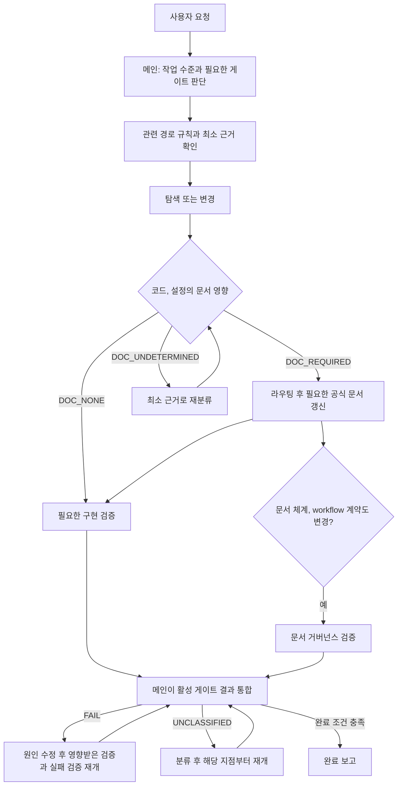

# 현재 조건부 하네스 구조와 실제 동작 분석

> 과거 검토 기록. 검토 당시의 후보와 관측을 보존한다. 현재 채택 범위는 결정 목록에서 확인하며, 미실행 계획이나 예비 시험을 제품 검증 완료로 해석하지 않는다.

## 1. 문서의 성격과 조사 기준

이 문서는 현재 저장소에서 확인한 하네스의 구조와 실행 흐름을 설명하는 조사 결과다. 새로운 운영 규칙을 정하거나 기존 규칙의 소유 위치를 옮기는 문서가 아니다. 후속 검토 방향은 같은 디렉토리의 `02-portability-and-reverse-engineering-plan.md`에 정리한다.

- 조사일: 2026-10-22
- 기준 브랜치: `feat/##_하네스_구조_설정`
- 기준 HEAD: `f6e33dd56baa2a651a70d7d0b2cc3ebde6575153`
- 확인한 설치 버전: `codex-cli 0.163.0`
- 사용자 입력: [초기 질문과 검토](questions.md)의 Q1~Q10
- 작업 범위: 구조 조사, 기존 시나리오 관찰, 미확정 계획 작성

본문에서 `현재 계약`은 AGENTS, README, config, skill에 적힌 기준을, `현재 구현`은 script, hook 본문에서 확인한 실행을 뜻한다. `관찰`은 이번에 실제 실행한 결과이며, `해석`과 `보완 후보`는 조사자의 판단이다. 이 구분이 필요한 이유는 현재 계약의 모든 항목이 자동 검사로 구현돼 있지는 않기 때문이다.

현재 하네스의 핵심은 다음과 같다.

> 메인 에이전트가 요청과 변경 내용을 해석해 필요한 게이트를 선택하고, 필요한 규칙, 문서, 절차만 읽은 뒤, 명시적으로 호출한 검증 스크립트와 세션 복구 hook의 도움을 받아 작업을 마친다.

게이트 전체를 자동 실행하는 단일 프로그램, 모든 규칙을 강제하는 hook, Markdown matrix를 읽어 실행하는 공통 엔진은 현재 저장소에 없다.

## 2. 어디까지 확인했는가

### 2.1 실행과 정책을 이루는 파일

다음은 본문을 확인한 하네스 구성 요소다.

- 루트 `AGENTS.md`, `README.md`, `.gitignore`
- `.codex/README.md`, `.codex/scripts/README.md`
- `.codex/config/`의 6개 파일 전체
- `.codex/skills/`의 10개 `SKILL.md` 전체
- `.codex/scripts/`의 5개 shell script 전체
- `.codex/hooks.json`, `.codex/hooks/followup_compact_guard.py` 전체
- `docs/README.md`와 discussions, decisions, runbook, followup, guides, explainers, roadmap, contract, learn 경로의 README
- discussion, ADR, followup 템플릿, worklog 템플릿과 관련 경로 README
- 문서 작업 및 테스트 복구 runbook, DEBUG, troubleshooting의 연결 구조와 내용
- `prompts/topics/docs-and-prompt-governance.md`, 조건부 하네스 전환 worklog
- `.github/CONTRIBUTING.md`, `.github/Pull_request_template.md`, CI와 contract-check workflow

`docs/learn/troubleshooting/README.md`는 로컬 학습 경로와 공식 근거의 경계를 확인하는 데 필요한 구간을 확인했다. 개인 학습 본문을 하네스 정책 근거로 사용하지 않았다.

### 2.2 프로젝트 종속성을 확인하기 위한 파일

`settings.gradle`, `contract.lock.yml`, 계약 변경 guide, `docs/REQUIREMENTS.md`의 문서 개요, 모듈 구조, 계층 책임, 테스트 배치 기준을 확인했다. REQUIREMENTS 전체 기능, 모든 제품 ADR, discussion, guide, 전체 제품 소스와 모든 과거 worklog를 재감사한 작업은 아니다.

하네스 구성 파일은 전부 확인하되, 제품 지식 문서는 경로, 역할, 직접 연결된 계약을 확인하는 방식으로 범위를 나눴다. 모든 제품 문서를 읽어야 하네스가 작동한다는 뜻으로 받아들이면 현재 조건부 설계와 반대가 된다.

### 2.3 저장소와 실행 환경의 구분

현재 `.agents/`는 비어 있다. 저장소에는 `.codex/config.toml`, `.codex/agents/`, 프로젝트 매니페스트, bootstrap 프로그램이 없다. `.codex/state/`도 조사 시작 시 실제 디렉토리는 없었으며 `.gitignore`에 관련 제외 규칙만 있다.

이번 세션에는 저장소 skill 목록과 시스템, 플러그인 skill이 환경에서 제공됐다. 이 사실만으로 다른 컴퓨터에서도 `.codex/skills/`가 같은 방식으로 자동 발견된다고 결론 내릴 수는 없다. 사용자 홈 설정, 설치한 플러그인, 인증 정보와 hook trust 저장소는 이번 저장소 조사에 포함하지 않았다.

## 3. 전체 구조 지도

```text
프로젝트 루트
├── AGENTS.md                         작업 진입, 작업 수준, 독립 게이트, 완료 책임
├── README.md                         제품 개요, 실행법, 계약 진입점
├── .gitignore                        공유 자산과 로컬 상태의 Git 경계
├── .codex/
│   ├── README.md                     하네스 보조 경로 안내
│   ├── hooks.json                    compact/session 이벤트 연결
│   ├── hooks/
│   │   └── followup_compact_guard.py  복구 상태 marker, snapshot, 알림
│   ├── config/
│   │   ├── gate-state-contract.md
│   │   ├── doc-update-matrix.md
│   │   ├── doc-to-code-check-matrix.md
│   │   ├── failure-route-map.md
│   │   ├── subagent-task-contract.md
│   │   └── doc-governance-search-excludes.txt
│   ├── skills/
│   │   ├── docs-task-start/SKILL.md
│   │   ├── doc-governance-check/SKILL.md
│   │   ├── implementation-check/SKILL.md
│   │   ├── followup-handoff/SKILL.md
│   │   ├── runbook-trigger/SKILL.md
│   │   ├── verification-retry/SKILL.md
│   │   ├── subagent-orchestration/SKILL.md
│   │   ├── commit-stage/SKILL.md
│   │   ├── commit-msg/SKILL.md
│   │   └── commit-ready/SKILL.md
│   └── scripts/
│       ├── README.md
│       ├── gate-common.sh
│       ├── check-doc-governance.sh
│       ├── check-doc-implementation.sh
│       ├── verify-and-retry.sh
│       └── check-harness-scenarios.sh
├── .agents/                          현재 비어 있음
├── docs/
│   ├── README.md                     문서 라우터와 전역 작성 기준
│   ├── REQUIREMENTS.md               현재 제품 요구사항과 채택 정책
│   ├── discussions/                  채택 전 비교와 검토
│   ├── decisions/                    채택된 ADR
│   ├── guides/                       구현 계약과 수행 순서
│   ├── explainers/                   구조와 동작 설명
│   ├── roadmap/                      기존 기능의 후속 작업
│   ├── contract/                     서비스별 계약 문서
│   ├── platform.md                   소비 중인 platform 기준
│   ├── troubleshooting.md            운영 runbook 진입점
│   ├── runbook/                      실패 축별 예방, 점검, 복구
│   ├── followup/
│   │   ├── README.md
│   │   ├── 000-active-task-template.md
│   │   └── active/                   로컬 진행 상태, 기본 한 작업
│   │       ├── <task>.md
│   │       ├── <task>.scope
│   │       └── .state/               검증 결과, marker, compact snapshot
│   └── learn/                        개인 로컬 학습, 공식 근거에서 제외
├── prompts/
│   ├── README.md
│   ├── topics/                       주제별 탐색 인덱스
│   └── worklog/                       YYYY-MM/ 아래 목표별 사실 기록
├── .github/                          기여, PR 양식과 CI/CD, 외부 계약 검사
├── contract.lock.yml                 외부 계약 및 서비스별 소비, 실행 정보
├── settings.gradle / build.gradle    실제 모듈, 빌드 체계
└── harness/                          이번 Q&A 원문과 검토 중인 계획
```

`active/<task>.*`와 `.state/`는 생성되는 형식을 설명한 것이다. 배포할 템플릿에 현재 작업 상태를 실어야 한다는 뜻은 아니다.

## 4. 규칙의 소유 위치와 제어 방식

### 4.1 선언, 절차, 실행은 역할이 다르다

| 위치 | 현재 맡는 역할 | 실행 관점에서의 의미 |
| --- | --- | --- |
| `AGENTS.md` | 최상위 작업 계약, 작업 수준과 게이트 활성화 원칙 | 에이전트가 해석하는 지침 |
| 각 경로 README | 해당 경로의 문서 종류, 진입, 작성 기준 | 필요할 때 읽는 라우팅 기준 |
| `.codex/config/*.md` | 세부 분류, 상태, 갱신, 위임 계약 | 사람이 읽고 에이전트가 사용하는 명세 |
| `.codex/skills/*/SKILL.md` | 조건이 맞을 때 수행할 반복 절차 | 모델의 행동 안내 |
| `.codex/scripts/*.sh` | 입력 검사, 경로 매칭, 계획 산출, 검증 실행 | 호출되면 기계적으로 실행 |
| `.codex/hooks.json` | 런타임 이벤트와 명령 연결 | Codex가 로드, 신뢰한 경우 자동 발동 |
| `docs/followup/active/` | 현재 작업을 재개하기 위한 상태 | 모델, 세션을 넘겨 읽을 복구 자료 |
| `prompts/` | 실제 수행 이력과 탐색 인덱스 | 현재 정책을 대신하지 않는 과거 근거 |

특히 `.codex/config/`라는 이름이 Codex CLI의 네이티브 설정 스키마를 의미하지는 않는다. 이 저장소에서는 Markdown 계약 파일을 모아 두는 디렉토리다. 현재 shell script는 Markdown matrix를 파싱하지 않고 자체 조건문과 정규식으로 동작한다.

### 4.2 강제 수준도 서로 다르다

에이전트가 문서를 언제 읽는지, 요구사항이 바뀌었는지, ADR이 필요한지, 같은 실패 축인지 판단하는 부분은 의미 판단이다. 현재 저장소에 그 전체 판단을 독립적으로 계산하는 프로그램은 없다.

반면 잘못된 `--change-kind`, scope 입력 충돌, 일부 동반 문서 누락, 테스트 명령 실패, 유효하지 않은 retry 입력은 스크립트가 종료 코드로 반환한다. hook도 특정 복구 이상 상태에서는 `continue: false`를 반환할 수 있다.

따라서 모델을 바꾸면 동일한 스크립트의 기계적 동작은 재사용할 수 있지만, 어떤 게이트를 선택하고 어떤 근거를 읽는지는 별도로 수용 검증해야 한다.

## 5. 작업 수준과 독립 게이트의 실제 의미

### 5.1 작업 수준

`AGENTS.md:62`의 `Direct`, `Scoped`, `Harness`는 Codex의 내장 실행 모드명이 아니라 이 저장소의 작업 분류다.

- `Direct`: 요청만으로 답할 수 있는 설명, 상태 확인. 하위 문서와 도구를 자동으로 열지 않는다.
- `Scoped`: 특정 모듈, 파일, 경로를 중심으로 직접 관련 자료만 확인한다.
- `Harness`: 정책, 계약, 복합 변경, 장기 상태, 실패 복구처럼 비용이 큰 작업. 필요한 게이트를 조합한다.

`Harness`가 되더라도 모든 skill, runbook, 테스트, subagent를 실행하지 않는다. 작업 도중 위험 신호가 생기면 해당 부분만 추가한다.

### 5.2 게이트별 판단과 실행 경로

아래 표는 `AGENTS.md:76`의 계약을 구조 이해를 위해 요약한 것이다. 상세 규칙 원본은 AGENTS와 각 소유 문서다.

| 게이트 | 무엇을 계기로 여는가 | 실제 연결 대상 |
| --- | --- | --- |
| `path-rule` | 특정 경로에 진입하거나 영향을 판단 | 해당 README, 같은 역할의 기존 파일 |
| `docs-routing` | 문서 생성, 수정, 분류 또는 필요한 문서 갱신 | `docs/README.md` → 대상 경로 README |
| `doc-impact` | 코드, 설정 변경의 문서 영향 판단 | 메인의 요청, diff 해석, 필요할 때 update matrix |
| `doc-update` | `DOC_REQUIRED` | 영향받는 공식 문서만 갱신 |
| `requirements` | 제품 동작, 계약, 채택 정책 판단 필요 | REQUIREMENTS와 관련 공식 근거 |
| `skill` | 특정 반복 절차의 발동 조건 충족 | 필요한 `SKILL.md` 하나 |
| `script` | 계획 산출, 자동 확인, 검증 필요 | 관련 config와 script |
| `implementation-verification` | 코드 또는 구현 의미가 바뀜 | 구현 검증 계획, 관련 테스트 |
| `doc-governance` | 문서 체계, 규칙, workflow 계약 변경 | update matrix, 거버넌스 script |
| `verification-retry` | 실제 최초 검증 `FAIL` | 실패 state, 필요한 PASS state, 선택 재검증 |
| `runbook` | 실패, 반복 실수, 복구 또는 직접 필요한 예방 신호 | 관련 실패 축 파일 하나 |
| `followup` | 여러 단계의 미완료 상태를 복구할 필요 | active 문서, scope, 상태 파일 |
| `prompts` | 기록 수정, 같은 목표 재개, 과거 의도 확인 | 관련 topic/worklog부터 좁게 탐색 |
| `subagent` | 독립 범위로 분리할 이득이 명확 | task packet, 런타임 위임 도구 |

이 게이트 목록 전체를 저장하는 공통 ON/OFF 설정 파일은 없다. 메인이 현재 작업에 대해 판단하고, 일부 검증 호출에 `--change-kind`와 scope를 넘기는 방식이다.

### 5.3 서로 다른 상태 축

- 작업 수준: `Direct` / `Scoped` / `Harness`
- 문서 영향 결과: `DOC_REQUIRED` / `DOC_NONE` / `DOC_UNDETERMINED`
- 공통 게이트 상태: `PASS` / `FAIL` / `UNCLASSIFIED`
- PASS 증거 재사용 계획: `REUSED` / `RECHECK`
- 긴 구현 작업의 검증 단계: `진행 중` / `검증 대기`

`DOC_UNDETERMINED`와 `UNCLASSIFIED`는 같은 값이 아니다. 전자는 문서 영향 판단이 남아 있다는 뜻이고, 후자는 해당 게이트를 분류할 입력이 부족하거나 충돌한다는 상태다.

`PASS`는 출력 맥락도 봐야 한다. 비활성 게이트가 반환한 PASS, dry-run 계획 산출의 PASS, 실제 테스트 실행의 PASS는 증명한 범위가 서로 다르다.

## 6. config 파일 6개의 역할

| 파일 | 실제 내용 | 자동화와의 경계 |
| --- | --- | --- |
| `gate-state-contract.md` | 상태, 실패 반환 정보, PASS 효력, 재분류, 재개 | script의 상태 형식과 에이전트 판단의 공통 계약 |
| `doc-update-matrix.md` | 문서 영향, 변경 성격, 편집 모드, 동반 갱신 대상 | 스크립트가 전문을 파싱하지 않음 |
| `doc-to-code-check-matrix.md` | 구현 검증 후보, 모듈별 floor, 확대 조건, 테스트 예외 | 모듈, 예외 실행은 shell에도 별도 구현 |
| `failure-route-map.md` | 문서 작업 실패와 구현 검증 실패의 runbook 후보 | retry script가 이 파일을 읽어 자동 라우팅하지 않음 |
| `subagent-task-contract.md` | 선택 호출, 역할, packet, 권한, 출력, 통합 | 네이티브 agent TOML이나 실제 권한 sandbox가 아님 |
| `doc-governance-search-excludes.txt` | 금지 참조 검색 제외 glob, 현재 `docs/learn/**` | governance script가 실제 읽는 설정 파일 |

편집 모드는 현재 기준 문서를 고치는 `correct_in_place`, 주제 단위 보강, 결정별 ADR, 목표별 worklog, 현재 상태 snapshot, 로컬 제외로 나뉜다. 이 모드는 문서를 어떻게 유지할지 안내하며 자동 편집 프로그램을 제공하지는 않는다.

## 7. skill 10개의 역할

| skill | 발동 후 하는 일 | 경계 |
| --- | --- | --- |
| `docs-task-start` | 문서 성격을 분류하고 필요한 README, 대상 문서로 진입 | 코드의 문서 영향을 대신 판정하지 않음 |
| `doc-governance-check` | 문서 체계, workflow 계약의 동반 갱신과 거버넌스 검증 | 일반 제품 문서 최신화와 별개 |
| `implementation-check` | scope, 변경 성격을 받아 검증 floor 확인 후 실행 | 문서 게이트를 대신 열지 않음 |
| `followup-handoff` | 복구에 필요한 active 상태를 유지하고 marker 확인 | 장기 worklog나 정책 저장소가 아님 |
| `runbook-trigger` | 증상을 고정하고 관련 실패 축 하나로 진입 | 정상 작업의 선행 전체 로드가 아님 |
| `verification-retry` | 실패 정보를 이어받아 원인 수정 후 필요한 검증 재개 | 최초 검증을 확인용으로 반복하지 않음 |
| `subagent-orchestration` | 선택 호출 여부, packet, 허용 범위, 통합 점검 | skill을 agent로 일대일 변환하지 않음 |
| `commit-stage` | 사용자가 지정한 작업 관련 변경만 선별 stage | 포괄적인 git add나 임의 unstage 금지 |
| `commit-msg` | 현재 diff 기준으로 제목, 본문 초안 작성 | 자체 stage, 자동 commit을 하지 않음 |
| `commit-ready` | stage 성공 후 메시지 초안 절차를 순서대로 연결 | 실제 commit은 별도 명시 요청 대상 |

각 skill은 YAML frontmatter의 이름, 설명과 Markdown 절차로 구성된다. skill 본문이 로드된다고 테스트가 바로 실행되거나 다른 게이트가 연쇄 활성화되지는 않는다. commit 보조 skill 3개는 기본 하네스 파이프라인과 분리돼 있다.

## 8. shell script 5개의 실제 실행 흐름

### 8.1 `gate-common.sh`

공통 보조 함수이며 독립적인 게이트 선택 엔진은 아니다.

1. `--scope-file`이 있으면 실제 일반 파일인지 확인하고 파일 목록을 읽는다.
2. 입력이 없을 때만 `git status --short --untracked-files=all`을 사용한다.
3. 경로별 파일, 디렉토리 내용을 해시해 fingerprint를 만든다.
4. 결과 파일에 상태, 변경 성격, fingerprint, 재개 지점과 dependency 항목을 기록한다.
5. retry에서 기존 dependency hash와 새 scope의 dependency pattern을 비교한다.

공통 종료 코드는 대체로 `0` 성공/비활성, `1` 실패, `2` 미분류, `64` 옵션 오류다. scope 입력이 잘못된 경우에는 분류 이전에 종료하므로 결과 파일이 항상 만들어진다고 보장할 수 없다.

scope 파일 입력은 stdin, process substitution, 일부 FD 경로를 거부한다. 그러나 목록 안의 모든 경로를 정규화하고 저장소 경계를 검증하는 일반적인 manifest parser는 아니다. Git status fallback은 공백 기반 awk로 경로를 추출하므로 공백, rename 경로를 다루는 범용 배포에 앞서 보완 검토가 필요하다.

### 8.2 `check-doc-governance.sh`

1. scope 목록과 fingerprint를 만든다.
2. AGENTS, 특정 README, topic, `.codex` 보조 경로에서 거버넌스 후보를 탐지한다.
3. 후보인데 변경 성격을 받지 못하면 `UNCLASSIFIED`를 반환한다.
4. 본문 정리나 내부 구현 변경 등 비활성 유형이면 PASS로 종료한다.
5. 활성 유형은 일부 필수 파일의 scope 포함 여부를 검사한다.
6. 금지 참조 문자열을 검색하고 active 작업이 여러 개인지 검사한다.
7. 요청한 결과 파일에 최종 상태와 의존 경로 정보를 남긴다.

실제 필수 파일 검사는 `check_required_file`, `check_required_prefix`로 scope 목록에 경로가 들어 있는지 확인한다. 해당 파일의 의미 있는 최신화 여부를 diff로 판단하는 구현은 아니다.

`doc-governance-change`는 AGENTS, docs README, governance topic, worklog를 검사한다. 반면 `workflow-contract-change` 분기에서는 `.codex/skills|scripts|config` 변경 시 `.codex/README.md` 연결을 검사하지만, matrix가 요구하는 topic, worklog까지 같은 수준으로 자동 검사하지 않는다.

금지 참조 검색은 전달된 변경 파일만이 아니라 지정한 저장소 문서 영역을 검색한다. `--followup-file` 옵션은 파싱하지만 이 script 본문에서는 그 값으로 검증 단계를 확인하지 않는다.

### 8.3 `check-doc-implementation.sh`

scope와 변경 성격을 받아 구현 검증 계획을 산출하고, `--run`일 때만 테스트를 실행한다.

1. `--scope-file` 또는 반복 `--scope-path`를 받는다. 두 방식의 동시 입력은 `64`로 거부한다.
2. `--scope-path`는 임시 일반 scope 파일로 변환하고 종료 시 정리한다.
3. `sample-api`, `sample-core`, `sample-infrastructure`, `sample-boot` 경로를 명시적인 조건문으로 매칭한다.
4. 단일 모듈은 해당 `:<module>:test`를, 다중 모듈, 루트 Gradle, 계약 변경은 논리적인 `test` floor를 선택한다.
5. `--dry-run --json`이면 `verification_floor`, 이유, scope, 의존 경로, 패턴, 제외 테스트 등을 출력한다.
6. 실제 실행 전 연결된 followup이 `진행 중`이면 최종 검증 실행을 거부한다.
7. Gradle 실행 결과를 PASS/FAIL로 기록한다. result 파일은 옵션으로 지정한 경우에만 남긴다.

연결된 followup은 명시 `--followup-file` 또는 상대 경로 `docs/followup/active/<task>.scope`에서 유도한다. 모든 위치의 followup을 자동 탐색하는 방식은 아니다. 파일을 찾지 못하거나 검증 단계 문구가 없으면 `검증 대기`가 반드시 있어야 실행되는 구조도 아니다.

JSON dry-run의 `status: PASS`는 계획 산출 성공이며 테스트 통과가 아니다. 또한 두 모듈 변경에서 floor는 `test`로 확대되지만 `requires_full_test` 값은 루트, 계약 변경용 내부 flag를 그대로 써 `false`일 수 있다. 소비자는 그 flag 하나만 보고 실행 범위를 결정하면 안 된다.

boot 검증은 단순한 제외 필터가 아니다. 현재 `boot_test_classes`에 있는 다음 9개 클래스에 `--tests`를 붙이는 포함 목록 방식이다.

- `org.example.api.block.ApiIntegrationTestA`
- `org.example.api.block.ApiIntegrationTestB`
- `org.example.api.block.ApiIntegrationTestC`
- `org.example.api.document.ApiIntegrationTestD`
- `org.example.api.document.ApiIntegrationTestE`
- `org.example.api.editor.ApiIntegrationTestF`
- `org.example.api.editor.EditorOperationConcurrencyIntegrationTest`
- `org.example.boot.DocumentsOperationalConfigurationTest`
- `org.example.boot.SchemaIntegrationTest`

논리적인 전체 `test`는 api, core, infrastructure 테스트 실행과 위 boot 선택 실행으로 변환된다. 따라서 이 하네스의 전체 floor와 CI의 `./gradlew clean test`는 실제 범위가 같지 않다.

matrix가 명시한 제외 테스트는 `org.example.api.resource.ResourceLifecycleTest`다. 현재 구현은 이 하나를 제외하는 일반 규칙으로 새 테스트를 자동 포함하지 않는다. boot 테스트가 추가되면 목록과 실행 범위를 다시 대조해야 한다.

### 8.4 `verify-and-retry.sh`

1. 최초 검증이 만든 `--failure-file`이 실제로 `state=FAIL`인지 확인한다.
2. followup이 연결돼 있으면 진행 중 단계를 차단한다.
3. 전달받은 `--pass-state` 각각의 dependency hash와 새 scope의 pattern을 비교한다.
4. 영향 없으면 `REUSED`, 있으면 `RECHECK`로 계획한다.
5. dry-run이 아니면 재검증할 선행 게이트를 입력 순서대로 실행하고 실패 게이트를 재개한다.
6. 최초 FAIL 파일을 보존하고 실패 게이트의 새 결과를 `<failure-file>.retry`에 저장한다.
7. `--runbook-approved`로 지정한 기존 파일이 있을 때만 사례를 덧붙인다.

실행 가능한 게이트는 현재 `doc-governance`와 `implementation-verification` 두 개다. 일반적인 임의 명령 retry 엔진이나 dependency graph 정렬기는 아니다. 반복 재시도에서도 같은 실패 파일을 쓰면 `.retry` 경로는 다시 쓰이므로 전체 실행 이력을 자동 축적하지 않는다.

`failure-route-map.md`를 읽어 runbook 후보를 계산하는 코드는 이 script에 없다. 현재 실패 축 선택은 메인과 문서 계약에 남아 있다. 결과 state도 실행 명령, 전체 실패 로그를 모두 담지 않으므로 skill의 실패 반환 계약은 에이전트가 추가 정보로 채워야 한다.

### 8.5 `check-harness-scenarios.sh`

`/tmp`에 scope, state fixture를 만들어 기존 script의 종료 코드와 핵심 출력 문구를 검사한다. 구현 검증 부분은 dry-run이고, 실제 Gradle 테스트나 모델 호출을 수행하지 않는다.

현재 본문 기준으로 거버넌스 5개, 구현 계획 8개, retry 3개의 총 16개 시나리오와 36개 assertion이 있다. 과거 전환 worklog의 14개, 31개 기록은 당시 결과다. 이후 scope-path 입력 관련 검증이 추가된 현재 상태와 구분해야 한다.

## 9. hook과 세션 복구의 실제 동작

### 9.1 현재 등록한 이벤트

`.codex/hooks.json`에는 아래 세 이벤트만 등록돼 있다.

| 이벤트 | matcher | 실행 모드 | 역할 |
| --- | --- | --- | --- |
| `PreCompact` | `manual|auto` | `pre-compact` | 압축 전 marker와 scope 상태 확인 |
| `PostCompact` | `manual|auto` | `post-compact` | 압축 후 active와 요약 대조 안내 |
| `SessionStart` | `startup|resume|clear|compact` | `session-start` | 시작, 재개 시 active 복구 안내 |

모두 Git root를 구해 `/usr/bin/python3`로 같은 guard를 호출한다. 현재 코드 수정 전후의 `PreToolUse`, `PostToolUse` 검사, DB 접근 검사, 자동 테스트 실행 hook은 등록돼 있지 않다.

공식 Codex 문서도 프로젝트 hook을 지원하지만, non-managed hook은 정의별 review/trust가 필요하다고 설명한다. 저장소에 JSON이 존재한다는 사실과 현재 실행 환경에서 실제 발동한다는 사실은 별개다. [공식 Hooks 문서](https://learn.chatgpt.com/docs/hooks)

### 9.2 active, scope, marker, snapshot

active 본문은 목표, 고정 제약, 읽은 기준 문서, 현재 파일 범위, 현재 상태, 다음 작업의 여섯 섹션을 유지한다. 긴 구현 작업에서는 현재 상태에 검증 단계를 둔다.

guard가 읽는 `.scope`는 같은 이름의 active 옆에 있는 감시 목록이다. active 파일 자체와 scope 파일, 목록의 파일에 대해 존재, 파일 종류, 크기, mtime, SHA-256을 수집한다.

`mark`는 사람이거나 에이전트가 복구 상태를 확인한 뒤 명시적으로 실행하는 모드다. `.state/followup-compact-guard.json`에 fingerprint와 시각을 쓰며 유효시간은 15분이다. marker는 의미적으로 올바른 handoff가 작성됐다는 것을 검사하지 않는다.

일반적인 marker 누락, 만료, 감시 파일 변경이면 PreCompact는 `.state/precompact-snapshot.json`에 변경 후보와 Git 상태 등 기계적 단서를 남기고 압축을 허용한다. active 본문을 자동 요약하거나 갱신하지 않는다.

active가 여러 개이거나 일부 scope 오류처럼 복구 기준이 깨지면 중단 응답을 반환한다. PostCompact는 active, snapshot, 압축 요약을 필요한 범위에서 대조하라는 안내를 반환한다. SessionStart 역시 active를 먼저 읽으라는 문맥을 제공한다.

### 9.3 복구 구현의 확인 범위

`load_scope_paths`는 절대 경로에 저장소 경계 검사를 적용하지만, 상대 경로는 resolve한 뒤 같은 경계 검사를 적용하지 않는다. `../`나 symlink를 포함한 상대 경로까지 저장소 안으로 제한한다는 보장은 현재 본문으로는 성립하지 않는다. 이번 작업에서는 이 동작을 수정하지 않았다.

복구 감시 scope와 검증 입력 scope는 의미도 구분해야 한다. 전자는 다시 확인할 기준, 결과 파일을 포함할 수 있고, 후자는 현재 변경 세트다. 감시 목록을 그대로 변경 목록으로 넘기면 바뀌지 않은 규칙 문서까지 변경 후보로 취급할 수 있다.

## 10. 문서 체계와 기록의 연결

### 10.1 문서 경로별 역할

| 경로 | 보관하는 내용 | 하네스에서 읽는 이유 |
| --- | --- | --- |
| `docs/REQUIREMENTS.md` | 현재 제품 요구사항과 채택 정책 | 기대 동작, 계약을 확인할 때 |
| `docs/discussions/` | 비교, 검토, 채택 전 근거 | 아직 결정되지 않은 선택을 이해할 때 |
| `docs/decisions/` | 채택된 기술 결정 | 현재 구조의 제약과 채택 이유를 확인할 때 |
| `docs/guides/` | 구현 계약, 순서, 체크리스트 | 실제 변경을 어떤 순서와 계약으로 수행할지 확인할 때 |
| `docs/explainers/` | 내부 구조, 알고리즘, 흐름 | 코드만으로 설명하기 어려운 맥락이 필요할 때 |
| `docs/roadmap/` | 현재 기능의 다음 버전 작업 | 현재 계약과 미래 후보를 구분할 때 |
| `docs/contract/`, `docs/platform.md` | 서비스 계약과 platform 소비 기준 | 프로젝트 외부 경계, 종속 계약을 확인할 때 |
| `docs/runbook/` | 실패 축의 점검, 복구 | 실패 신호가 있는 해당 축을 복구할 때 |
| `docs/followup/` | 현재 작업의 재개 상태 | 세션, 컨텍스트, 실행자 전환 시 |
| `docs/learn/` | 개인 로컬 학습 | 공식 정책, PR 근거로 직접 사용하지 않음 |
| `prompts/worklog/` | 실제 수행한 판단, 구현, 검증 | 같은 목표나 과거 의도를 좁게 확인할 때 |
| `prompts/topics/` | 관련 기록, 공식 문서를 찾는 인덱스 | 날짜를 몰라도 주제로 진입할 때 |

현재 Q&A가 예로 드는 `docs/adr/`, `docs/requirements/`, `docs/choice/`는 이 저장소의 문서 체계가 아니다. 각각 현재 decisions, 단일 REQUIREMENTS 파일, 채택 전 discussions라는 경계에 맞춰 해석해야 한다.

### 10.2 템플릿과 fixture

현재 확인한 문서 템플릿은 다음과 같다.

- `docs/discussions/000-strategy-review-template.md`: 목적, 배경, 범위, 질문, 선택지, 비교, 추천, 미해결, 다음 액션, 관련 문서. 선택지마다 시나리오를 요구한다.
- `docs/decisions/000-adr-template.md`: 상태, 배경, 결정, 영향, 관련 문서. decisions README는 채택된 결정만 저장하도록 한다.
- `docs/followup/000-active-task-template.md`: 현재 작업 복구용 여섯 섹션.
- `prompts/worklog/TEMPLATE.md`: 목표 아래 Step별 목적, 변경, 판단, 검증.

ADR 템플릿의 기본 상태는 `제안됨`이지만 decisions 경로 규칙은 채택된 결정만을 대상으로 한다. 역공학 자동 생성에서 템플릿 기본값을 그대로 채택 상태로 해석하면 안 된다.

문서 역공학 정답셋을 모은 전용 fixture 디렉토리나 REQUIREMENTS 생성 전용 템플릿은 현재 없다. 시나리오 script 안에서 만드는 임시 fixture와 제품 테스트 fixture는 문서 역공학 fixture와 역할이 다르다.

### 10.3 로컬 상태와 공유 기록

`.gitignore`는 `docs/followup/active/**`를 제외하고 `.gitkeep`만 남긴다. `docs/learn/**`도 일부 README를 제외하면 로컬 대상이다. 반면 현재 `harness/`는 이 규칙으로 제외돼 있지 않다.

따라서 같은 컴퓨터의 두 실행자가 같은 checkout을 쓰면 active 상태를 함께 읽을 수 있지만, 다른 컴퓨터나 별도 clone으로 `git pull`만 해서 active가 전달되지는 않는다. 원격 전환의 handoff에는 별도 전달 방식을 정해야 한다.

## 11. 요청부터 완료까지의 대표 흐름



설명용 흐름도다. 코드, 설정 변경이 없는 작업은 문서 영향 판정과 구현 검증이 필요하지 않을 수 있고, 복구, prompts, runbook, subagent는 해당 조건이 생길 때만 곁가지로 붙는다.

### 11.1 단순 질문

요청만으로 답할 수 있으면 Direct로 답한다. README, skill, script, worklog를 모두 읽어야 하는 작업으로 만들지 않는다.

### 11.2 단일 모듈의 기존 계약 안 버그 수정

Scoped로 관련 코드, 인접 테스트, 경로 규칙을 확인한다. 변경 후 메인이 `DOC_NONE`으로 판단하면 문서 최신화 탐색을 열지 않는다. 구현 검증 계획 JSON에서 명확한 floor를 받고 필요한 검증을 수행한다.

### 11.3 외부 API 의미가 바뀌는 작업

현재 REQUIREMENTS, guide, 외부 contract lock의 관계를 확인해야 한다. 필요한 문서를 갱신하고 관련 구현도 검증한다. 제품 문서가 바뀌었다는 이유만으로 문서 체계 거버넌스를 자동 실행하지 않는다.

### 11.4 하네스의 workflow 계약 변경

AGENTS, README, config, skill, script 중 어느 위치가 변경을 소유하는지 정한다. matrix가 요구하는 동반 문서와 기록을 맞추고 거버넌스 및 변경한 자동화의 검증을 수행한다. governance script PASS만으로 의미적 정합성까지 끝난 것으로 보지 않는다.

### 11.5 실패와 실행자 전환

최초 실패의 입력, scope, state, 출력을 보존한다. 원인 수정 뒤 영향받지 않은 PASS는 재사용하고 필요한 검증만 재개한다. 전환 전에는 active에 미완료 상태와 다음 작업을 남기고, 다음 실행자가 active, scope, 필요한 공식 근거를 읽는다.

## 12. subagent와 외부 자동화의 경계

subagent 계약은 Explorer, Worker, Doc Governance Reviewer, Verification Analyst라는 선택적 역할을 정의한다. packet의 허용 읽기, 수정, 명령 범위와 기준 revision, fingerprint를 메인이 정하고 결과를 통합한다.

이 역할 이름은 상시 실행 프로세스나 `.codex/agents/*.toml` 등록을 의미하지 않는다. packet에 허용 경로를 적는 것만으로 운영체제 수준의 권한 격리가 생기는 것도 아니다. 실제 도구, 권한, 위임 지원은 런타임이 제공해야 한다.

`.github/workflows/ci.yml`은 제품 테스트, 빌드, 이미지 및 외부 계약 연결을 다루고, `contract-check.yml`은 lock과 계약 영향 경로를 검사한다. 현재 확인한 workflow에는 `.codex` 거버넌스, 구현 게이트 script를 호출하는 연결이 없다. CD의 `deploy-gate`는 배포 절차이며 여기서 말하는 조건부 하네스 게이트와 별개다.

## 13. 이관에 앞서 구분해야 할 현재의 차이와 빈틈

아래 항목은 이번에 발견한 사실과 그 영향이다. 이 조사에서 수정하거나 정책으로 채택하지 않았다.

| 항목 | 확인한 사실 | 이관, 계획에 주는 의미 |
| --- | --- | --- |
| matrix와 실행 | Markdown 계약을 shell이 읽지 않고 같은 기준 일부를 별도 구현 | 설정 파일만 옮겨도 실행 기준이 바뀌는 구조가 아님 |
| governance 검사 범위 | workflow 계약의 topic, worklog 필수성이 script에서 모두 강제되지 않음 | 문서 계약과 자동 검사 범위를 따로 검증해야 함 |
| scope 옵션 | `--scope-path`는 implementation script만 지원 | scripts README의 공통 설명을 모든 script에 적용하면 안 됨 |
| boot 검증 범위 | 9개 클래스 allowlist | 새 프로젝트의 테스트명을 바꾸는 것 이상으로 선택 정책을 분리해야 함 |
| PASS 재사용 | 등록 dependency와 pattern만 검사 | 미등록 공통 설정, 검증 도구, 간접 의존 변경까지 포괄한다고 볼 수 없음 |
| 검증 증거 | `.state`는 간단한 상태, 해시이며 전체 명령, 로그를 담지 않음 | 새 실행자가 실패를 재개할 수 있는 보조 증거가 필요 |
| full-test 출력 | 다중 모듈에서 floor와 boolean이 다르게 보일 수 있음 | 기계 소비 출력의 일관성 점검 필요 |
| scope의 경계 | compact guard의 상대 경로 경계 확인이 불완전 | 공통 배포 전에 절대, 상대, symlink 사례 점검 필요 |
| scope의 두 용도 | 복구 감시 목록과 변경 목록이 구분 없이 재사용될 여지 | watch 목록과 검증 변경 세트를 명시적으로 구별해야 함 |
| skill 발견 | 현재 자산은 `.codex/skills`, `.agents/`는 비어 있음 | 새 CLI 환경에서 discovery 연결을 별도로 확인해야 함 |
| 작업 기록 규칙 | 루트 README에는 모든 AI 작업 로그 문구가 남아 있음 | AGENTS, prompts의 조건부 기록 기준과 다른 설명이 있음 |
| 기여 문서 | `.github/CONTRIBUTING.md`는 auth 라이브러리 모듈, 테스트 규칙을 기술 | editor 프로젝트의 공통 하네스 자산으로 그대로 배포하면 안 됨 |
| 링크와 제품명 | 서로 다른 저장소와 기준 브랜치를 가리키는 링크가 혼재 | 저장소, 기준 브랜치와 링크 생성값을 프로젝트별로 확인해야 함 |
| 운영 문서 충돌 | 루트 README의 ECS 기본 설명과 runbook/lock의 EC2 기준이 다름 | 코드에서 문서를 역생성할 때 기존 문서를 모두 같은 신뢰도로 합칠 수 없음 |
| 공유 상태 | active와 marker는 Git 제외 | 다른 clone, 원격 실행으로 전환할 때 자동 전달되지 않음 |

공식 Codex skill 문서는 저장소 skill 발견 위치로 `.agents/skills`를 안내한다. 현재 세션의 주입 방식과 별개로 새 설치에서 이 경로 및 기존 자산의 호환 방식을 확인하는 단계가 필요하다. 이번 조사에서는 경로를 옮기지 않았다. [공식 skill 문서](https://learn.chatgpt.com/docs/build-skills)

관련 구현 위치는 `gate-common.sh:115`, `check-doc-governance.sh:148`, `check-doc-implementation.sh:170`, `check-doc-implementation.sh:353`, `followup_compact_guard.py:94`다. 경로는 모두 `.codex/scripts/` 또는 `.codex/hooks/` 아래를 기준으로 한다.

## 14. 실제 관찰 결과와 남은 확인

이번에 `bash .codex/scripts/check-harness-scenarios.sh`를 실행해 36개 assertion이 모두 PASS인 것을 확인했다. script 본문 기준으로 총 16개 시나리오이며, 분류, 비활성, dry-run, 입력 충돌, retry 계획을 검사한다.

CLI `--version`, `--help`에서 버전과 `--oss`, `--local-provider` 옵션도 확인했다. 명령은 정상 종료했지만 sandbox에서 PATH alias를 만들 수 없다는 경고가 있었다. 이를 로컬 모델 실행 성공으로 해석하지 않는다.

이번에 확인하지 않은 것은 다음과 같다.

- 제품 Gradle 테스트의 현재 통과 여부와 외부 패키지 인증 환경
- 실제 local model의 추론, 도구 호출, 문맥 유지 성능
- 이 실행 환경에서 hook trust가 완료됐는지와 native compact/session 이벤트 발동
- 다른 컴퓨터, 별도 clone, 다른 CLI에서 skill과 복구 절차가 동일하게 발견되는지
- 다른 프로젝트에 이식했을 때 문서, 빌드, 테스트 바인딩이 충분한지

과거 worklog의 PASS와 이번 script 관찰은 해당 범위의 증거다. 하네스의 모든 의미 판단, 제품 테스트, 모델 간 품질 동등성을 증명한 결과는 아니다.

## 15. 후속 계획으로 넘기는 판단

현재 구조에서 보존할 가치는 최소 컨텍스트로 시작하는 진입, 메인이 소유하는 의미 판단, 문서의 소유 위치, 명시적 scope, 실패 증거 재사용, 현재 상태 중심 handoff다.

다른 프로젝트로 옮길 때 달라져야 하는 것은 제품 지식의 내용, 모듈, 테스트, 명령, 저장소 링크, 실패 축별 경로, 실행 환경의 skill/hook 연결이다. 모델 전환은 이 공통 작업 상태를 유지하면서 추론 provider 또는 에이전트 런타임을 바꾸는 문제로 분리해 검토해야 한다.

이 구분을 바탕으로 한 단계별 제안과 Q&A 교정은 `harness/plan/draft-v1/02-portability-and-reverse-engineering-plan.md`에 이어진다.
