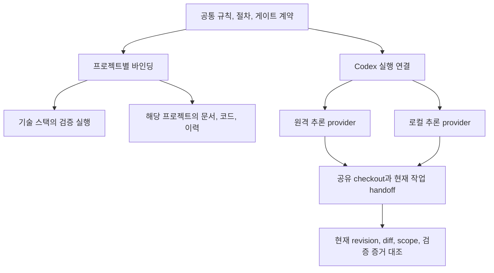

# 조건부 하네스 재사용, 역공학, Codex와 로컬 AI 전환 계획 초안

> 과거 검토 기록. 검토 당시의 후보와 관측을 보존한다. 현재 채택 범위는 결정 목록에서 확인하며, 미실행 계획이나 예비 시험을 제품 검증 완료로 해석하지 않는다.

## 1. 문서 목적과 현재 상태

이 문서는 Q&A의 흐름을 현재 저장소 구조에 맞춰 보정한 검토용 계획이다. 특정 구조, 모델, 배포 방식, 새 정책이 채택됐다는 뜻이 아니다. 현재 구현의 세부 근거는 같은 디렉토리의 `01-current-harness-analysis.md`를 먼저 본다.

- 작성일: 2026-10-22
- 조사 기준: `f6e33dd56baa2a651a70d7d0b2cc3ebde6575153`
- 입력: [초기 질문과 검토](questions.md)의 Q1~Q10
- 이번 산출물: 현재 구조 분석과 후속 작업 계획
- 이번에 수행하지 않은 일: 공통 레포 생성, 기존 규칙 개편, bootstrap 구현, 로컬 모델 설치, provider 변경, 기존 제품 문서 재작성

사용자는 Q&A가 확정안이 아니라고 명시했다. 따라서 아래의 추천, 단계, 필드는 채택 후보이며, 계획서 작성 자체로 REQUIREMENTS나 ADR을 갱신하지 않는다. 사용자가 말한 단계 수에서 아직 구체화되지 않은 추가 요청도 임의로 구현하지 않는다.

## 2. Q&A에서 읽히는 목표

### 2.1 흐름이 잡혀 있는 목표

1. 현재 조건부 하네스의 동작을 정확히 이해한다.
2. 하네스의 재사용 가능한 부분을 다른 프로젝트에도 일관되게 적용할 수 있게 한다.
3. 모듈명, 테스트 클래스, 실행 명령, 라우팅 링크처럼 프로젝트마다 달라지는 값은 해당 프로젝트에 맞게 넣는다.
4. 대상 프로젝트의 현재 코드와 과거 기록을 조사해 현재 문서 체계에 맞는 내용을 채울 수 있게 한다.
5. 우선 Codex에서 사용할 수 있는 이식 흐름을 확보한 뒤, 작업 중 Codex와 로컬 AI를 오가며 이어간다.

이는 현재 editor 제품의 데이터를 다른 AI 서비스로 옮기는 작업과 구분된다. 재사용 대상은 개발 작업을 수행하는 규칙, 절차, 도구이고, 제품 요구사항과 기존 ADR의 내용은 프로젝트에 귀속된다.

### 2.2 아직 정하지 않은 구현 선택

- 공통 하네스를 별도 Git 레포, 버전 고정 복사, subtree/submodule, 패키지 중 무엇으로 공급할지
- 프로젝트별 바인딩을 어떤 파일 형식과 경로로 둘지
- Codex CLI 하나에서 provider를 바꿀지, 다른 로컬 에이전트 런타임까지 지원할지
- 사용할 로컬 추론 서버, 모델, 양자화, 컨텍스트 크기와 하드웨어
- 역공학 문서 후보를 누가 검토하고 어느 범위까지 공식 문서로 반영할지
- 같은 머신의 checkout 전환만 지원할지, 별도 clone, 원격 실행까지 지원할지

이 선택들이 미정이어도 현황 정리, 종속성 목록, 시나리오와 완료 조건은 먼저 구체화할 수 있다.

## 3. 먼저 구분할 세 가지 축

| 축 | 현재 또는 가능한 예 | 전환할 때 달라지는 것 |
| --- | --- | --- |
| 작업 위치 | IntelliJ 터미널의 로컬 checkout, 다른 머신, 원격 작업 공간 | 파일, Git 변경, 미추적 handoff 상태에 접근하는 방식 |
| 에이전트 런타임 | Codex CLI, 이후 검토할 다른 실행기 | 도구, skill 발견, hook, 권한, 압축, 위임 인터페이스 |
| 추론 provider | 원격 모델, 로컬 추론 서버 | 모델의 이해력, 도구 사용, 문맥 처리, 지연, 자원 |

현재 프로젝트는 이미 Codex를 사용하는 구조다. Q&A의 일부 답변처럼 로컬 전용 자체 실행기를 먼저 만든 뒤 Codex 공식 hook으로 전면 이관해야 하는 상태는 아니다.

이번 계획에서 `Codex 우선 이식`은 현재 구조를 다른 프로젝트의 Codex 환경에서 재현 가능하게 만드는 일을 뜻한다. 원격 추론 모델을 쓴다고 CLI의 파일, shell 작업이 모두 원격 cloud sandbox에서 실행되는 것은 아니다.

## 4. Q&A 주장별 유지, 수정, 보류

### 4.1 Q1~Q10을 현재 구조에 맞춰 해석한 결과

| 구간 | 유지할 방향 | 수정하거나 보류할 부분 |
| --- | --- | --- |
| Q1~Q2: 로컬 AI와 IDE 활용 | 로컬 추론 서버와 개발 도구를 연결해 보조 작업에 활용 | 무료, 오프라인, 외부 전송 없음은 전체 구성과 운영을 확인해야 하는 조건이다. PC 정보 없이 모델, 성능을 확정하지 않는다. |
| Q3: 기존 하네스 이관 | 파일 기반 계약과 script는 재사용 자산이 된다 | 100% 동일 이관, 추종, 보안, 비용 제로를 보장할 수 없다. 의미 판단과 tool loop를 따로 검증한다. |
| Q4: 같은 동작 재현 | 가능한 한 현재 실행기와 자산을 유지하는 방법을 먼저 평가 | `.codex/config/`는 이 저장소의 Markdown 경로다. 제시된 YAML과 자체 `[provider]` 토글은 현재 네이티브 설정으로 채택하지 않는다. |
| Q5: 필요한 문서 추가 탐색 | 현재의 최소 컨텍스트, 조건부 확장은 유지 | 파일 분할만으로 문맥이 매번 4K~8K에 머물거나 모델 품질이 같아지지는 않는다. 대화, 도구 출력도 누적된다. |
| Q6: 문서가 부족한 프로젝트 | 코드, 테스트, 설정, 기록을 조사해 문서 후보를 채운다 | 문서가 비었다고 추정하거나 AGENTS를 자동 재정의하지 않는다. 코드 관찰을 곧바로 채택 요구사항, ADR로 올리지 않는다. |
| Q7: Codex로 이관 | 네이티브 instructions, skill, hook과 현재 자산의 호환성을 확인 | 현재 hook은 복구용 3개다. 예시 JSON/TOML과 내장 모델 설명, 모든 skill의 subagent 변환을 실제 현황으로 취급하지 않는다. |
| Q8: 공통 레포 재사용 | 공통 절차와 프로젝트별 지식, 설정의 경계를 둔다 | 기존 문서를 없는 것으로 처리하지 않는다. 프로젝트 전용 skill, 설정은 기본적으로 그 프로젝트에서 버전 관리할 자산이다. |
| Q9: 명령, 경로 종속성과 이력 | 모듈, 테스트, 링크 바인딩, 기준 revision 고정, 주요 기능별 이력 탐색 | manifest 하나와 템플릿 치환만으로 종속성, 역사적 의도가 완전히 해결되지는 않는다. `git log --onset`도 사용할 수 있는 예시 명령이 아니다. |
| Q10: 작업 중 자유로운 전환 | 공통 파일 상태와 handoff를 기준으로 작업을 이어간다 | endpoint 토글이 대화 메모리, 실행 중 도구, 검증 증거를 자동 이전하지 않는다. 문서, scope, 검증 상태의 재개 계약이 필요하다. |

### 4.2 현재 경로로 바로잡기

| Q&A의 예시 | 현재 저장소의 실제 기준 |
| --- | --- |
| `agents.md` | `AGENTS.md` |
| `.codex/skill/` | `.codex/skills/<name>/SKILL.md` |
| `.codex/script/` | `.codex/scripts/` |
| `.codex/matrix/` | `.codex/config/`의 관련 Markdown matrix |
| `docs/adr/` | `docs/decisions/` |
| `docs/requirements/system-spec.md` | `docs/REQUIREMENTS.md` |
| `docs/choice/` | 현재 독립 경로 없음. 비교, 채택 전 근거는 `docs/discussions/` |
| docs 아래 프롬프트 로그 | 실제 위치는 루트 `prompts/worklog/`, 탐색은 `prompts/topics/` |
| bootstrap, manifest, 네이티브 agent TOML | 현재는 존재하지 않는 후속 구현 후보 |

블록 에디터를 만들고 있다는 사실이 개발 문서를 제품 DB나 RAG에 실시간 동기화해야 한다는 요구로 이어지지는 않는다. Q&A의 그 제안은 이번 목표에 필수적이지 않으므로 별도 선택으로 남긴다.

### 4.3 공식 문서와 설치 CLI로 확인한 점

현재 설치 CLI `0.163.0`의 help와 공식 명령 문서는 `--oss`, `--local-provider` 및 `ollama`, `lmstudio` 선택을 제공한다. 따라서 Codex CLI를 유지하고 로컬 provider를 연결하는 방법을 먼저 검증할 근거가 있다. 임의의 새 API 래퍼나 다른 IDE 플러그인부터 만들 필요는 아직 확인되지 않았다. [공식 CLI 명령 문서](https://learn.chatgpt.com/docs/developer-commands?surface=cli)

공식 provider 설정은 `model_provider`, `model_providers.<id>` 같은 문서화된 구조를 사용한다. Q&A의 자체 토글 예시는 그대로 넣지 않고, 실제 설치 버전과 지원 API, 도구 호출, 스트리밍을 확인한 뒤 설정한다. [공식 고급 설정 문서](https://learn.chatgpt.com/docs/config-file/config-advanced)

프로젝트 hook은 공식 기능이지만 신뢰 검토가 별도다. skill은 현재 공식 문서의 `.agents/skills` 발견 경로와 기존 `.codex/skills` 자산의 연결을 새 설치에서 확인해야 한다. 파일을 복사했다는 이유만으로 로딩, 발동이 완료됐다고 보지 않는다. [공식 hook 문서](https://learn.chatgpt.com/docs/hooks), [공식 skill 문서](https://learn.chatgpt.com/docs/build-skills)

이 확인은 로컬 모델이 실제로 이 하네스를 수행했다는 성능 실험이 아니다. Ollama의 특정 API, 모델 버전, 다른 플러그인의 IntelliJ 지원, 하드웨어별 성능, 라이선스는 이번 단계에서 확정하지 않았다.

## 5. 추천하는 구조의 경계

### 5.1 공통 하네스

재사용 후보는 작업 수준과 게이트의 의미, 상태, 재개 계약, 문서 소유 위치 원칙, 최소 컨텍스트 진입, 반복 절차, 범용적인 scope, fingerprint, 검증 실행 보조다.

다만 현재 AGENTS나 skill을 파일째 공통으로 분류하면 안 된다. AGENTS에는 Java/Spring 개발 관점과 프로젝트 문서, PR 규칙이 함께 있고, 구현 검증 skill과 script에도 Gradle 전제가 있다. 파일별 복사 여부보다 내용별 공통성부터 분류하는 것이 먼저다.

### 5.2 프로젝트 바인딩

프로젝트마다 바뀌는 실제 값을 공통 절차가 참조할 수 있게 한다. 테스트 명령과 모듈명뿐 아니라 문서 경로, 링크, 실패 축, 검증 예외, 외부 계약 연결도 대상이다.

기계가 결정적으로 사용하는 값은 검증 가능한 설정에, 의미 판단 절차는 skill에, 실제 정책과 지식은 해당 README, 공식 문서에 둔다는 방향을 추천한다. 모든 프로젝트 값을 skill 텍스트 치환으로만 해결하면 실행 코드와 생성된 문서의 원본이 늘어난다.

### 5.3 기술 스택별 실행 연결

Gradle 모듈 테스트와 Maven, npm 등의 실행 방법은 다르다. 공통 게이트는 필요한 검증 범위, 결과, 재개를 다루고, 실행 연결부는 해당 스택의 명령, 선택 방식, 출력을 맡도록 검토한다.

현재 editor-service에는 Gradle 실행 연결과 다음 정보가 함께 들어 있다.

- 4개 `sample-*` 모듈과 경로 매칭
- 전체 실행으로 확대하는 조건
- boot 테스트 9개 클래스의 포함 목록
- 외부 resource 통합 테스트 예외
- followup에서 검증 단계를 읽는 방식

이들을 각각 구분해야 단순 모듈명 변경과 테스트 선택 정책 변경을 혼동하지 않는다.

### 5.4 에이전트 런타임 연결

런타임 연결부는 AGENTS를 어떻게 읽는지, skill을 어떻게 발견하는지, hook 이벤트와 명령을 어떻게 연결하는지, 실제 사용할 수 있는 도구와 권한이 무엇인지 설명한다.

우선은 Codex 하나만 대상으로 검증한다. 다른 로컬 에이전트가 필요해지면 현재 파일 자산을 유지하면서 필요한 연결부만 추가하는 별도 단계로 둔다. runtime adapter를 추가한다는 이유로 규칙 소유 위치를 복제하지 않는다.

### 5.5 프로젝트 지식과 현재 작업 상태

REQUIREMENTS, ADR, discussion, guide, 제품 runbook, worklog의 내용은 대상 프로젝트에 남긴다. 현재 editor-service의 제품 내용을 공통 템플릿의 초기 정답으로 넣지 않는다.

active followup, marker, 게이트 state는 실행 중 로컬 상태다. 공통 하네스 버전과 구분하고 템플릿 배포에서 제외한다. 다른 clone으로 옮길 때에는 재개 가능한 최소 상태를 별도로 전달한다.

위 그림은 역할 경계 제안이다. 새 최상위 디렉토리를 반드시 만들거나 현재 `.codex` 경로를 당장 바꾸겠다는 확정안은 아니다.

## 6. 프로젝트별로 분리할 값의 구체 목록

### 6.1 바인딩 후보 필드

아래 필드명은 의미를 보여주기 위한 후보이며 파일 형식, 스키마는 미정이다.

| 분류 | 담을 값 | 현재 프로젝트의 사례 |
| --- | --- | --- |
| 식별 | 프로젝트명, 저장소 위치, 문서 링크 기준 | editor-service, 문서에 혼재한 저장소 URL |
| 버전 | 공통 하네스 버전, binding schema 버전, runtime 호환 범위 | 현재는 별도 배포 버전 계약 없음 |
| 경로 | 코드 root, 모듈 root, 테스트 root, 빌드 파일 | `sample-api/src/` 등 |
| 검증 task | 범위별 task와 전체 검증 task | `:sample-core:test`, `test` |
| 실행 argv | 실행 파일, 인자, 작업 디렉토리, 필요한 환경 키 | Gradle Wrapper와 선택 인자 |
| 테스트 선택 | include/exclude 방식, 이유, 적용 환경, 재검토 조건 | boot allowlist와 resource 예외 |
| 문서 route | 요구사항, 검토, 결정, guide, runbook, followup, 기록의 경로 | 현재 docs/prompts 체계 |
| 링크 | 저장소 base, 문서 branch/ref, 필요 시 commit 고정 링크 | 현재 `blob/dev` 링크 규칙 |
| 실패 route | 게이트별 기존 runbook 후보 | 문서 workflow 실패 / 테스트 실패 |
| 외부 계약 | contract repo, pin, 소비 경로, 동기화 절차 | `contract.lock.yml` |
| scope | 검증 변경 목록과 복구 감시 목록의 위치, 의미 | 현재 같은 `.scope` 형식이 두 역할에 사용됨 |
| evidence | 결과, 명령, 로그, fingerprint 저장 위치 | 현재 active `.state/` |

비밀값은 이식용 설정에 복사하지 않고 필요한 환경 키 이름과 준비 조건만 다룬다. 여기서의 목표는 프로젝트별 실행 계약을 재현하는 것이다.

### 6.2 매니페스트만 추가해서 끝내면 안 되는 이유

현재 Markdown matrix는 기계가 직접 읽는 설정이 아니다. 새 binding 파일을 만들면 실제 script가 그 파일을 읽고 값의 유효성을 확인하도록 연결해야 한다.

그때 어떤 값이 기계 실행의 원본인지 하나로 정하고, matrix는 그 값의 의미, 정책을 설명하거나 생성된 부분만 참조하도록 조정해야 한다. 문서, manifest, shell 안에 같은 모듈 목록을 각각 수동 유지하는 구조는 피하는 방향으로 검토한다.

테스트 명령도 문자열 하나에 옵션과 클래스명을 무조건 이어 붙이기보다 실행 파일, 인자, 선택 정책의 구조로 다루는 편이 서로 다른 프로젝트에 적용하기 쉽다. 공백 경로와 인자 quoting도 함께 검증 대상으로 둔다.

### 6.3 skill로 남길 프로젝트 전용 부분

도메인 검토 순서, 외부 계약 동기화, 특수한 검증 준비, 특정 실패 축 점검처럼 판단과 절차가 필요한 부분은 프로젝트 전용 skill의 후보가 된다.

모듈명, 링크처럼 단순 값이 다른 문제와, 도메인 계약 자체가 다른 문제를 나눠야 한다. 프로젝트 전용 skill과 binding은 팀이 재현해야 할 자산이면 그 프로젝트 Git에 포함하는 방향이 맞으며, Q&A처럼 일괄 gitignore 처리하는 방안은 추천하지 않는다.

## 7. 배포, 업데이트 방식의 선택지

### 7.1 버전 고정 복사 또는 생성

시나리오는 공통 버전을 선택해 대상 프로젝트의 기존 파일과 비교하고, 설치 예정 diff를 만든 뒤 검토해 반영하는 방식이다.

- 장점: 기존 루트 AGENTS, docs 구조에 맞추기 쉽고 실행 시 별도 Git 구조가 필요 없다.
- 단점: 설치한 버전, 원본, 프로젝트 수정 범위를 추적하지 않으면 업데이트가 어려워진다.
- 트레이드오프: 초기 도입 단순성과 장기 동기화 비용을 교환한다.
- 적합한 상황: 첫 파일럿과 아직 경계가 바뀔 수 있는 단계.

### 7.2 subtree 또는 submodule

시나리오는 공통 자산을 별도 하위 경로에 버전 고정해 연결하고, 프로젝트 루트에서 필요한 지침, skill, hook 진입점을 연결하는 방식이다.

- 장점: 공통 소스의 출처와 버전을 추적하기 쉽다.
- 단점: 하위 경로만 가져왔다고 루트 AGENTS, 네이티브 skill, hook이 자동 연결되지 않는다. clone, 업데이트 방식도 달라진다.
- 트레이드오프: 중앙 추적을 얻는 대신 프로젝트 연결, Git 운영 복잡도가 늘어난다.
- 적합한 상황: 공통 자산의 경계가 안정되고 업데이트 빈도가 높을 때.

### 7.3 패키지 또는 plugin

시나리오는 지원하는 런타임의 배포, 발견 방식을 활용하고 프로젝트 binding을 별도로 연결하는 방식이다.

- 장점: 런타임이 지원하는 재사용, 설치 체계를 활용할 수 있다.
- 단점: 해당 런타임과 버전의 제약을 받는다. 제품 문서, 프로젝트 설정, 로컬 상태까지 자동 해결되지는 않는다.
- 트레이드오프: 배포 편의와 runtime 종속성을 교환한다.
- 적합한 상황: Codex 파일럿과 연결 계약이 안정된 이후.

현재 추천은 배포 포맷부터 확정하지 않고, 파일럿에서 버전 고정 복사, 검토 diff로 내용 경계를 검증하는 것이다. 그 뒤 업데이트 비용을 근거로 최종 공급 방식을 고른다.

## 8. 역공학은 두 개의 다른 문제로 나눈다

### 8.1 현재 동작의 복원

현재 기준 revision의 코드, 테스트, 설정, 계약에서 실제로 무엇을 하는지 확인한다. REQUIREMENTS의 후보 내용을 만드는 데 사용하되, 코드에 존재한다는 이유만으로 제품의 올바른 요구사항이라고 확정하지 않는다.

구현에는 버그, 임시 처리, 오래된 호환 코드, 미활성 기능이 있을 수 있다. 따라서 `관찰된 동작`, `기존 문서의 요구`, `그 차이`, `현재 검증 상태`를 구분해서 제시한다.

### 8.2 과거 결정과 검토의 복원

주요 기능이 생기거나 바뀐 시점을 Git 이력에서 찾고 당시 diff, 테스트, 문서, 명시적 기록을 조사한다. 결과물은 확인할 수 있는 결정과 비교 근거이며, 현재 코드 모양만으로 과거의 이유와 대안을 만들어 내는 작업이 아니다.

커밋 diff는 무엇이 바뀌었는지를 보여 주지만 왜 바뀌었는지를 항상 증명하지는 않는다. 커밋 메시지나 PR이 짧거나 기록이 없으면 이유는 미확인으로 남는다.

### 8.3 문서별 반영 경계

| 대상 | 채울 수 있는 후보 | 추가 조건 |
| --- | --- | --- |
| REQUIREMENTS | 현재 관찰과 기존 요구를 대조한 동작 명세 후보 | 정책, 요구 의미가 달라지면 사용자 확인 후 반영 |
| discussions | 선택지, 근거, 추정, 미해결 질문 | 새 검토와 과거 검토의 재구성을 명시적으로 구분 |
| decisions ADR | 채택된 사실과 근거가 확인되는 결정 | 채택, 시점, 근거를 확인하고 기존 ADR 중복을 검사 |
| explainers | 현재 구현의 구조와 흐름 설명 | 정책 결정으로 포장하지 않음 |
| guides | 현재 유효한 구현 계약, 순서 | 실제 코드, 명령과 대조하고 필요한 검증 수행 |
| prompts/worklog | 이번 역공학 조사, 반영, 검증의 사실 기록 | 과거에 존재하지 않던 대화, 검증 결과를 만들지 않음 |

`choice`에 해당하는 선택지 비교는 현재 체계에서는 discussions로 연결하는 것이 우선 후보다. 별도 경로를 만들려면 문서 거버넌스 변경으로 검토해야 한다.

## 9. 역공학 실행 절차 제안

### 9.1 기준 revision과 입력을 고정한다

1. 대상 프로젝트와 분석할 기준 branch/ref를 정한다.
2. ref를 full commit SHA로 해석하고 그 SHA를 조사 기준으로 남긴다.
3. 현재 working tree의 미커밋 변경을 포함할지 구분한다. 기본 파일럿은 커밋 기준 분석과 로컬 diff를 분리하는 방향을 추천한다.
4. 코드, 테스트, 설정, 문서, 외부 계약의 읽기 범위를 고정한다.
5. 과거 이력이 shallow, squash, rename, 누락 상태인지 확인하고 근거의 한계를 기록한다.

`최신 브랜치`는 재현 가능한 식별자가 아니다. 실행 시점마다 달라질 수 있으므로 분석을 시작한 SHA와 이후 변경을 분리한다. 원격 이력 추가 취득이 필요하면 실제 접근 범위와 환경을 확인한 뒤 수행한다.

### 9.2 프로젝트 구조를 먼저 수집한다

빌드 파일, 모듈, 진입점, 테스트 배치, API 명세, 마이그레이션, 외부 계약 위치를 확인한다. 처음부터 전체 코드와 모든 Git diff를 모델 입력으로 넣지 않는다.

이 단계에서 binding 후보와 문서 존재 상태를 분리해 산출한다. 기존 AGENTS, README, 템플릿은 소유 위치를 확인하며 보존하고, 없는 문서와 오래된 문서를 구분한다.

### 9.3 기능 단위의 근거 묶음을 만든다

기능 하나에 대해 관련 entrypoint, 서비스, 모델, 영속, 테스트, 설정, 기존 문서를 연결한다. 이후 기능의 도입, 수정 이력을 추적한다.

Git 탐색에는 실제 지원하는 `git log -- <path>`, 파일별 `git log --follow -- <file>`, `git show <sha>`, 필요한 구간의 `git blame` 등을 사용한다. 명령 선택은 rename, merge, 기준 tree에 따라 달라질 수 있으며, 최근 몇 개월 이력만으로 모든 결정이 복원된다고 가정하지 않는다.

역사적 tree의 내용을 확인할 때는 `git show <sha>:<path>`처럼 기준 시점을 드러낸다. 단순 rename, format commit을 실제 설계 결정과 혼동하지 않도록 전후 의미를 비교한다.

### 9.4 관찰, 명시 근거, 추정을 분리한다

각 주장에는 다음 정보를 연결하는 방향을 추천한다.

- 기능 또는 주장 식별자
- 조사 기준 SHA와 확인한 파일, 심볼
- 현재 동작을 뒷받침하는 코드, 테스트, 설정
- 변경 근거가 되는 커밋 SHA와 당시 파일
- 명시적 결정, 검토 근거가 있으면 그 출처
- 사실, 명시된 이유, 해석, 미확인의 구분
- 코드, 기존 문서, 외부 계약이 충돌하는 지점
- 조사하거나 실행하지 못한 항목

이 근거 묶음의 저장 위치, 형식도 후속 설계 대상이다. 구현 전에 현재 docs/prompts/followup 경계와 맞는 위치를 정하고, 근거 파일이 곧바로 공식 정책이 되는 구조는 만들지 않는다.

### 9.5 문서 초안을 만든 뒤 기존 문서와 비교한다

템플릿에 맞춰 후보를 만들고, 기존 문서가 있으면 해당 주제, 결정에 대한 변경 제안 diff를 만든다. 문서 전체를 자동 덮어쓰거나 기존 ADR 번호를 새로 매기지 않는다.

권장 결과는 `추가 후보`, `수정 후보`, `충돌`, `근거 부족`, `반영 불필요`를 구분해 보여주는 형태다. 아직 채택되지 않은 후보를 decisions나 현재 REQUIREMENTS로 자동 게시하지 않는다.

복원 문서에는 이번 작성일과 과거 사건 시점을 구분한다. 과거 논의가 문서로 존재하지 않았다면 그 당시 작성된 회의록처럼 재현하지 않는다.

### 9.6 반영과 재실행을 검증한다

채택된 부분만 올바른 경로에 반영하고, 문서 체계 변경과 구현 의미 변경의 게이트를 각각 판단한다. 채택된 요구, 계약이 실제 코드와 맞지 않으면 그 차이를 해결할 작업으로 남긴다.

같은 입력으로 재실행했을 때 기존 내용을 파괴하거나 같은 결정을 중복 생성하지 않는지 확인한다. 경로, ID, 근거 수집은 재현 가능하게 만들 수 있지만 모델의 서술 결과가 항상 동일하다고 보장하지는 않는다. 허용할 문장 차이와 허용할 수 없는 사실, 상태 차이를 fixture 기준으로 나눈다.

## 10. 대상 프로젝트의 문서 상태별 처리

### 10.1 기존 문서가 충분한 프로젝트

현재 editor-service가 이 사례다. 기존 REQUIREMENTS, ADR, discussion을 그대로 유지하고 코드, 이력과의 차이 및 누락 후보를 찾는다. 이 프로젝트에서 문서를 비운 상태를 기본 전제로 삼지 않는다.

### 10.2 문서가 없는 기존 프로젝트

현재 동작 관찰과 주요 이력의 근거 묶음부터 만든다. 관찰 기반 설명, 검토 초안을 먼저 제시하고, 정책 채택과 공식 요구사항 반영을 구분한다. 하네스의 경로, scope, 상태 계약은 제품 문서가 모두 채워지기 전에도 적용할 수 있다.

### 10.3 일부 문서가 오래되거나 충돌하는 프로젝트

문서가 있다는 이유로 전부 사실로 취급하거나 코드가 최신이라는 이유로 전부 덮어쓰지 않는다. 출처, 적용 시점, 실행 근거를 비교한 뒤 충돌을 보여준다. 현재 프로젝트의 배포 기본 설명 차이도 이런 파일럿 사례가 될 수 있다.

### 10.4 새 프로젝트

코드, 역사가 없으면 역공학할 사실도 없다. 빈 템플릿과 실제 합의된 초기 요구만 두고 개발하면서 채운다. 과거 ADR이나 검증 이력을 생성하지 않는다.

## 11. Codex와 로컬 AI 사이의 작업 전환

### 11.1 우선 경로: Codex CLI 유지

공식 지원과 설치 help가 확인된 `--oss --local-provider` 경로를 먼저 파일럿으로 검증한다. 예를 들어 `codex --oss --local-provider ollama -m MODEL_ID`는 로컬 provider 선택을 시험할 명령 형태다. `MODEL_ID`는 실제 설치, 검증한 모델명으로 바꿔야 하며 이번에는 실행하지 않았다.

원격 provider로 돌아가는 명령과 profile 설정은 해당 설치의 실제 사용자 설정을 기준으로 확정한다. 모델명만 바꾸면 provider까지 항상 바뀐다고 가정하지 않는다. 이 경로가 성립하면 파일 도구, 작업 절차를 유지하면서 추론 provider 차이를 먼저 측정할 수 있다.

### 11.2 다른 로컬 에이전트는 후속 선택지

필요하면 별도 실행기를 평가하되 AGENTS 인식, skill discovery, shell, patch, search, hook, 권한, compact, 위임 지원을 하나씩 대응시킨다. 지원하지 않는 compact 이벤트는 명시적 handoff checkpoint 같은 대체 절차로 검토한다.

대체 절차의 동작이 검증되기 전에는 같은 이름의 hook, 게이트가 있다는 이유만으로 호환 완료라고 부르지 않는다.

### 11.3 전환 전 인계할 상태

현재 followup 형식과 기존 scope, state를 우선 활용하고 다음 정보를 빠뜨리지 않는 방식으로 보완한다.

- 원래 목표와 바뀌면 안 되는 제약
- checkout/worktree, 기준 SHA와 현재 diff
- 현재 작업 수준, 활성 게이트, 확정한 변경 성격과 문서 영향
- 이미 읽은 근거 중 다시 필요한 최소 경로
- 수정 중인 파일과 다음 작업
- 검증 계획, 실제 실행 명령, PASS/FAIL state와 필요한 로그
- 재사용 가능한 PASS의 입력, 의존성, 아직 검증하지 않은 범위
- 중단, 종료, 보존해야 할 실행 중 프로세스나 외부 작업이 있으면 그 상태

모든 내부 추론과 대화 로그를 이전하는 것이 목표는 아니다. 새 실행자가 같은 목표, 제약, 코드 상태에서 작업을 재개할 수 있는지를 기준으로 한다.

### 11.4 전환 후 재개 절차

1. 다음 실행자가 최상위 계약과 active handoff를 먼저 확인한다.
2. 저장소, 기준 SHA, 현재 diff, scope가 인계 상태와 맞는지 대조한다.
3. 필요한 규칙, 문서만 보충하고, 변경된 기준이 있으면 해당 판단만 다시 연다.
4. PASS는 파일의 존재가 아니라 입력, 환경, 도구, 의존성의 유효성을 확인한 범위에서 재사용한다.
5. 미완료 작업이나 실패한 동일 검증 지점부터 이어간다.

현재 PASS 비교는 등록 파일, pattern 중심이므로 다른 머신, 런타임, 검증 도구 버전으로 이동한 결과까지 자동 유효하다고 보기 어렵다. 이관 검증에서는 evidence가 어느 실행 환경까지 유효한지도 정해야 한다.

### 11.5 같은 checkout과 원격 전환

같은 머신에서 provider를 바꾸는 파일럿을 먼저 진행하면 ignored active 상태를 같은 디스크에서 참조할 수 있다. 원격 작업 공간이나 별도 clone에서는 현재 ignore 정책상 active가 Git으로 전달되지 않으므로 최소 상태를 명시적으로 전달할 수단이 필요하다.

전환 순간 같은 파일을 두 실행자가 동시에 수정하지 않도록 작업 소유권을 넘기는 절차도 필요하다. 병렬 subagent 정책과 별개로, 사용자가 실행자를 바꿔 이어가는 기본 시나리오부터 검증한다.

## 12. 모델, 하드웨어 선택을 위한 측정

현재 PC 사양과 대상 로컬 모델은 주어지지 않았다. Q&A의 모델명, VRAM 표, 속도 단정은 이번 계획의 선정 근거로 쓰지 않는다.

실험할 때는 다음을 함께 남기는 방향을 추천한다.

| 구분 | 확인할 내용 |
| --- | --- |
| 환경 | CPU/GPU, RAM/VRAM, OS, 추론 서버와 모델, 양자화 버전 |
| 문맥 | 입력, 출력, 도구 로그 크기, 실제 설정한 컨텍스트, 압축, handoff 시점 |
| 도구 | 파일 추가 탐색, 정확한 patch, 유효한 tool call, 오류 후 복구 |
| 판단 | 게이트 선택, DOC_NONE/DOC_REQUIRED 구분, 미확인 근거의 보류 |
| 품질 | 코드, 문서의 실제 정합성, 근거 없는 정책, 이유 생성 여부 |
| 효율 | 작업 완료 시간, 필요한 재시도, 사용자 개입, 메모리 사용량 |
| 전환 | Codex→로컬→Codex에서 scope, 실패, PASS 상태의 유지 |

같은 task, 기준 SHA, 제약, 검증 기준을 사용하되, 모든 모델에 무조건 같은 크기의 컨텍스트를 강제할 필요는 없다. 대신 각자 사용한 입력과 선택 근거를 기록해 공정하게 해석한다. 통과 기준 수치는 파일럿 전에 정하고 관찰 결과에 맞춰 사후 완화하지 않는다.

## 13. 단계별 실행 계획

### 단계 0. 현황과 검토 범위 고정 — 이번에 수행

수행 내용은 현재 파일, 실행 흐름, Q&A의 차이를 조사하고 이 두 문서를 작성하는 것이다. 기존 시나리오 script의 36개 assertion이 PASS인 것도 관찰했다.

완료 기준은 현재 사실과 미확정 설계를 분리하고, 다음 단계의 입력, 변경 후보, 검증 범위가 읽히는 상태다. 이 완료는 재사용 하네스나 로컬 전환 구현 완료를 뜻하지 않는다.

### 단계 1. 공통, 프로젝트, 런타임 경계와 baseline 확정

입력은 현재 조사, 사용자가 채택한 목표, 첫 대상 프로젝트다.

수행 후보는 파일뿐 아니라 내용 단위로 소유 경계를 분류하고, 기존 규칙과 자동 검사의 차이 중 첫 이식에 필요한 보완 범위를 정하는 것이다. skill 발견과 hook trust, 발동도 기준 환경에서 관찰한다.

우선 검토 대상은 governance의 누락 검사, scope 옵션, 경로 처리, 테스트 allowlist와 전체 검증 의미, PASS dependency/evidence다. 이 조사에서 발견한 모든 주변 문서를 한꺼번에 정리하는 작업으로 확대하지 않는다.

산출물은 소유 위치표, 지원 범위, baseline 시나리오와 동작 계약이다. 단계 종료 조건은 어떤 부분이 자동 검사이고 어떤 부분이 에이전트 판단인지 명확하고 첫 파일럿의 baseline 결과가 남아 있는 것이다.

### 단계 2. 프로젝트 binding과 검증 실행부 분리

입력은 단계 1의 경계와 editor-service의 실제 모듈, 테스트, 문서 경로다.

binding 형식과 필수 값, 기계 원본을 정하고 script가 그것을 읽도록 분리한다. 모듈, 클래스, 링크, runbook 경로를 editor-service binding으로 옮기는 방안을 구현, 검증한다.

산출물은 schema/설정, 실행 연결부, 문서 설명과 회귀 fixture다. 종료 조건은 기존 프로젝트에서 같은 검증 범위를 유지하고, 잘못되거나 빠진 설정이 조용히 통과하지 않으며, 공통 코드에 `sample-*`와 제품 테스트명이 남지 않는 것이다.

### 단계 3. Codex용 이식 패키지와 설치, 업데이트 흐름

기존 AGENTS, docs, skill, hook이 있는 대상을 포함해 설치 예정 diff를 생성한다. 설치된 공통 버전과 프로젝트 수정 범위를 식별하고, 재설치, 업데이트 시 덮어쓰기와 충돌 처리 방식을 검증한다.

새 환경의 Codex에서 지침, skill, hook을 실제 확인한다. 루트 계약이나 네이티브 discovery 경로가 단순 복사로 해결되지 않는 경우 연결 방식을 검토한다.

산출물은 버전 고정 자산과 Codex 연결, 설치 절차다. 종료 조건은 기존 제품 문서, 로컬 변경을 보존하고, 이름이 다른 프로젝트에도 같은 코어를 적용하며, 재설치로 중복, 손실이 발생하지 않는 것이다.

### 단계 4. 작은 기능의 수동 역공학 파일럿

처음부터 전 프로젝트 자동 bootstrap을 만들지 않는다. 기능 하나의 현재 동작과 핵심 변경 이력을 조사해 근거 묶음, 요구사항 후보, 선택 검토, ADR 후보를 직접 만들어 본다.

기존 문서가 있는 경우와 없는 경우를 둘 다 다룬다. 이유가 기록되지 않은 사례도 포함해 `미확인`이 유지되는지 확인한다.

산출물은 근거 형식과 올바른 문서 반영 예시다. 종료 조건은 근거를 따라 재확인할 수 있고, 현재 동작과 채택 정책, 과거 의도가 구분되며, 기존 문서를 파괴하지 않는 것이다.

### 단계 5. 역공학 수집, 초안 제안 자동화

단계 4에서 검증된 입력, 출력 계약을 바탕으로 구조 수집, Git 근거 묶기, 후보 생성, 기존 문서 비교, 재실행 처리를 자동화한다. 수집과 경로, ID 관리는 결정적으로 만들고 의미 해석, 문장 생성과 분리한다.

산출물은 bootstrap 또는 동등 절차와 fixture다. 아직 `bootstrap.py`라는 이름이나 구현 언어를 확정할 단계는 아니다.

종료 조건은 문서 없는 프로젝트, 기존 문서, 충돌 문서, 새 프로젝트를 구분하고, 이력 누락과 근거 부족을 보류하며, 같은 입력의 재실행이 중복 ADR, 정책 덮어쓰기를 만들지 않는 것이다.

### 단계 6. Codex CLI의 로컬 provider와 왕복 handoff

실제 머신, 모델, 추론 서버를 정하고 도구 호출이 되는 작은 읽기 task부터 시험한다. 이후 작은 변경, 필요한 테스트, 실패 복구와 Codex→로컬→Codex 전환을 진행한다.

산출물은 검증한 환경 조합, 정확한 실행 설정, 명령, 측정 결과와 handoff 절차다. 종료 조건은 단순 응답 성공이 아니라 같은 작업을 왕복해 이어가고 필요한 검증을 닫는 것이다. 로컬에서 맡기 어려운 작업의 재인계 기준도 함께 정한다.

### 단계 7. 추가 런타임과 배포 범위 확장 — 필요할 때

별도 로컬 실행기, 다른 머신, 원격 작업 공간, 더 많은 빌드 도구, plugin 배포가 실제 필요해질 때만 확장한다. 앞 단계에서 해결되지 않은 기본 호환 문제를 대규모 프레임워크 도입으로 덮지 않는다.

종료 조건은 추가 환경별 수용 시나리오와 기존 범위의 회귀가 모두 확인된 것이다.

단계 4~5의 대규모 자동화가 단계 6의 작은 provider 실험을 반드시 막는 것은 아니다. 다만 모든 새 프로젝트의 역공학과 모델 전환을 한 번에 성공시키려 하지 말고, 각 축의 실패 원인을 분리할 수 있는 순서를 유지한다.

## 14. 검증 시나리오와 완료 조건

### 14.1 현재 결과와 새로 필요한 검증

현재 통과한 것은 기존 shell 분기의 16개 시나리오, 36개 assertion이다. 아래 표는 앞으로 추가하거나 관찰할 수용 기준이며 아직 실행된 PASS가 아니다.

| 축 | 대표 시나리오 | 확인할 결과 |
| --- | --- | --- |
| 조건부 진입 | 요청만으로 답할 수 있는 질문 | 불필요한 README, skill, script 로드가 없음 |
| 문서 영향 | 단일 모듈의 기존 계약 안 버그 수정 | DOC_NONE, 관련 구현 검증만 선택 |
| 문서 영향 | 외부 계약 변경 | 필요한 문서 갱신과 구현 검증, 무관한 governance 강제 없음 |
| 미분류 | 계약 문서만 바뀌었는데 의미가 미확정 | UNCLASSIFIED와 최소 확인 후 동일 지점 재개 |
| binding | 이름이 다른 Gradle 멀티모듈 | 코어 수정 없이 그 프로젝트의 task 선택 |
| binding | 단일 모듈, 다른 빌드 도구 | 지원 실행 연결부 또는 명시적 미지원 결과 |
| 경로 | 공백, 한글, rename, 삭제, 상대 경계, symlink | scope, 해시, 명령 인자가 실제 대상을 정확히 다룸 |
| 테스트 범위 | boot 테스트 클래스 추가 | 선택 정책에 맞게 포함되고 예외가 의도대로 유지됨 |
| 실패 전파 | 실제 검증 명령이 실패 | PASS 오인 없이 실패 증거와 재개 지점 보존 |
| PASS 재사용 | 무관한 파일 / 공통 설정, 도구 / 직접 의존 변경 | 각각 재사용 또는 필요한 재검증으로 구분 |
| hook | 신뢰 전후, compact, resume | 실제 발동과 안내, 중단, snapshot이 기대와 일치 |
| 설치 | 기존 AGENTS, 문서, 로컬 변경 존재 | 덮어쓰기 없이 검토 가능한 diff와 충돌 표시 |
| 업데이트 | 재설치와 공통 버전 업데이트 | 프로젝트 수정 보존, 중복, 무추적 변경 없음 |
| 역공학 | 현재 동작과 기존 요구가 다름 | 관찰, 요구, 충돌, 미검증이 구분됨 |
| 역공학 | 결정 이유 기록이 없는 커밋 | 이유, 비교 대안, 채택일을 만들어 내지 않음 |
| 역공학 | 기존 ADR, 문서가 있음 | 중복 생성, 번호 변경, 무단 덮어쓰기 없음 |
| 이력 | shallow, rename, merge, squash | 근거 누락과 분석 한계를 드러냄 |
| fixture | 같은 입력으로 재실행 | 사실, 분류, 경로가 유지되고 차이가 검토 가능 |
| 전환 | Codex→로컬→Codex 같은 checkout | 목표, diff, scope, 실패, 유효한 증거 유지 |
| 원격 전환 | 별도 clone, 머신 | ignored 상태의 전달과 환경별 증거 재확인 |

### 14.2 fixture를 구분한다

- 게이트 fixture: scope, change-kind, dependency, 예상 종료 상태와 계획
- 프로젝트 fixture: 다른 모듈명, 경로, 빌드 도구, 문서 경로를 가진 작은 대상
- 역공학 fixture: 기준 SHA, 현재 동작, 과거 근거, 근거 없는 부분과 기대 분류
- 전환 fixture: 미완료 상태, PASS/FAIL, 다음 작업을 가진 handoff 사례

역공학 fixture의 정답을 자연어 문장 전체의 일치로만 두지는 않는다. 어떤 사실이 있어야 하고, 어떤 추정을 사실로 쓰면 안 되며, 어떤 상태, 경로로 분류돼야 하는지를 검증한다. 제품의 JUnit fixture와 이 fixture는 별개다.

### 14.3 파일럿 범위

우선 현재 editor-service를 기준 프로젝트로 두고, 모듈, 패키지, 문서 링크가 다른 작은 Gradle 프로젝트에 적용한다. 이 단계에서 공통성이 검증되면 다른 빌드 체계 한 가지를 대상으로 지원 경계를 확인하는 순서를 추천한다.

모델 비교는 같은 작은 task부터 진행하고 복합 역공학, 긴 변경은 뒤로 확장한다. 단순 script PASS와 에이전트의 실제 읽기, 판단, 전환 관찰을 따로 기록한다.

## 15. 실제 구현 시 문서와 기록을 갱신할 위치

이번 임시 계획서는 기존 공식 규칙을 바꾸지 않는다. 후속 구현이 채택되면 변경 성격에 따라 다음 소유 위치를 검토한다.

| 바뀌는 내용 | 우선 검토할 소유 위치 |
| --- | --- |
| 최상위 진입, 게이트 원칙 | `AGENTS.md` |
| 문서 전역 라우팅, 공식 경계 | `docs/README.md` |
| 특정 디렉토리 전용 문서 구조 | 해당 경로 README, 템플릿 |
| 공통 상태, 분류, 갱신 계약 | `.codex/config/`의 해당 원본 |
| 반복 절차 | 관련 `SKILL.md` |
| 실행 입출력, 검증 | 관련 script와 scripts README |
| 세션, 모델 handoff 계약 | `docs/followup/README.md`, 관련 skill/hook |
| 채택 전 설계 비교 | `docs/discussions/` |
| 실제 채택된 중요한 기술 결정 | `docs/decisions/` |
| 제품 요구, 외부 계약, 채택 정책 | 사용자 확인 후 REQUIREMENTS와 직접 관련 문서 |
| 의미 있는 프로젝트 수행, 검증 기록 | 같은 목표의 `prompts/worklog/`, 필요 시 topic 링크 |

workflow 계약 변경과 단순 script 내부 구현 변경을 구분하고, 실제 diff가 요구하는 동반 문서, 거버넌스, 구현 검증만 수행한다. 신규 공통 정책을 모든 README, 템플릿, skill에 복사하는 방식으로 정리하지 않는다.

공통 하네스 레포로 추출할 때에는 그 레포의 문서 소유 위치를 다시 정해야 한다. 현재 editor-service의 파일 내용을 공통 레포의 채택 정책으로 자동 승격하지 않는다.

## 16. 다음 구현 작업을 열기 전에 필요한 결정

당장 모든 선택을 끝낼 필요는 없다. 다음 구현 범위를 좁히는 데 필요한 결정부터 확인하면 된다.

1. 첫 작업을 공통, 프로젝트 경계와 검증 바인딩 분리로 시작할지
2. 첫 이식 대상의 빌드 구조와 기존 문서 상태가 무엇인지
3. Codex CLI를 유지한 provider 전환을 우선 지원할지
4. 문서 역공학은 후보 제안까지인지, 검토 후 공식 반영까지인지
5. 전환 범위를 같은 머신의 checkout부터 시작할지

배포 방식, manifest 형식, 모델명은 위 범위와 파일럿 증거를 보고 확정할 수 있다. 이 질문들은 이번 계획서 작성의 선행 조건으로 요구한 것이 아니라 다음 구현 단계의 의사결정 목록이다.

## 17. 추천하는 첫 실행 단위

계획 채택 후 첫 구현은 `현재 조건부 의미를 보존하면서 프로젝트별 검증, 경로 바인딩을 분리하고 Codex 환경에서 다시 확인하는 작은 파일럿`으로 잡는 것을 추천한다.

구체적으로는 공통과 editor 전용 값을 분류하고, binding 원본을 정해 구현 검증 경로부터 연결한 뒤, 다른 모듈명의 작은 프로젝트에서 같은 코어가 다른 검증 계획을 만드는지 확인하는 범위다. 기존 제품 문서를 대량으로 재생성하지 않고 이식 경계를 먼저 증명할 수 있다.

그 결과가 확보되면 기능 하나의 근거 기반 역공학과 작은 provider 왕복 전환을 각각 진행한다. 이 순서가 Q&A의 목표를 유지하면서도 현재 구조의 실제 종속성과 미확인 사항을 단계별로 확인하는 방향이다.
