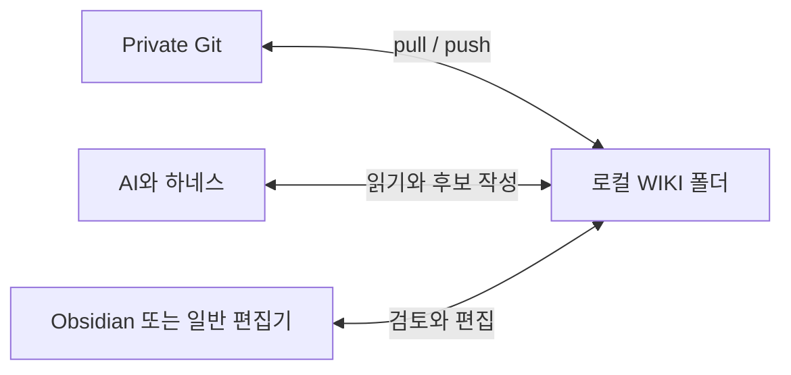

# WIKI 저장과 Obsidian

> 검토와 관측 기록. 검토 당시의 후보와 관측을 보존한다. 현재 채택 범위는 결정 목록에서 확인하며, 미실행 계획이나 예비 시험을 제품 검증 완료로 해석하지 않는다.

작성일: 2026-11-02. 정합성 갱신: 2026-11-11. 공식 기능, 비용의 조사 시점은 각 근거를 따른다. WIKI의 공개, 저장, 편집, 공유 수단과 토큰 비용 판단을 다룬다. Windows 문서 배치 관측은 [이전 기록](../../evidence/environment-observations.md), 앱/WIKI의 PR, 버전 연결은 [작업 연계](../../design/sync.md)로 분리했다. 예비 문서 연결과 같은 세션 재개는 완료됐고, 제품 설치, 원격 Git 연계, 토큰 비교는 미실행이다.

## 추천과 판단 범위

추천은 **로컬 Markdown WIKI를 AI가 직접 읽고 수정하고, 별도 private Git으로 작업 단위 이력을 공유하며, Obsidian은 선택 편집기로 사용하는 방식**이다. 본인 사용에서는 앱 Git과 WIKI를 분리한다. 다른 사용자를 위한 모듈은 프로젝트 내부 WIKI도 지원하는 방향을 유지한다. 원본 저장 위치, 사용 편집기, 공유 수단은 각각 선택할 수 있어야 한다.

현재 구현은 Obsidian 전용 연동이 아니라 외부 문서 폴더를 연결하는 예비 도구다. 단순 열람만 한다면 일반 Markdown 편집기로도 충분하고, Obsidian을 추가했다는 사실 자체는 기술 검토의 핵심 기술 성과가 되기 어렵다. 아래 추천은 사람이 근거, 미검토 항목을 더 쉽게 찾는 경우에 한정한다. 실제 탐색, 검토 효과와 토큰 절감은 미측정이다.

Obsidian을 사용하기 위해 전용 서버, MCP, 자동 색인이나 PR 연계를 필수로 요구하지 않는다. 별도 WIKI 사용자의 최소 원격 PR 연계는 11/11 첫 제공 범위로 채택했으며 [작업 연계](../../design/sync.md)가 소유한다. 첫 연결 후보는 명시한 WIKI 폴더의 필요한 파일을 직접 읽고 수정하는 방식이다. 외부 경로도 설치, 권한, 링크, 복구 검증이 필요하므로 무료에 가까운 구조 변경이라고 평가하지 않는다. 11/04 오류 보고 후 [배치 대안](../../evidence/environment-observations.md)을 보강했고, 11/05 Windows 앱, Windows 문서 원본을 유지하며 WSL에서 접근하는 지원 방향을 수용했다. 사용자 환경의 이전, 같은 세션 접근은 확인했으며 범용 제품 지원 검증은 남아 있다.

## 공개 저장소와 서비스 배포의 차이

사용자의 노출 우려는 타당하다. 다만 개발 WIKI가 Git에 존재하면 안 된다는 일반 규칙은 과도하다. Git의 변경 이력과 저장소 접근 권한, 실행 산출물의 포함 범위는 따로 정할 수 있다.

배포 모듈의 공개 README, 설치 안내, 공통 skill은 사용자가 제품을 쓰기 위한 자산이다. 내부 지식을 분리하더라도 배포물의 사용 설명과 공통 동작 규칙은 남아야 한다.

| 경계 | 검토 결과, 추천 |
| --- | --- |
| 비공개 코드 저장소 | 같은 팀이 접근할 코드, WIKI를 함께 관리하면 변경과 검토를 연결하기 쉽다. 내부 문서를 분리할 별도 권한 요구가 없다면 한 저장소도 유효한 선택이다. |
| 공개 코드 저장소 | 공개 가능한 요구, ADR, 사용법만 포함한다. 내부 논의, 민감한 기록은 별도 접근 범위로 관리한다. 저장 위치를 옮긴 뒤 공개한다고 과거 공개 이력까지 사라지는 것으로 보지 않는다. [GitHub 공개 범위](https://docs.github.com/en/repositories/managing-your-repositorys-settings-and-features/managing-repository-settings/setting-repository-visibility). |
| 빌드 입력, Docker 이미지 | 저장소 문서 전체가 실행 산출물에 포함돼야 하는 것은 아니다. `.dockerignore`는 빌드 컨텍스트에서 파일을 제외하는 수단이고, 실제 `COPY`, 산출물 패키징, 이미지 내용은 따로 확인해야 한다. [Docker build context](https://docs.docker.com/build/concepts/context/). |
| AI에 제공하는 입력 | 로컬/비공개 저장만으로 클라우드 모델 입력까지 비공개 로컬 처리되는 것은 아니다. 클라우드 메인이 읽어 사용하는 본문은 그 호출 경계에 들어간다. 외부 공유 금지 자료와 모델에 제공해도 되는 자료를 구분한다. 이는 제안 구조의 데이터 흐름에 대한 판단이다. |

`.gitignore`는 이미 추적 중인 파일에 영향을 주지 않는다. 기존 문서의 추적, 이력, 배포 여부를 확인한 뒤 이전을 설계해야 하며 지금 추적 해제, 이력 변경, 파일 삭제를 수행하지 않는다. [Git 문서](https://git-scm.com/docs/gitignore). API 키 같은 실제 비밀값을 WIKI에 넣는 것을 private 저장소로 정당화하지 않는다. 현재 저장소의 공개 상태, Docker 산출물, 민감 자료 유무를 감사한 결과는 아니다.

## Obsidian이 맡는 역할

vault는 로컬 파일시스템의 폴더다. 노트는 Markdown 일반 텍스트이며 다른 편집기와 파일 도구도 편집할 수 있다. Obsidian은 외부 파일 변경을 반영하고 vault별 설정은 `.obsidian`에 둔다. 앱의 저장 방식에 근거하면 기존 Markdown 폴더를 사람이 편하게 탐색, 편집하는 도구로 사용할 수 있다. [데이터 저장 방식](https://help.obsidian.md/Files+and+folders/How+Obsidian+stores+data).

다음 책임들을 하나의 기능으로 생각하면 도입 판단이 어긋난다.

| 역할 | 후보 | 별도로 남는 책임 |
| --- | --- | --- |
| 사람이 읽고 편집 | Obsidian, IDE, 일반 편집기 | 문서의 정확성, 채택 상태 |
| 여러 기기로 전달 | Obsidian Sync, Git 기반 공유 | 동시 변경과 충돌의 최종 판단 |
| 변경 이유, 검토, 코드 버전 연결 | Git commit, PR과 작업 기록 | 코드/WIKI 조합의 검증 |
| AI가 필요한 지식 접근 | 파일 직접 읽기 또는 선택 MCP | 접근 권한, 허용 경로, 반환량, 근거 |
| 작업 중단, 복구 | 현재 하네스의 진행, 실패, 검증 계약 | 실제 도구 발동과 최신 상태 확인 |

Obsidian 설치가 위 책임들을 자동으로 묶어 해결하지는 않는다.

### Git만 쓸 때와의 차이

11/08 사용자 지적은 **AI가 같은 Markdown 폴더를 읽는 현재 경로에서는 맞다.** Obsidian을 닫아도 그 경로, 본문, AI 접근 권한이 같으면 하네스의 파일 읽기/쓰기는 Obsidian에 의존하지 않는다. 반면 Git이 버전과 공유를 관리한다는 사실이 사람이 문서를 읽고 연결을 탐색하는 편집기의 역할까지 없애지는 않는다. Obsidian은 단순 뷰어 이상이지만 이 프로젝트에서 그 기능을 실제로 사용하는지는 별도 판단이다.

추천에서 AI가 연결할 대상은 **private Git의 로컬 작업 폴더**다. 같은 폴더를 Obsidian에서 열면 그 폴더가 vault이기도 하다. 두 사본을 유지하거나 AI가 읽을 때마다 GitHub에 접속하는 구성은 아니다. 원격 주소로 처음 도입할 때는 인증, clone, 버전 선택이 필요하고, 이후 원격 공유, 갱신 때 push, fetch/pull과 충돌 처리가 필요하다. 원격 파일 API로 직접 읽고 쓰는 방식은 별도 구현이며 기존 경로 연결 시험의 지원 범위가 아니다. [Git clone](https://git-scm.com/docs/git-clone).

Windows–WSL 연결도 심볼릭 링크가 아니다. 일반적인 C드라이브 마운트가 `/mnt/c`이며 실제 값은 변환 결과를 사용한다. Obsidian에서 여는 Windows 폴더와 WSL의 파일 읽기/쓰기는 같은 원본을 향한다. 이는 [Microsoft의 파일시스템 설명](https://learn.microsoft.com/en-us/windows/wsl/filesystems)과 예비 도구 구현에서 확인한 경계다.

아래는 **배포 모듈을 적용할 프로젝트의 후보 구성**이다.



| 선택 | 장점 | 비용, 한계 | 현재 판단 |
| --- | --- | --- | --- |
| 일반 편집기 | 추가 앱, 전용 설정 없이 기존 작업 환경 사용 | 노트 관계, 상태 목록을 목차/검색 등으로 직접 탐색 | 단순 열람이면 충분한 대안 |
| 같은 폴더 + 선택 Obsidian | 원본 복제 없이 역링크, 속성 보기로 사람의 검토 보조 | 링크, 속성 유지와 앱 사용 학습 필요, AI 품질/토큰 절감 자동 보장 없음 | 추천. 사람이 실제 사용할 기능만 좁게 선택 |
| Obsidian 전용 플러그인, MCP 중심 | 앱 내부 조작, 특화 화면까지 연결 가능 | 앱/플러그인 버전, 권한, 가용성, 테스트 범위 증가, 일반 편집기 호환 부담 | 현재 필수 요구가 없어 첫 범위에서 비추천 |

선택 Obsidian을 추천하는 이유는 앱 이름이 아니라 [검토 기능 — 「유용한 Obsidian 기능」](storage.md#%EC%9C%A0%EC%9A%A9%ED%95%9C%20Obsidian%20%EA%B8%B0%EB%8A%A5)의 사용성이다. 배포 README에서 같은 WIKI를 vault로 여는 선택 경로를 안내하고 앱이 없어도 핵심 기능이 동작하게 하는 방향이다. 처음에는 기존 Markdown 링크의 Backlinks, 검색만 써도 된다. 속성, Bases, Canvas는 목적, 원문 보존, 추가 관리 비용을 먼저 확인하며, 이번 검토로 일괄 변환이나 전용 기능 구현을 승인하지 않는다.

제거 기준도 둔다. 일반 편집기로 필요한 근거와 미해결 항목을 충분히 찾는다면 Obsidian 도입을 생략해도 된다. 반대로 잘못된 근거 연결 찾기, 관련 ADR 탐색, 미검토 후보 찾기의 시간/정확도에 이점이 있다면 선택 사용을 설명할 수 있다. 이는 후속 평가 후보이며 새 실험 실행, 수치 성과를 뜻하지 않는다. 두 저장소의 commit/PR/충돌 비용은 편집기와 별개이므로 Obsidian을 제거한다고 사라지지 않는다.

## 팀 동기화와 Git 이력

공식 Sync 공유 vault는 모든 참여자에게 Sync 구독이 필요하다. 세밀한 사용자별 권한은 지원하지 않으며, 같은 파일의 커서, 편집을 함께 보는 공동 편집도 제공하지 않는다. 변경은 동기화 후 보이며 동시 편집은 충돌 처리 대상이다. 따라서 팀 문서 공유에는 사용할 수 있지만 충돌 없는 협업 저장소라는 가정은 부적절하다. [공유 vault](https://help.obsidian.md/sync/collaborate).

공식 문서에 따르면 Markdown 충돌은 자동 병합되며 중복, 형식 문제가 남을 수 있다. 충돌 파일을 따로 만드는 설정도 있다. 일부 다른 파일은 마지막 수정 우선이고 설정은 JSON 병합 방식이므로, 본문, Canvas, 설정 모두 같은 보존 의미라고 가정하지 않는다. [충돌 처리](https://help.obsidian.md/sync/troubleshoot).

Sync에는 버전 복원이 있지만 Git의 commit, branch, PR 검토를 대체하는 계약으로 보기는 어렵다. 문서상 노트 이력은 Standard 1개월, Plus 12개월이고 첨부의 과거 버전은 2주다. 구독과 보존 한도를 가진 복구 기능이라는 점을 구분한다. [버전 이력](https://help.obsidian.md/sync/version-history).

11/04 재확인한 공식 Sync 가격은 1인당 Standard 월 결제 $5 또는 연 결제 기준 월 $4, Plus 월 결제 $10 또는 연 결제 기준 월 $8이다. Standard 두 명이면 월 결제 합계 $10, 연 결제는 합계 $96/년이다. 소규모 팀, 기술 검토용이라는 이유로 공유 참여자 구독이 면제되는 안내는 없다. 세금, 환율, 별도 할인은 계산하지 않았다. [Sync 가격](https://obsidian.md/sync), [공유 조건](https://help.obsidian.md/sync/collaborate).

Obsidian 앱 자체는 무료이며 Sync는 별도 유료 서비스다. 무료 앱을 선택한다고 Sync까지 구독해야 하는 것은 아니다. [앱 가격](https://obsidian.md/pricing). 최소 비용 조건에서는 기존 기기, 네트워크와 무료 Git 호스팅 범위 안에서 운영하는 방식을 우선 검토한다.

Sync의 종단간 암호화는 원격 vault, 전송을 보호하며 로컬 vault 자체를 암호화하지 않는다. 따라서 클라우드 모델에 읽힌 본문, 로컬 파일 권한, 팀원의 접근은 별도로 관리해야 한다. [보안 설명](https://help.obsidian.md/sync/security).

이 프로젝트의 첫 운영에는 Git을 원본 이력, 공유 수단으로 두고 Obsidian은 편집기로만 사용하는 안을 추천한다. 같은 작업 폴더를 여러 자동 동기화 수단이 동시에 고치게 하는 구성은 첫 범위에서 보류한다. 팀에서 같은 파일을 동시에 수정하면 작성 범위를 나누거나 변경을 순서대로 적용하고 검토해야 하며, Git도 의미상 충돌을 자동 해결하지는 않는다.

## 무료 운영 대안

GitHub Free는 비공개 저장소와 협업자를 지원한다. 작은 Markdown 위키에 유료 Actions, LFS, 서버를 추가할 필요는 없다는 것이 첫 운영 추천이다. 호스팅의 모든 부가 기능, 대용량 저장까지 무제한 무료라는 뜻은 아니다. [GitHub 요금제](https://docs.github.com/en/get-started/learning-about-github/githubs-plans).

| 방식 | 장점 | 비용, 부담 | 추천 |
| --- | --- | --- | --- |
| 별도 private Git + 작업 단위 commit, push | 무료 범위에서 이력, 차이, 되돌리기, 비동기 공유. 제품은 Windows Git, 개발 작업은 기존 WSL Git 활용 | 저장 시점과 충돌은 관리해야 함. 실시간 공동 편집 아님 | 현재 첫 운영 추천 |
| 같은 private Git + Obsidian Git 플러그인 | 앱 버튼, 주기, 편집 중단 후 commit/pull/push 가능 | 커뮤니티 플러그인 설치, 인증, 플랫폼 연결 필요. 작성 중간 상태, 원하지 않은 파일도 커밋될 수 있음 | 첫 방식이 검증된 뒤 편의 기능으로 선택 |
| Syncthing + 파일 버전 보관 | 구독 없이 기기 간 폴더 공유, 매 변경마다 PR 불필요 | 기기 연결, 충돌 파일 처리, 보존 설정 필요. Git의 작업별 이력, 검토를 그대로 제공하지 않음 | 기기 간 자동 전달이 더 중요한 경우의 대안 |

Obsidian Git은 Obsidian 회사의 Sync 서비스와 다른 커뮤니티 플러그인이다. 유지관리자 문서에서 수동, 자동 commit-and-sync와 변경 범위 선택을 확인했다. 이는 Git 작업을 줄이는 편의 수단이며 의미상 충돌이나 코드/WIKI 일관성을 자동 해결하지 않는다. 작업 단위로 여러 문서를 수정하는 동안에는 자동 pull/commit을 겹치지 않게 운용하는 편을 추천한다. 현재 플러그인을 설치하거나 동작을 시험하지 않았다. [기능](https://publish.obsidian.md/git-doc/Features), [사용 방식](https://publish.obsidian.md/git-doc/Start%20here).

Syncthing은 별도 구독 서비스 없이 자기 기기 사이의 파일을 동기화하는 오픈소스다. 자체 기기, 저장 공간, 네트워크 비용은 남는다. 버전 보관은 기본 비활성이며 다른 기기에서 받은 변경에 적용된다. 같은 기기에서 본인이 바꾼 파일의 모든 과거 상태를 보관하는 기능으로 보면 안 된다. 동시 수정은 충돌 사본이 생기므로 사람이 판단해야 한다. 이런 한계 때문에 현재의 근거 추적, 되돌리기 목적에는 Git을 더 추천한다. [공식 소개](https://syncthing.net/), [버전 보관](https://docs.syncthing.net/users/versioning.html), [충돌](https://docs.syncthing.net/users/syncing.html).

이 비교를 근거로 `harness/`에 Git을 초기화하거나 자동 업로드를 켜지 않는다. 특히 현재 폴더에서 Git 플러그인을 켜기 전에 실제 저장소 루트, remote, 선택 파일을 확인해야 한다. 폴더를 vault로 열었다는 사실만으로 부모 앱 저장소와 Git 경계가 분리되지 않는다.

## 프로젝트와 vault 연결

현재 구조는 프로젝트의 `docs`와 상대 경로, matrix, skill, hook의 소비 지점이 연결돼 있다. 따라서 문서 폴더만 옮겨도 그대로 동작한다고 보장할 수 없다. 현재 연결은 [모듈 문서 — 「최소 WIKI」](../../design/knowledge/wiki.md)와 [구조 감사](../architecture/baseline-audit.md)에 기록돼 있다.

배포 모듈의 구체 연결 후보는 [프로젝트 WIKI 연결](../../design/knowledge/wiki.md)이 소유한다.

추천 연결은 프로젝트 코드 루트와 WIKI 루트를 명시적으로 구분하는 것이다. 아래는 개념이며 실제 설정 키, 파일, 명령 이름을 확정한 예제가 아니다.

```text
프로젝트 → 승인된 연결 정보 → 이 프로젝트의 WIKI 원본 한 곳
                              ├─ 프로젝트 내부 Markdown
                              └─ 별도 private 저장소의 로컬 Markdown

Codex와 선택 로컬 보조 → 허용된 정보만 접근
Obsidian 또는 일반 편집기 → 같은 Markdown 원본 편집
```

설치 후에는 IDE 종류보다 프로젝트에서 시작한 도구가 어느 WIKI 루트를 사용할지 확인하는 절차가 중요하다. 시작 시 프로젝트 식별, 경로, 읽기/쓰기 권한, 문서 버전을 확인하고 연결을 선택할 수 있게 설계할 수 있다. 변경할 때는 사용자 요청으로 연결을 바꾸고 다시 확인한다. 단순 링크를 적으면 샌드박스 밖의 쓰기 권한까지 생긴다고 가정하지 않으며, 지금 동작하는 설치 명령으로 안내하지 않는다.

접근 권한은 세 층으로 나눈다. Obsidian의 vault 등록은 어느 층의 권한도 AI에 대신 부여하지 않는다.

| 대상 | 필요한 조건 | 자동화의 한계 |
| --- | --- | --- |
| 로컬 문서 읽기, 수정 | OS 권한과 AI CLI의 해당 경로 접근 허용 | 허용 범위의 일반 문서 작업은 매번 승인받지 않도록 구성 가능. 관리 정책, 보호 경로, 추가 작업에 따라 승인은 남음 |
| 새 세션, 재개 | 설정된 WIKI 경로를 실제 실행의 허용 범위와 진입 지시에 반영 | 현재 예비 도구는 `--add-dir`와 읽기 지시를 전달. 실행 미리보기만으로 이미 열린 세션의 권한이 바뀌지 않음 |
| 원격 Git, PR | 저장소 인증, 작업별 권한, CLI의 네트워크/명령 허용 | 로그인 정보 재사용과 실행 승인은 별개. token 만료, 권한 변경, push/PR 정책에 따라 추가 확인 가능 |

Codex 공식 문서는 추가 쓰기 경로의 `--add-dir`와 승인/샌드박스 정책을 구분한다. **한 번 등록하면 어떤 작업도 승인 없이 영구 사용한다는 보장은 없다.** 현재 11/08 세션의 Windows 시험 폴더는 쓰기 허용 루트 밖이므로 외부 쓰기에는 실행 승인이 필요하다. 일반 파일과 Git 메타데이터의 쓰기 제한도 같다고 가정하지 않는다. 실제 새 세션/재개 시험에서 문서 읽기, 수정과 Git 조작을 구분해 확인한다. [CLI 옵션](https://learn.chatgpt.com/docs/developer-commands?surface=cli), [승인과 보안](https://learn.chatgpt.com/docs/agent-approvals-security).

공개 코드 저장소에는 민감한 로컬 절대 경로나 내부 저장소 정보 대신 비밀이 아닌 연결 식별만 두는 안을 검토한다. 실제 로컬 경로, 권한은 호스트 설정이 맡는다. vault가 없거나 잘못 연결됐으면 빈 WIKI로 재생성하지 않고 영향받는 작업을 미완료로 남긴다.

기존 하네스 역할은 다음 조건에서 유지할 수 있다.

- 진입, 요구, 구조, 결정, 실패, 진행의 정보 역할은 유지하고 실제 위치만 연결한다. 폴더 이동만으로 role이 충족됐다고 판단하지 않는다.
- 검증 명령은 코드 프로젝트를 기준으로 실행한다. 문서 경로를 바꾼 탓에 다른 작업 디렉토리에서 검사를 실행하지 않는다.
- 재개에는 코드 revision, WIKI revision 또는 내용 식별, 미완료 검사를 함께 확인한다. 잘못된 프로젝트의 노트를 읽거나 새 코드에 오래된 WIKI를 조용히 적용하지 않는다.
- 기존 원문, ADR 이력, 링크, 진행 상태를 보존한다. 이동 후의 코드 참조와 위키 링크까지 검사한다.
- 동시 편집 중 파일이 바뀌면 변경 전 상태와 대조하고 충돌을 보고한다. Obsidian Sync의 파일 병합을 하네스의 의미상 검증으로 사용하지 않는다.
- 기본 필수 정보는 일반 Markdown으로도 이해할 수 있게 유지한다. Obsidian 전용 화면, 플러그인 데이터는 보조 자료로 둔다.

현재 첫 실행, 코드 프로젝트 범위는 11/11 [ADR 0020](../../decisions/runtime/0020-windows.md)의 Windows 직접 실행이다. WSL/Linux는 후속이며 내부/외부 WIKI와 Obsidian 미사용 경로를 유지한다. 과거 예비 WSL 접근, 위키 이전의 관측을 제품 Windows 실행, 권한, 복구 성공으로 확대하지 않는다.

## MCP와 로컬 AI

MCP는 외부 도구의 기능을 AI에 제공하는 연결 수단이다. Codex는 서버별 활성화, 허용 도구, 승인, 출력량 설정 등을 문서화한다. 그러나 로컬 Markdown 접근에 항상 별도 MCP 서버가 필요한 것은 아니다. 이미 허용된 파일 도구로 필요한 문서를 읽고 수정할 수 있는지 먼저 확인하는 쪽을 추천한다. [OpenAI Docs](https://learn.chatgpt.com/docs/extend/mcp).

직접 파일 접근과 MCP를 비교하면 다음과 같다. 이 질문에는 실질적인 연결 선택이 두 가지여서 제3의 새 서버 구조를 억지로 추가하지 않는다.

| 방식 | 장점 | 비용, 제약 | 현재 추천 |
| --- | --- | --- | --- |
| 허용한 폴더의 파일 직접 접근 | 기존 Markdown, Git, 검색을 사용, 추가 서비스 최소화 | 경로, 권한, 링크, 동시 변경 처리는 필요 | 첫 연결 후보 |
| 선택 MCP로 검색, 노트 작업 제공 | 원격 접근이나 앱 전용 기능을 제한된 도구로 제공 가능 | 서버/플러그인 신뢰, 인증, 권한, 가용성, 도구 출력, 토큰 확인 필요 | 파일 접근으로 부족한 요구가 확인될 때 비교 |

특정 Obsidian MCP 구현의 안전성, 속도, 사용량을 검증하지 않았다. MCP라는 이유만으로 자동으로 안전하거나 토큰을 줄인다고 판단하지 않는다.

로컬 AI와도 같은 Markdown 근거를 사용할 수 있는 방향이다. 중요한 것은 모델 이름보다 읽을 범위, 반환량, 근거 위치, 메인 검토를 통제하는 연결이다. 로컬 보조가 요약하면 원본 위치와 누락/불확실성을 반환하고 클라우드 메인이 확인해야 한다. 로컬 실행기에 넘긴 문서를 다시 클라우드에 모두 전달하면 원하는 절감이 없어질 수 있으므로 실제 완료 비용으로 비교한다. 벡터 DB, RAG, 실시간 전체 색인을 이번 도입의 필수 요소로 삼지 않는다. 모두 후속 설계 판단이며 로컬 도입은 아직 미채택이다.

## 토큰 영향

사용자 지정 비교 조건은 [토큰 비용 검토](../integration/ai-tools.md)가 소유한다. 여기서는 확인한 동작에서 추론할 수 있는 범위와 아직 모르는 값을 나눈다.

| 사용 방식 | 현재 판단할 수 있는 비용 | 아직 측정해야 할 것 |
| --- | --- | --- |
| AI를 호출하지 않고 Obsidian에서 편집, Sync만 사용 | 그 편집, 동기화 행위로 인한 추가 모델 호출은 0이라는 조건부 판단. Sync 구독, 로컬 자원은 별도 | AI 플러그인, 자동 요약 등 추가 기능을 켠 경우의 호출 여부 |
| 같은 문서를 같은 범위로 직접 읽기 | 모델에 전달되는 본문 문자열과 토크나이저가 같으면 그 본문 토큰 수는 같음. 저장 위치만으로 본문이 비싸지는 것은 아님 | 경로 안내, 명령, 메타데이터, 반복 탐색, 입력 누적에 따른 전체 작업 차이 |
| private Git의 로컬 작업 폴더 읽기, 수정 | 같은 파일 도구, 본문, 수정 범위를 쓰면 vault와 같은 파일 작업. Git 관리 여부 자체로 모델 입력이 늘지는 않음 | 상태/diff 확인, 커밋 메시지, 충돌 처리 등 실제 추가 작업의 입력과 출력 |
| 원격 저장소 API, 웹으로 직접 읽기, 수정 | 요청, 응답의 메타데이터, 인증 오류, 재시도, 변경 버전 확인이 추가될 수 있음. raw 본문만 같은 형식으로 받으면 본문 비용은 동일 | 도구/반환 형식에 따라 다르므로 항상 더 비싸거나 완전히 같다고 단정 불가 |
| MCP 사용 | 도구 설명, 실제 로드한 스키마, 요청, 반환 결과, 추가 호출이 비용 후보. 검색 범위를 좁혀 읽는 양을 줄일 가능성도 있음 | 선택 서버, 도구, 버전, 지연 로딩, 출력 형식, 캐시, 작업별 실제 증감 |
| AI 검색, 요약, 색인 추가 | 수행 위치와 모델 호출 여부에 따라 일회성/반복 비용 발생 가능 | 원문 검토, 잘못된 검색, 요약 누락에 따른 재작업까지 포함한 순효과 |

이 표의 0은 조건에 해당하는 행위의 추가 모델 호출을 말하며 Codex 작업 전체 비용 0이나 현재 환경의 실측값이 아니다. AI를 쓰지 않는 파일 편집이라는 조건에서의 판단이다. Obsidian 앱의 일반 텍스트 저장 방식은 앞의 공식 자료를 근거로 한다.

현재 폴더를 그대로 vault로 열고 같은 문서만 읽는다면 위치, 본문을 바꾸지 않으므로 별도 AI 연결 비용을 추가할 이유가 없다. Obsidian의 일반 검색, 그래프, 색인은 앱의 로컬 자원 사용이다. AI 없이 실행한 Git 전송도 그 자체로 LLM 토큰을 쓰지 않지만, AI가 명령을 작성하고 결과, diff, 로그를 읽으면 그 내용은 비용에 포함될 수 있다. 네트워크 시간과 LLM 토큰은 다른 지표다. Git 관리 여부와 Obsidian 사용 여부를 독립적으로 비교하고, 전체 세션 토큰이 같다고 보장하지 않는다. 실제 증감률은 미측정이다.

MCP 비용을 모든 도구 정의가 매번 전부 로드되는 고정량으로 계산해서도 안 된다. OpenAI는 필요한 도구 정의를 뒤늦게 읽는 tool search를 문서화한다. 이는 관련 API 기능의 사실이며 현재 Codex, 선택 MCP에서 같은 설정이 활성화됐다는 실증은 아니다. [Tool search](https://developers.openai.com/api/docs/guides/tools-tool-search).

현재 Obsidian/MCP를 연결해 비교하지 않았으므로 추가 토큰 수, 증감률은 **미측정**이다. 선정한 서버도 없어서 공통으로 적용할 신뢰 가능한 수치 범위를 제시하기 어렵다. 파일 수, 글자 수나 다른 제품의 광고 수치를 이 환경의 실측으로 바꾸지 않는다.

현재의 도입 판단은 다음과 같다. 선택 편집기로만 사용하는 경우에는 토큰 증가보다 사람의 사용 편의와 설정/관리 비용을 먼저 비교할 수 있다. MCP, 자동 요약을 추가하는 경우에는 기존 조건부 읽기보다 불필요한 문서를 더 넣거나 재시도를 늘릴 수 있어 측정이 필요하다. 반대로 필요한 부분을 더 정확히 반환하면 감소할 수도 있다. 따라서 Obsidian 사용 자체를 토큰 때문에 배제할 근거는 없지만, 추가 AI 연결을 이점 검증 없이 기본으로 넣을 근거도 없다.

후속 비교를 한다면 같은 문서, 질문, 모델, 완료 기준에서 로컬 파일 작업, Git 작업 추가, 원격 API/MCP 경로를 나누고 새 세션, 재개, 캐시 조건을 통제한다. 입력, 캐시 부분, 출력, 추론 필드는 도구의 정의에 맞춰 중복 합산하지 않는다. 완료 품질, 누락, 재작업, 시간도 함께 본다. 구독 할당량으로의 정확한 환산은 확인되지 않았으므로 예측하지 않는다. 이번에는 모델 호출이나 실험을 실행하지 않았다.

## 두 저장소를 사용할 때

[이 절의 본문 — 「두 저장소를 사용할 때」](../../design/sync.md).

### 여러 저장소를 하나의 프로젝트로 관리할 때

[이 절의 본문 — 「여러 저장소를 하나의 프로젝트로 관리할 때」](../../design/sync.md).

### 원자성과 작업 단위

[이 절의 본문 — 「원자성과 작업 단위」](../../design/sync.md).

### 연계 대안

[이 절의 본문 — 「연계 대안」](../../design/sync.md).

### 저장과 공유 흐름

[이 절의 본문 — 「저장과 공유 흐름」](../../design/sync.md).

### 롤백의 세 의미

[이 절의 본문 — 「롤백의 세 의미」](../../design/sync.md).

### 확인할 사례

[이 절의 본문 — 「확인할 사례」](../../design/sync.md).

### PR과 CI 연결

[이 절의 본문 — 「PR과 CI 연결」](../../design/sync.md).

### PR 자동화의 세 범위

[이 절의 본문 — 「PR 자동화의 세 범위」](../../design/sync.md).

### 필요한 권한과 비용, 실패 시 처리

[이 절의 본문 — 「필요한 권한과 비용, 실패 시 처리」](../../design/sync.md).

## 유용한 Obsidian 기능

아래는 공식 기능에 근거한 적용 제안이다. 제품에 구현했거나 사용자가 채택한 기능 목록이 아니다. 기능별 데이터는 일반 Markdown, 표준 링크, 필요한 속성에 남기고, 화면 전용 정보가 현재 정책의 유일한 원본이 되지 않게 한다.

| 기능 | 이 작업에서의 사용 예 | 한계 |
| --- | --- | --- |
| Backlinks | 요구 문서를 열고 그것을 참조하는 ADR, 검증 근거를 역으로 찾아 변경 영향 검토 | 같은 vault의 연결 탐색이며 코드 의존성, 누락, 최신성을 검증하는 엔진이 아님 |
| Search, Bookmarks | 작업 범위, 용어로 필요한 문서만 찾고 검토 진입점을 재사용 | 기존 목차, 라우팅의 대체 원본이나 자동 AI 컨텍스트 선택기가 아님 |
| Properties, Bases | 문서 종류, 검토 상태, 범위 속성으로 아직 채택되지 않은 역공학 후보를 모아 검토 | 속성은 실제 검토 상태와 같아야 함. 본문의 상태와 별도로 중복 수기 관리하면 불일치 위험 |
| Canvas | 요구→결정→검증을 실제 노트 카드로 연결해 설명하고 설계를 검토 | 별도 텍스트 카드에만 근거를 적으면 Backlinks에 잡히지 않음. 중요한 내용은 연결한 Markdown에 보존 |
| Graph | 이미 만들어진 문서 연결을 시각적으로 탐색 | 그래프 모양, 노드 수는 정확성, 완전성, 독창성 지표가 아님 |
| Templates | 반복 문서의 기본 틀 입력을 보조 | 배포 모듈의 템플릿과 별도 복사본이 갈라지지 않게 관리 |

Backlinks는 연결/미연결 언급을 보여 주고, Properties는 Markdown 파일의 YAML 데이터다. Bases는 그 파일, 속성을 필터/정렬해 보여 주며 보기 정의를 `.base` 등에 저장한다. Canvas는 공개 JSON Canvas 형식을 쓰지만 일반 Markdown 편집기가 같은 화면을 제공한다는 뜻은 아니다. [Backlinks](https://help.obsidian.md/Plugins/Backlinks), [검색](https://help.obsidian.md/plugins/search), [Properties](https://help.obsidian.md/properties), [Bases](https://help.obsidian.md/bases), [Canvas](https://help.obsidian.md/Plugins/Canvas).

이 기능들은 사람의 근거 검토를 돕는 후보이며 Obsidian만 가능한 독점 기능이라고 주장하지 않는다. 기술 검토의 검토 흐름으로는 **AI가 근거를 붙인 문서 후보 작성 → 사람이 미검토 후보와 연결 근거 확인 → 채택된 변경을 Git/앱 버전에 연결**하는 예가 가능하다. Obsidian은 그중 사람의 검토 화면을 맡을 수 있다. 상태, 근거의 의미와 검사는 하네스가 소유하고 Markdown에도 남겨야 하며, 속성 필터나 그래프만으로 근거의 진실성, 완전성을 판정하지 않는다.

검토 시간, 근거 누락 발견, 잘못된 채택 감소를 일반 편집기와 비교해 이점이 확인되면 이 연결을 기술 검토의 한 축으로 설명할 수 있다. 현재는 후보이며 구현, 효과 검증 전이다. 단순 앱 도입만으로 핵심 차별성을 주장하거나 이를 위해 전용 플러그인/MCP를 필수화할 근거는 없다. 기본 검색, 역링크, 속성 보기는 LLM 호출이 아니지만 전체 AI 토큰 증감은 별도 측정 대상이다.

## 남은 합의와 검증

Windows 문서 사본의 양방향 수정, 이름 변경, GUI 반영과 재열기 보존을 확인했다. 원래 UNC 오류의 전문과 환경 일부는 확보하지 못했으므로 원인을 재현하거나 해결했다고 주장하지 않는다. 제품의 설치, 권한 연결, Git/PR 자동화 검증은 별도다. [예비 환경 관측](../../evidence/environment-observations.md)과 현재 [개발 순서](../../development/roadmap.md)를 구분한다.
