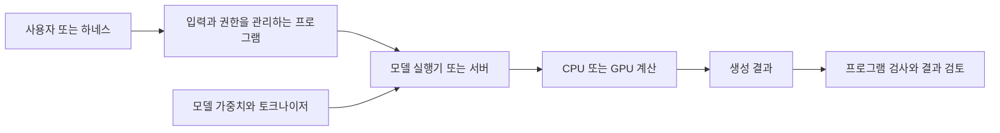
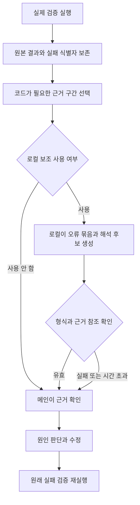

# 로컬 AI 이해와 활용

> 기술 설명. 검토 당시의 후보와 관측을 보존한다. 현재 채택 범위는 결정 목록에서 확인하며, 미실행 계획이나 예비 시험을 제품 검증 완료로 해석하지 않는다.

작성, 자료 확인: 2026-10-27. 현재 작업 환경은 Windows 11, WSL2이며, GPU, VRAM, RAM 용량은 아직 확인하지 못했다.

이 문서는 로컬 AI를 이해하고 도입 여부를 판단하기 위한 학습 자료다. **모델 설치나 구조 변경 계획을 확정하는 문서가 아니다.** 외부 자료로 확인한 기능, 사례와, 현재 프로젝트에 적용해 본 판단을 구분한다. 모델별 지원 기능과 실행 도구는 바뀌므로 실제 구현 시 사용할 버전에서 다시 확인해야 한다.

처음에는 1~6절로 개념과 활용을 이해하고, 7~9절에서 도입, 협업 방식을 비교한 뒤, 10~12절에서 현재 하네스에 대입하면 된다. 마지막에는 용어와 다음 학습 순서를 모았다.

| 읽을 내용 | 바로가기 |
| --- | --- |
| 개념, 역사, 동작, 장비, 도구 | [1~5절 — 「1. 로컬 AI는 무엇인가」](local-ai.md#1.%20%EB%A1%9C%EC%BB%AC%20AI%EB%8A%94%20%EB%AC%B4%EC%97%87%EC%9D%B8%EA%B0%80) |
| 실제 사례, 장단점, 좋고 나쁜 사용 | [6~7절 — 「6. 실제 기업은 어디에 사용하는가」](local-ai.md#6.%20%EC%8B%A4%EC%A0%9C%20%EA%B8%B0%EC%97%85%EC%9D%80%20%EC%96%B4%EB%94%94%EC%97%90%20%EC%82%AC%EC%9A%A9%ED%95%98%EB%8A%94%EA%B0%80) |
| 프로젝트 도입, 클라우드 협업 | [8~9절 — 「8. 프로젝트에 따라 도입 방식이 달라진다」](local-ai.md#8.%20%ED%94%84%EB%A1%9C%EC%A0%9D%ED%8A%B8%EC%97%90%20%EB%94%B0%EB%9D%BC%20%EB%8F%84%EC%9E%85%20%EB%B0%A9%EC%8B%9D%EC%9D%B4%20%EB%8B%AC%EB%9D%BC%EC%A7%84%EB%8B%A4) |
| 현재 하네스 적용 후보, 추천, 효과 측정 | [10~12절 — 「10. 현재 조건부 하네스에 적용하는 다섯 가지 예시」](local-ai.md#10.%20%ED%98%84%EC%9E%AC%20%EC%A1%B0%EA%B1%B4%EB%B6%80%20%ED%95%98%EB%84%A4%EC%8A%A4%EC%97%90%20%EC%A0%81%EC%9A%A9%ED%95%98%EB%8A%94%20%EB%8B%A4%EC%84%AF%20%EA%B0%80%EC%A7%80%20%EC%98%88%EC%8B%9C) |
| 용어, 다음 학습 | [13~14절 — 「13. 자주 보게 될 용어」](local-ai.md#13.%20%EC%9E%90%EC%A3%BC%20%EB%B3%B4%EA%B2%8C%20%EB%90%A0%20%EC%9A%A9%EC%96%B4) |

## 1. 로컬 AI는 무엇인가

**로컬 AI는 AI의 종류보다 ‘모델의 계산을 어디에서 실행하는가’를 설명하는 말이다.** 학습된 모델을 개인 PC, 스마트폰, 회사 내부 서버 등 직접 관리하는 환경에 올려 입력을 처리한다. 채팅 모델뿐 아니라 음성 인식, 이미지 검사, 문서 분류, 검색용 임베딩 모델도 포함한다.

실무에서는 서로 다른 환경을 모두 로컬이라고 부르기도 한다. 이 문서에서는 다음처럼 구분한다.

| 구분 | 모델이 계산하는 장소 | 누가 주로 운영하는가 | 대표 상황 |
| --- | --- | --- | --- |
| 개인 PC | 내 데스크탑, 노트북 | 개인 개발자 | 코드 보조, 문서 요약 실험 |
| 온디바이스 | 스마트폰, 현장 기기 자체 | 제품 개발사, 기기 사용자 | 통역, 음성 인식, 카메라 분석 |
| 온프레미스 | 회사 소유, 관리 서버 | 사내 운영팀 | 내부 문서 검색, 사내 AI 서비스 |
| 클라우드에서 자체 운영 | 임대한 외부 GPU 서버 | 서비스 개발, 운영팀 | 공개 모델을 직접 배포한 API |
| 외부 모델 API | 제공자의 서버 | OpenAI, Anthropic 등 | 제공되는 모델을 API로 호출 |

클라우드에서 공개 모델을 직접 운영하는 것도 **self-hosting, 자체 운영**이다. 하지만 내 PC에서 실행하는 것은 아니다. 반대로 로컬 프로그램을 설치했다고 추론까지 로컬이라는 보장도 없다. 그 프로그램이 외부 API를 호출할 수 있다.

예를 들어 Ollama는 로컬 실행과 클라우드 모델 사용을 모두 지원한다. `localhost`에 요청하더라도 선택한 모델이 클라우드 모델이면 외부 처리가 개입할 수 있다. 설치 여부나 접속 주소만으로 판단하지 말고 **선택한 모델, 실제 추론 위치, 외부 연결**을 확인해야 한다. [Ollama FAQ](https://docs.ollama.com/faq), [API 호환 안내](https://docs.ollama.com/api/openai-compatibility)

### OpenAI 및 Claude와 로컬 AI는 분류 기준이 다르다

OpenAI와 Anthropic은 제공자이고, 로컬은 실행 위치다. OpenAI가 공개한 `gpt-oss`도 자신의 장비에서 실행할 수 있다. 그렇다고 클라우드에서 쓰는 모든 OpenAI 모델을 다운로드할 수 있다는 뜻은 아니다. [OpenAI의 gpt-oss 로컬 실행 안내](https://developers.openai.com/cookbook/articles/gpt-oss/run-locally-ollama)

또한 **로컬에서 돌아가는 Codex CLI와 로컬에서 돌아가는 언어 모델은 다르다.** CLI가 내 파일과 터미널을 다루면서 모델 추론은 클라우드에 요청할 수 있다. 도구 실행 위치와 모델 실행 위치를 따로 봐야 한다.

## 2. 어떻게 여기까지 왔는가

로컬 AI가 ChatGPT 이후 처음 생긴 것은 아니다. 머신러닝 모델을 내려받아 제품이나 서버에 넣어 실행하는 방식은 이전에도 쓰였다. 최근 관심의 중심이 ‘내 장비에서 대화, 추론, 코딩을 수행하는 언어 모델’로 넓어진 것이다.

| 시기 | 주요 흐름 | 지금과 연결되는 의미 |
| --- | --- | --- |
| 생성형 AI 대중화 이전 | 기기, 서버에 학습된 모델을 배포해 분류, 인식 수행 | 모델을 직접 운영하는 방식 자체는 오래된 접근 |
| 2017년 | Transformer 논문 발표, TensorFlow Lite 개발자 프리뷰 공개 | 언어 모델의 중요한 기반과 모바일 추론 도구의 발전. 서로 다른 목적의 흐름 |
| 2020년 | RAG 연구 발표 | 모델이 외부 자료를 찾아 답변에 사용하는 접근이 발전 |
| 2023년 이후 | LLaMA 같은 모델 공개, llama.cpp 같은 실행 도구의 확산 | 모델을 가져와 소비자 장비에서 실행, 조정하는 생태계 확대 |
| 2024~2026년 | 기기 내 기능, 사내 생성형 AI, 클라우드와의 혼합 운영 | 모든 요청을 같은 위치, 모델에서 처리하지 않는 제품과 서비스 등장 |

2017년 Transformer 논문은 attention 중심 구조를 제안했고, 같은 해 TensorFlow Lite는 모바일, 임베디드 추론을 위한 경량 실행 환경으로 소개됐다. 2023년 LLaMA 논문은 7B~65B 모델을 연구 공동체에 공개했다. 이 흐름을 ‘한 기술이 로컬 AI를 발명했다’는 식으로 단순화하면 안 된다. [Transformer 논문](https://arxiv.org/abs/1706.03762), [TensorFlow Lite 발표](https://developers.googleblog.com/en/announcing-tensorflow-lite/), [LLaMA 논문](https://arxiv.org/abs/2302.13971)

현재 llama.cpp는 여러 하드웨어에서 추론하고 낮은 비트 수로 가중치를 표현하는 기능을 제공한다. 모델 공개, 실행기 최적화, 메모리 절약 기술이 함께 개인 장비의 활용 범위를 넓혔다. [llama.cpp 공식 저장소](https://github.com/ggml-org/llama.cpp)

## 3. 모델을 내려받으면 무엇이 돌아가는가

### 모델과 실행기, 애플리케이션의 역할



**모델**에는 학습으로 정해진 수치인 가중치와 모델 구조가 있다. **토크나이저**는 글을 모델이 처리할 단위로 변환한다. **실행기**는 모델을 메모리에 올리고 계산하며, **애플리케이션**은 대화 기록, 검색, 도구, 접근 권한, 화면을 관리한다.

따라서 좋은 모델 파일을 받는 것만으로 좋은 개발 에이전트가 완성되지 않는다. 파일을 읽는 범위, 테스트 명령 실행, 결과 확인, 실패 복구는 주변 프로그램이 함께 제공해야 한다. 지금의 조건부 하네스도 바로 이 주변 절차와 규칙을 다루는 작업이다.

### 학습과 추론은 다르다

- **학습(training)**: 데이터로 모델의 가중치를 조정한다. 대규모 사전학습은 많은 계산과 데이터가 필요하다.
- **추론(inference)**: 이미 학습된 모델에 입력을 주고 결과를 얻는다. 보통 ‘로컬 모델을 사용한다’는 것은 이 단계다.
- **미세조정(fine-tuning)**: 기존 모델을 특정 작업, 출력 방식에 맞게 추가 학습한다. 처음부터 모델을 만드는 것과 다르다.

모델에 프로젝트 파일을 읽혀 답변받았다고 가중치가 자동으로 바뀌지는 않는다. 대화 기록을 저장하거나 검색 자료를 추가하는 것과 학습은 별개다. 지금 구상 중인 로그 정리, 문서 근거 추출은 우선 **추론과 검색만으로 가능한지** 확인할 대상이다.

### 글을 생성하는 과정

일반적인 생성형 언어 모델은 입력과 지금까지 생성한 내용을 바탕으로 다음 토큰을 이어 만든다. 토큰은 단어 하나와 같지 않으며, 한국어, 영어, 코드와 토크나이저에 따라 같은 글의 토큰 수가 달라진다. [Hugging Face의 텍스트 생성 설명](https://huggingface.co/docs/transformers/main/en/llm_tutorial)

이 때문에 자연스러운 답변이 반드시 사실인 것은 아니다. 존재하지 않는 API를 만들거나, 로그에 없는 원인을 단정하거나, 서로 다른 실패를 하나로 합칠 수 있다. **문장 생성 능력과 사실 확인 능력을 같은 것으로 보면 안 된다.**

### 공개 가중치와 오픈소스

공개 가중치(open weights)는 학습된 모델 수치를 받아 실행할 수 있다는 뜻으로 널리 쓰인다. 이것만으로 학습 코드, 데이터 정보까지 공개됐거나 모든 사용, 배포가 허용된 것은 아니다. OSI도 공개 가중치와 오픈소스 AI를 구분한다. [OSI의 설명](https://opensource.org/ai/open-weights)

실제로 선택할 때는 **모델의 정확한 버전과 라이선스, 실행기의 라이선스, 재배포 조건**을 각각 확인한다. 파일을 다운로드할 수 있다는 사실을 제품에 자유롭게 포함해 배포해도 된다는 뜻으로 해석하지 않는다. 최종 하네스가 공개 저장소로 배포돼도 모델 파일까지 함께 배포할 필요는 없다.

## 4. 장비와 컨텍스트가 속도에 미치는 영향

### 모델 크기와 메모리

`8B`는 보통 약 80억 개의 매개변수를 뜻한다. 더 큰 모델이 항상 내 작업에서 더 정확한 것은 아니며, 크기만으로 속도나 품질을 확정할 수도 없다.

**가중치만** 단순 계산하면 다음과 같다. 아래는 장비 요구량이나 실제 실행 결과가 아닌 산술 예시다.

```text
80억 매개변수 × 16비트 ÷ 8 ≈ 16 GB
80억 매개변수 ×  4비트 ÷ 8 ≈  4 GB
```

실행에는 가중치 외에도 양자화 부가 정보, 계산용 공간, 입력 처리 상태, KV 캐시 등이 필요하다. 따라서 ‘4 GB 모델 파일이니 VRAM 4 GB에서 충분하다’고 결론 내릴 수 없다. 일부를 RAM, CPU로 넘기는 offload도 가능하지만, 통신과 계산 비용 때문에 속도가 달라진다.

| 자원, 개념 | 의미 | 확인할 이유 |
| --- | --- | --- |
| RAM | CPU가 사용하는 주 메모리 | 모델, 자료, 개발 도구가 함께 차지 |
| VRAM | 외장 GPU의 메모리 | 모델, 추론 상태를 GPU에 담을 수 있는 범위 결정 |
| 통합 메모리 | CPU, GPU가 공유하는 메모리 구조 | 외장 GPU의 VRAM 수치와 단순 비교하면 안 됨 |
| 양자화 | 가중치 등을 낮은 정밀도로 표현 | 메모리를 줄이지만 품질, 속도 변화는 방식과 하드웨어에 따라 다름 |
| KV 캐시 | attention 계산에서 이전 토큰의 일부 계산 결과 보관 | 입력 길이, 동시 요청이 늘면 메모리 부담 증가 |
| OOM | 필요한 메모리를 확보하지 못한 상태 | 긴 로그나 병렬 호출에서 발생 가능 |

KV 캐시의 크기와 관리 방식은 실제 서버 처리량에 영향을 준다. vLLM의 PagedAttention 연구도 이를 주요 문제로 다룬다. [vLLM 논문](https://arxiv.org/abs/2309.06180)

**MoE(Mixture of Experts)**는 요청, 토큰 처리 시 모델의 일부 부분을 선택적으로 사용하는 구조다. ‘전체 매개변수’와 ‘활성 매개변수’를 구분해야 한다. 활성 수치만 보고 필요한 전체 메모리를 계산하면 안 되며, 실제 가중치 배치, offload 방식까지 확인해야 한다.

### 컨텍스트는 저장 공간이 아니다

컨텍스트 윈도는 한 번의 모델 처리에서 참고할 수 있는 토큰 범위다. 시스템 지시, 대화, 도구 결과, 새 출력 등이 이 예산을 나눠 쓴다. 모델, API별 입력/출력 제한과 계산 방식도 확인해야 한다.

**클라우드에 대화가 저장된다고 그 모든 기록을 매번 모델이 동시에 읽는 것은 아니다.** 로컬도 기록을 파일에 무한히 가까울 만큼 쌓을 수 있지만, 한 번에 사용할 문맥은 유한하다. 긴 자료를 분할하면 처리 자체는 가능해도, 서로 떨어진 근거를 연결하거나 모순을 찾는 문제가 남는다.

큰 컨텍스트를 설정하면 메모리 사용량도 커진다. 모델이 지원하는 최대 길이와 내 장비에서 실용적으로 사용할 길이는 구분해야 한다. [Ollama 컨텍스트 안내](https://docs.ollama.com/context-length)

active 같은 상태 안내 문서는 모델의 기억 자체가 아니라 다시 읽어 상태를 복원하는 외부 자료다. 로컬 AI를 붙여도 이 차이는 없어지지 않는다.

### 속도는 하나의 숫자가 아니다

- **첫 응답 시간(TTFT)**: 요청부터 첫 토큰이 나올 때까지. 모델 로딩, 대기, 입력 처리의 영향을 받는다.
- **생성 속도(tokens/s)**: 출력이 시작된 뒤 얼마나 빨리 이어지는가.
- **총 완료 시간**: 검색, 전처리, 추론, 검사, 재시도, 클라우드 재검토까지 끝나는 시간.
- **처리량(throughput)**: 일정 시간에 여러 요청을 얼마나 처리하는가. 한 요청의 응답 속도와 다르다.

처음 모델을 메모리에 올리는 실행과 이미 올라와 있는 실행을 섞어 평균만 내면 실제 사용감을 설명하기 어렵다. 또 로컬 AI와 Gradle, IDE, DB를 같은 PC에서 돌리면 자원을 경쟁한다. 하네스 실험에서는 **AI만 빠른지보다 개발 작업 전체가 느려지지 않는지** 확인해야 한다.

현재 장비 정보가 없으므로 특정 모델 크기나 처리 속도를 추천할 근거는 부족하다. WSL2에서 NVIDIA GPU를 활용하는 공식 경로는 있지만, 지원 GPU와 Windows 드라이버 조건이 필요하다. WSL을 사용한다는 사실만으로 GPU 추론이 준비됐다고 볼 수 없다. [NVIDIA WSL 가이드](https://docs.nvidia.com/cuda/wsl-user-guide/index.html)

## 5. 도구와 기술을 구분하자

### 모델을 실행하는 도구

아래는 제품 순위가 아니라 역할 비교다. 같은 모델이라도 도구의 지원 형식, 설정, 하드웨어에 따라 결과가 달라진다.

| 도구 | 주된 역할 | 도입할 만한 상황 | 주의할 점 |
| --- | --- | --- | --- |
| Ollama | 모델 관리와 로컬 API 제공 | 작은 프로그램에서 모델 호출을 시험 | 로컬/클라우드 모델 구분, 컨텍스트와 모델별 기능 확인 |
| LM Studio | 화면으로 모델을 다루고 로컬 서버 제공 | 처음 모델을 비교하고 입력과 출력을 살펴볼 때 | 화면에서 잘 된 결과가 자동화 API에서도 같은지 확인 |
| llama.cpp | C/C++ 기반 추론과 서버 실행 | 양자화, 메모리 배치, 실행 옵션을 더 직접 다룰 때 | 모델 형식과 backend 설정을 이해해야 함 |
| vLLM | 여러 요청을 처리하는 모델 서버 | 공유 GPU 서버, 동시 요청, 처리량이 중요할 때 | 개인의 한정 작업에 필요한 운영 규모인지 먼저 판단 |

LM Studio는 모델을 미리 준비하면 채팅, 문서 처리, 로컬 서버를 오프라인으로 사용할 수 있다고 설명한다. vLLM은 batching, KV 캐시 관리, 여러 하드웨어, 모델 지원 등을 제공한다. **내 장비에서 어떤 도구가 가장 빠른지는 별도 실험 문제다.** [LM Studio 오프라인 안내](https://lmstudio.ai/docs/app/offline), [vLLM 공식 문서](https://docs.vllm.ai/en/latest/)

현재 상황에 대한 판단은 다음과 같다. 수동 학습은 LM Studio 같은 화면 도구도 편하지만, 이후 하네스의 제한된 호출 실험에는 Ollama 같은 API 서버가 이해하기 쉽다. 다만 모델, 장비가 정해지기 전에는 실행기를 확정하지 않는다. 첫 학습부터 공유 서버나 복잡한 운영 플랫폼을 구성할 필요는 없다.

### 모델은 어떤 기준으로 고를까

처음에는 인기 순위보다 맡길 작업을 기준으로 좁힌다. 로그 정리용이라면 한국어 요청과 Java 오류 메시지를 함께 이해하는지, 긴 입력에서 실패 항목을 놓치지 않는지, 정해진 출력 형식을 지키는지가 중요하다. 대화가 자연스럽다는 평가만으로 고르기 어렵다.

후보를 고를 때는 모델 카드에서 용도, 제약을 확인하고, 장비에 맞는 크기, 양자화 형식, 실제 실행기의 지원 여부, 사용할 컨텍스트 길이, 라이선스를 함께 본다. 모델 이름만 기록하지 말고 정확한 버전, 파일과 실행 설정도 남긴다. 장비에 올라간다는 것과 실무에서 기다릴 만한 속도로 정확히 동작한다는 것은 별도 조건이다.

### 검색과 추가 학습, 도구 호출의 차이

| 기술 | 쉬운 설명 | 주로 해결하는 문제 | 해결하지 못하는 것 |
| --- | --- | --- | --- |
| 임베딩(embedding) | 글을 비교할 수 있는 숫자 벡터로 변환 | 비슷한 의미의 문서 찾기 | 답의 사실 여부, 정책 우선순위 판정 |
| 재정렬(reranking) | 검색 후보와 질문을 비교해 순서를 다시 정함 | 상위 검색 결과의 관련성 개선 | 검색 후보에 아예 없던 문서의 복구 |
| RAG | 자료를 검색해 모델 입력에 붙이고 답변 생성 | 최신, 내부 자료에 근거한 답변 | 검색 누락, 잘못된 해석, 허위 결론의 완전 제거 |
| 미세조정 | 예시를 학습해 모델의 동작을 조정 | 반복되는 형식, 업무에 대한 적응 | 계속 바뀌는 저장소 사실의 자동 최신화 |
| LoRA | 상대적으로 작은 추가 매개변수를 학습하는 미세조정 방식 | 전체 가중치 조정보다 학습 부담을 줄일 후보 | 평가 데이터 없이 품질을 보장하는 것 |
| 구조화 출력 | JSON 등 정해진 형식으로 결과 생성 | 프로그램이 결과를 파싱, 검사 | 내용의 진실성과 누락 없음 |
| 도구 호출(tool calling) | 모델이 함수 이름과 인자를 제안 | 검색, 조회, 실행 프로그램과 연결 | 실행 권한과 안전한 입력 검증 |
| MCP | AI 애플리케이션과 도구, 자료를 연결하는 공통 규약 | 도구 연결 방식을 여러 클라이언트에서 재사용 | 모델 기억 공유, 업무 분배, 권한 보장의 자동 완성 |

LoRA는 기존 가중치를 고정하고 작은 학습 매개변수를 추가하는 접근이다. 현재 프로젝트의 첫 도입에서는 추가 학습보다 입력, 검색, 출력 검증부터 개선하는 편을 추천한다. [LoRA 원 논문](https://arxiv.org/abs/2106.09685)

RAG의 기본 아이디어는 모델 내부의 지식과 외부 검색 자료를 결합하는 것이다. 실무 검색에서는 먼저 후보를 찾고 별도 모델로 재정렬할 수 있다. **검색을 위해 반드시 대화형 LLM을 써야 하는 것은 아니다.** 작은 임베딩, 재정렬 모델도 로컬 AI 활용에 해당한다. [RAG 논문](https://arxiv.org/abs/2005.11401), [Sentence Transformers 검색, 재정렬 설명](https://www.sbert.net/examples/sentence_transformer/applications/retrieve_rerank/README.html)

예를 들어 ‘세션 재개’라는 질문으로 문서를 찾을 때 의미 검색은 ‘중단 후 복구’라는 표현의 문서도 후보로 올릴 수 있다. 반면 정확한 클래스명이나 오류 코드를 찾는다면 문자열 검색이 더 직접적이다. 두 방식은 실제 자료에서 비교하고 필요하면 결합한다. 작은 저장소부터 벡터 DB를 추가할 필요는 없다.

구조화 출력으로 `{"status":"PASS"}`라는 올바른 JSON을 받아도 테스트가 통과했다는 증거는 아니다. 스키마 검사는 필드, 타입, 허용 값의 문제를 줄이고, 실제 의미는 원문, 도구 결과로 따로 확인한다. [Ollama 구조화 출력](https://docs.ollama.com/capabilities/structured-outputs)

도구 호출도 마찬가지다. 모델이 실행 요청을 만들고 프로그램이 실제 작업을 수행한다. MCP는 그 연결 규약 중 하나다. 첫 보조 작업 하나에는 작은 함수나 HTTP 호출만으로 충분할 수 있으며, 여러 AI 클라이언트에 같은 도구를 제공할 필요가 생겼을 때 MCP 도입을 비교하면 된다. [Anthropic 도구 호출 설명](https://platform.claude.com/docs/en/agents-and-tools/tool-use/how-tool-use-works), [MCP 소개](https://modelcontextprotocol.io/docs/getting-started/intro)

## 6. 실제 기업은 어디에 사용하는가

아래 사례는 **실행 위치와 사용 업무를 출처에서 확인할 수 있는 것**을 골랐다. 도입 기업, 개발사, 공급사의 설명이며 독립적인 성능 재현은 아니다. 특히 기업 서버의 성공을 개인 PC에서의 성능이나 비용 절감으로 옮겨 해석하지 않는다.

### 제주은행: 내부 문서와 업무를 사내 생성형 AI에 연결

Plateer의 고객 사례는 제주은행에 XGEN 기반 플랫폼을 은행 자체 인프라의 망분리, 온프레미스 환경으로 구축했고, 운영 중이라고 명시한다. 내부 문서를 검색하는 질의응답, 문서 초안, 민원, 보이스피싱 대응 초안, 업무 분류 등에 활용한다고 설명한다. [Plateer의 제주은행 사례](https://labs.plateer.com/en/customers/case/jeju-bank-genai-platform)

이 사례는 ‘직원 각자의 PC에 모델을 설치했다’는 이야기가 아니다. 내부 자료, 업무 시스템, 공통 모델 서비스를 연결한 사내 운영 사례다. 공개 페이지에서 정확한 모델, GPU 구성이나 독립 검증된 절감률까지 확인한 것은 아니므로 해당 수치는 제시하지 않는다.

**현재 작업에 주는 교훈:** 문서를 많이 넣는 것보다, 어떤 자료를 어떤 업무에서 조회하고 누가 결과를 확인하는지 정하는 것이 먼저다. 이식할 프로젝트의 자료 접근 범위와 근거 보존 방식도 같은 이유로 필요하다.

### Banco Galicia: 문서 분석에 맞춘 내부 NLP 서비스

Red Hat은 Banco Galicia가 기업 고객 확인에 쓰이는 비정형 문서를 처리하기 위해 온프레미스 OpenShift 기반 NLP 플랫폼을 구축했다고 설명한다. TensorFlow, scikit-learn 등을 사용한 모델을 내부 서비스로 제공한 사례다. [Red Hat의 Banco Galicia 사례](https://www.redhat.com/en/success-stories/banco-galicia-NLP)

이는 최신 대화형 LLM을 도입한 사례로 소개하면 안 된다. 문서 분석이라는 특정 작업에 AI를 배치한 사례다. 출처의 ‘90% 정확도’는 초기 개념 검증의 설명이며, 모든 업무가 90% 정확하거나 어떤 모델에도 적용되는 수치가 아니다.

**현재 작업에 주는 교훈:** 로컬 AI 활용 능력은 가장 큰 챗봇을 실행하는 능력과 다르다. 범위를 좁히고 출력과 검증 방법을 정하면 작은 모델, 전용 모델, 일반 코드의 조합이 더 적합할 수 있다.

### 삼성: 기기 내 통역과 클라우드 기능을 함께 제공

Samsung Research는 Galaxy AI의 통역을 음성 인식 → 번역 → 음성 합성의 세 단계로 설명한다. 언어팩 형태로 전달되는 관련 모듈은 기기에서 동작하며, Galaxy AI 전체에는 기기 내 처리와 클라우드 처리가 함께 존재한다고 설명한다. [삼성 연구소의 개발 설명](https://research.samsung.com/news/Samsung-R-D-Institute-Japan-Special-Interview-Report)

이것은 판매되는 제품의 기능 사례이며, 은행의 사내 플랫폼과는 운영 목적이 다르다. 통역이 기기에서 된다고 Galaxy AI나 Bixby의 모든 기능이 로컬인 것은 아니다.

**현재 작업에 주는 교훈:** 서로 다른 처리를 역할별로 분리하되 하나의 사용자 흐름으로 제공할 수 있다. 다만 스마트폰에 최적화된 모델, 제품 구조가 일반 PC의 코딩 에이전트에서도 같은 성능을 준다는 근거는 아니다.

세 사례를 함께 보면 로컬 도입의 이유는 비용만이 아니다. 자료를 처리할 위치, 연결 안정성, 특정 업무의 응답성, 내부 시스템 통합을 함께 고려한다. 반대로 공개 모델을 썼다는 정보만 있고 실행 위치가 불명확한 사례는 온프레미스 사례로 세지 않았다.

## 7. 잘 쓰는 경우와 잘못 쓰는 경우

### 장점은 조건을 붙여 이해해야 한다

| 기대하는 장점 | 실제로 이점이 생기는 조건 | 함께 생기는 비용, 한계 |
| --- | --- | --- |
| 클라우드 사용량 감소 | 해당 처리를 외부 모델에 보내지 않고 완료 | 위임 지시, 검토, 재시도로 전체 사용량은 늘 수도 있음 |
| 데이터 처리 위치 통제 | 추론, 검색, 로그, 외부 도구의 경로까지 관리 | 요약을 클라우드에 보내면 요약 속 정보는 외부로 전달 |
| 오프라인 사용 | 모델과 필요한 자료, 실행기가 이미 준비됨 | 최신 외부 자료 조회나 클라우드 협업은 별도 연결 필요 |
| 환경 고정 | 모델 파일, 실행기, 설정을 버전으로 관리 | 하드웨어, 연산 차이와 생성 변동까지 사라지지는 않음 |
| 반복 작업의 경제성 | 충분한 반복량과 활용 가능한 장비가 있음 | 장비, 전력, 개발, 유지보수, 유휴 시간도 비용 |
| 빠른 응답 가능성 | 작은 모델, 짧은 입력, 적절한 하드웨어 | 긴 입력, CPU offload, 로딩, 대기열에서는 느릴 수 있음 |

**로컬에는 클라우드 서비스의 사용 할당량이 없을 수 있지만, 계산 자원은 유한하다.** ‘토큰 제한이 없다’를 ‘한 번에 무한 문맥을 처리하고 비용도 없다’는 뜻으로 사용하면 설계와 기술 검토 설명이 모두 부정확해진다.

### 좋은 사용과 나쁜 사용을 같은 업무로 비교

| 업무 | 잘 사용하는 방식 | 잘못 사용하는 방식 |
| --- | --- | --- |
| 로그 정리 | 코드가 실패 식별자, 원문을 보존하고 모델은 관련 구간과 해석 후보 반환 | 짧게 요약했다는 이유로 원문을 버리거나 원인을 확정 |
| 문서 검색 | 필수 규칙은 직접 확인하고 보조 자료만 검색, 재정렬 | 모델이 관련 없다고 판단한 상위 규칙을 읽지 않음 |
| 문서 복원 | 코드에서 관찰한 동작과 이력에 적힌 이유를 구분 | 현재 코드 동작을 곧바로 제품 요구사항, 채택 ADR로 생성 |
| 코드 초안 | 좁은 변경 후보를 만들고 기존 계약, 독립 테스트로 확인 | 모델이 만든 코드와 모델이 만든 테스트만으로 정답 선언 |
| 비용 절감 | 전체 완료 과정의 사용량, 품질, 시간을 비교 | 요약 길이만 재고 재시도, 메인 재검토 비용을 제외 |
| 보안 | 읽기 범위, 실행 권한을 코드로 제한 | ‘명령을 실행하지 마라’는 프롬프트만으로 보호했다고 주장 |
| 반복 검사 | 해시, 상태, JSON 형식은 일반 코드로 검사 | 정확한 규칙 계산까지 매번 언어 모델에게 질문 |

마지막 구분이 특히 중요하다. 문자열 검색, 종료 코드 확인, 파일 해시, 중복 제거처럼 정해진 규칙으로 처리할 수 있는 일은 일반 코드가 우선이다. OpenAI도 지연 최적화 지침에서 전통적인 방법으로 충분한 작업에 LLM을 기본 선택하지 말라고 설명한다. [OpenAI 지연 최적화 지침](https://developers.openai.com/api/docs/guides/latency-optimization)

로그, 저장소 문서에는 모델에게 지시하는 것처럼 보이는 문장이 섞일 수도 있다. 보조 모델은 이를 분석할 자료로 취급해야 하며, 반환 문자열을 셸 명령으로 바로 실행하거나 모델이 제안한 임의 경로를 무제한 읽게 해서는 안 된다. 로컬에서 실행한다는 사실 자체가 이 문제를 해결하지 않는다.

## 8. 프로젝트에 따라 도입 방식이 달라진다

아래는 앞의 기술을 프로젝트 유형에 대입한 설계 예시다. 모든 프로젝트에 같은 조합을 설치하라는 추천이 아니다.

| 프로젝트 | 시작할 수 있는 구성 | 우선 확인할 것 | 초기에는 피할 것 |
| --- | --- | --- | --- |
| 개인 개발 보조 | PC의 모델 서버를 도구가 필요할 때 호출 | 실제 입력 길이, 장비 여유, 검토 시간 | 여러 모델의 상시 실행, 자율 agent 다수 |
| Spring 업무 서비스 | Java 애플리케이션 → 내부 모델 API → 응답 검사 | 시간 초과, 동시 요청, 결과 검증, 장애 처리 | DB 트랜잭션 안에서 긴 추론 대기 |
| 내부 문서 검색 | 권한에 맞는 자료 수집 → 검색 → 모델 답변 | 문서 접근권한, 최신 버전, 출처, 답변 불가 처리 | 모든 문서를 한 색인에 넣고 권한 무시 |
| 대량 문서 처리 | 작업 큐 → 모델 worker → 검토, 저장 | 중복 요청, 재시도, 실패 항목 보존, 처리량 | 큐 적체를 모델 성능 문제로만 해석 |
| 팀 공용 AI | 공유 모델 서버 → 인증된 내부 API | 용량, 대기열, 사용 제한, 버전 변경 영향 | 개인 개발용 서버를 그대로 외부 공개 |
| 오프라인, 현장 기기 | 기기 내 전용 모델과 필요한 자료 포함 | 메모리, 전력, 업데이트, 연결 없이 가능한 범위 | 외부 검색이 필요한 기능을 오프라인으로 약속 |

Spring AI는 Ollama 채팅 모델을 호출하는 API와 Spring Boot 연동을 제공한다. 따라서 Java 개발자도 모델 호출 때문에 전체 애플리케이션을 Python으로 바꿀 필요는 없다. 다만 현재 프로젝트에 Spring AI를 추가해야 한다는 뜻은 아니다. **제품 기능에 AI를 넣는 작업과 개발 하네스에 AI를 붙이는 작업을 분리**해야 한다. [Spring AI Ollama 문서](https://docs.spring.io/spring-ai/reference/api/chat/ollama-chat.html)

백엔드 관점에서 모델 API는 응답이 느리고 실패하거나 틀린 내용을 반환할 수 있는 외부 의존성처럼 다루면 이해하기 쉽다. 시간 초과, 동시 실행 제한, 재시도 상한, 중복 처리, 응답 검사를 설계한다. 긴 작업에는 큐가 유용할 수 있지만, 개인 하네스의 직렬 호출 한 개를 위해 Kafka부터 도입하는 것은 과하다.

프로젝트마다 바뀌어야 할 것은 모듈명, 경로, 검증 명령, 자료 접근 정책이다. 로컬 모델의 프롬프트에 현재 프로젝트 경로를 덧붙이는 방식으로 이식성을 해결하면 안 된다. **대상 분석과 명시된 설정을 입력으로 받고, 모델은 그 범위의 자료만 처리하는 구조**가 현재 최종 목표에 더 맞는다. 이는 [이식성 ADR 0004](../decisions/architecture/0004-portability.md)의 추천과 연결되며 아직 구현된 기능은 아니다.

## 9. 클라우드 모델과 어떻게 협업하는가

### 협업에는 여러 형태가 있다

**오케스트레이션(orchestration)**은 작업 순서, 담당, 입력, 실패 처리를 조정하는 것을 말한다. 모델이 둘이라고 반드시 두 자율 에이전트가 대화해야 하는 것은 아니다. 고정된 프로그램이 모델을 한 번씩 호출하는 구조도 가능하다.

| 방식 | 흐름 | 장점 | 단점, 적합성 |
| --- | --- | --- | --- |
| 클라우드 메인 + 로컬 보조 | 메인이 좁은 일을 맡기고 결과를 검토 | 기존 판단, 검증 흐름을 유지하며 일부 입력 처리 이동 | 위임, 재검토 비용. 현재 하네스의 우선 후보 |
| 로컬 먼저, 어려우면 클라우드 | 로컬 처리 후 정해진 조건에서 상위 모델 호출 | 단독으로 닫히는 일이 많으면 클라우드 호출 감소 | 틀린 답을 성공으로 보고 넘기지 않는 문제. 실패 시 두 번 비용 |
| 역할별 고정 배치 | 검색은 로컬 모델, 설계는 클라우드 등 | 책임과 호출 경로가 명확 | 역할 간 자료 전달, 변경 관리 필요 |
| 병렬 제안, 교차 검토 | 여러 모델 결과를 모아 비교 | 다른 오류 후보를 찾을 가능성 | 비용, 지연, 통합 부담. 여러 모델의 동의도 정답 증거는 아님 |
| 메인 모델 전체 교체 | 작업 세션 자체를 다른 provider로 실행 | 로컬 단독 흐름을 시험 가능 | 도구 사용, 규칙 준수, 복구까지 전체 품질 확인 필요 |

Anthropic은 미리 정한 경로로 모델과 도구를 연결하는 workflow와, 모델이 진행 방식을 동적으로 선택하는 agent를 구분한다. 입력 분류에 따른 routing도 가능한 패턴이다. 이 문서의 초기 추천은 복잡한 자율 분업보다 범위가 고정된 보조 호출에 가깝다. [Anthropic의 agent 설계 설명](https://www.anthropic.com/research/building-effective-agents)

### 연결되는 것과 동일하게 동작하는 것은 다르다

OpenAI API 호환이라는 말은 요청, 응답 형식의 일부를 맞춘다는 뜻이다. 모델의 품질, 모든 도구 호출 형식, 서버가 기억하는 대화 상태까지 같아진다는 뜻은 아니다. Ollama도 OpenAI API의 **일부**를 지원한다고 명시한다. [Ollama API 호환 문서](https://docs.ollama.com/api/openai-compatibility)

구현 시에는 적어도 사용할 API의 대화 형식, 구조화 출력, 도구 결과 전달, 스트리밍 종료, 오류, 사용량 필드를 비교해야 한다. SDK 이름이 같아도 이 차이를 흡수하는 연결부와 확인이 필요하다.

OpenAI의 2025년 gpt-oss 예제에는 당시 Ollama의 Responses API 미지원 설명이 남아 있지만, 현재 Ollama 문서는 Responses 요청 예시와 지원 범위를 제공한다. **옛 공식 예제의 제한을 현재 기능으로 그대로 옮기지 않아야 한다.** 실제 채택 버전의 공급자 문서와 실행 결과를 우선 확인한다. [2025년 OpenAI 예제](https://developers.openai.com/cookbook/articles/gpt-oss/run-locally-ollama), [현재 Ollama 안내](https://docs.ollama.com/api/openai-compatibility)

Claude API에서도 사용자 정의 도구는 프로그램이 실행하고 결과를 모델에 돌려준다. 같은 로컬 작업 함수를 연결할 수 있지만 OpenAI의 메시지 형식을 그대로 보낼 수 있다고 가정하면 안 된다. 모델, API별 입출력을 맞추되, **실제 테스트 실행과 근거 기록은 공통 프로그램이 담당**하도록 설계할 수 있다. 이는 연동 방법의 예시이며 현재 저장소에서 시험한 결과는 아니다. [Claude 도구 호출 흐름](https://platform.claude.com/docs/en/agents-and-tools/tool-use/how-tool-use-works)

API 인증, 과금과 현재 사용하는 대화형 제품의 구독, 사용량도 확인 대상이다. ‘구독 중이니 별도 자동화 API도 같은 한도에서 쓸 수 있다’는 가정으로 비용 계획을 세우지 않는다. 이 문서는 특정 계정의 이용 조건이나 비용을 확인하지 않았다.

### 사용자가 원한 간단한 협업 선택은 가능한가

**협업 ON/OFF를 제공하는 설계는 가능하다.** 예를 들어 같은 실패 처리 과정에서 보조를 켰을 때만 로컬 모델을 호출하고, 껐을 때는 코드가 추린 근거를 메인이 직접 확인하도록 만들 수 있다. 입력, 검증, 복구의 공통 경로는 유지한다.

다만 이것을 Codex의 `/model` 명령에 이미 존재하는 기능처럼 말할 수는 없다. 공식 문서는 Codex의 `--oss`, `--local-provider`로 Ollama, LM Studio를 선택하는 로컬 provider 실행을 설명한다. 이것은 **메인 실행 provider 선택**이며, 클라우드 메인과 로컬 보조의 협업 버튼을 자동으로 만들어 주는 기능은 아니다. [Codex 고급 설정](https://learn.chatgpt.com/docs/config-file/config-advanced)

이 환경에서 확인한 설치 패키지는 Codex 0.164.0이다. 패키지 메타데이터를 읽었을 뿐 로컬 provider를 실행하지 않았으며, 세션 중 무중단 전환, 동일 대화 유지, 다른 provider의 subagent 호출도 검증하지 않았다.

하네스의 협업 모드는 기존 CLI의 기능 범위, 별도 도구 호출, 얇은 실행 연결부를 비교해 정할 후속 설계다. 모드마다 검증, 복구 흐름을 복제하는 방식은 피한다. 외부 클라우드에서 실행되는 에이전트라면 개인 PC의 `localhost`에 직접 접근할 수 있는지도 별도 문제다. 로컬 실행 클라이언트가 중간에서 도구를 호출하는 구조와 구분해야 한다.

## 10. 현재 조건부 하네스에 적용하는 다섯 가지 예시

현재 구조는 Codex 메인이 작업 수준과 gate를 정하고, 필요한 문서, skill, script를 선택하며, 경우에 따라 subagent를 사용하는 형태다. 로컬 모델 위임 경로는 아직 없다. 전체 근거는 [현재 구조 감사](../discussions/architecture/baseline-audit.md), 책임 초안은 [역할 분해 문서](../design/integration/local-ai.md)에 있다.

아래 다섯 개는 동시에 구현할 기능 목록이 아니다. 어떤 문제를 먼저 해결할지 비교하는 후보이며, 우선순위는 **현재 자료를 근거로 한 판단**이다.

| 후보 | 로컬에 맡기는 일 | 기대 이득 | 주요 위험, 비용 | 현재 판단 |
| --- | --- | --- | --- | --- |
| 1. 실패 로그 정리 | 관련 오류 묶음, 근거 구간, 해석 후보 | 긴 로그를 메인이 읽는 비용 감소 | 원인 왜곡, 누락, 코드만으로 충분할 가능성 | 첫 비교 실험 후보 |
| 2. 문서 근거 추출 | 코드, 이력, 문서에서 관찰 사실 정리 | 다른 프로젝트 도입 때 큰 입력 분담 | 코드 동작과 요구사항, 과거 의도 혼동 | 최종 이식 목표에 가장 직접적 |
| 3. 검색 보조 | 임베딩, 후보 재정렬 | 관련 자료 탐색과 불필요한 읽기 감소 | 필수 문서 누락, 색인 노후화 | 자료량과 탐색 비용이 클 때 |
| 4. 코드, 테스트 초안 | 좁은 변경의 제안 | 반복 생성 작업 분담 | 오답 수정, 검토 비용, 잘못된 테스트 | 앞 후보의 가치 확인 후 검토 |
| 5. 로컬 메인 + 클라우드 호출 | 초기 판단, 일부 구현까지 로컬 수행 | 로컬에서 닫히는 작업의 외부 호출 감소 | 전체 정책, 검증, 복구 품질과 routing 문제 | 초기 도입에서는 보류 추천 |

### 후보 1. 실패 로그의 근거를 정리한다

**입력:** 코드가 수집한 실행 명령, 종료 상태, 실패 검사 식별자, 관련 로그 구간. **출력:** 오류의 묶음, 근거 위치, 가능한 해석, 아직 모르는 점.

예를 들어 반복되는 stack trace와 서로 다른 초기화 오류가 섞여 있을 때, 코드는 정확히 같은 줄, 실패 ID를 추리고 모델은 표현이 다른 오류 사이의 관련성 후보를 제시할 수 있다. 단순히 로그 앞부분을 잘라 보내는 것보다 나을 가능성이 있다.

장점은 범위가 작고 원문과 대조하기 쉬워 첫 실험을 통제할 수 있다는 것이다. 단점은 **구조화된 테스트 결과만 읽어도 충분한 작업에서는 모델이 불필요**하다는 점이다. 실패가 드물거나 로그 입력이 전체 클라우드 비용의 작은 부분이면 최적화 효과도 작다.

로컬이 원인을 확정하거나 테스트를 재선택하거나 PASS를 선언하지 않는다. 메인은 필요한 원문을 확인해 원인을 판단하고, 같은 실패 검증을 다시 수행해야 한다. 기존 역할 R-05와 연결된다.

### 후보 2. 다른 프로젝트의 문서 복원에 필요한 사실을 추린다

**입력:** 명시적으로 선택한 소스, 테스트, 설정, 커밋 구간. **출력:** 관찰 사실, 근거 위치, 버전, 서로 충돌하는 내용, 확인할 질문.

예를 들어 ‘현재 주문 취소 처리는 어떤 상태를 바꾸는가’를 소스와 테스트에서 찾아 정리하고, 관련 커밋에 적힌 변경 이유를 별도로 연결한다. 메인과 사용자는 이것을 보고 요구사항, ADR에 반영할 내용을 판단한다.

장점은 사용자의 최종 목표인 **다른 프로젝트 분석과 문서 복원**에 직접 도움이 될 가능성이 있다는 것이다. 단점은 여러 파일에 걸친 행위를 잘못 합치거나, 커밋에 없는 설계 의도를 꾸며 낼 수 있다는 점이다. 현재 구현의 버그를 정상 요구사항으로 문서화할 수도 있다.

프로젝트의 모듈명, 경로 수집은 빌드 도구, 일반 코드가 우선이다. 로컬 모델은 수집한 자료의 의미 정리에 사용한다. 처음에는 작은 기능 한 개의 ‘사실 목록’으로 평가하며 `REQUIREMENTS.md`나 ADR을 자동 채택하지 않는다. 기존 역할 R-09 및 필수 이식 목표와 연결된다.

### 후보 3. 자료를 검색한 뒤 우선순위를 정한다

**입력:** 질문, 허용된 문서 범위, 현재 경로, diff. **출력:** 문서 후보와 관련 구간.

처음에는 경로, 제목, 키워드 검색을 사용하고, 표현 차이 때문에 필요한 문서를 놓치는 사례가 쌓였을 때 임베딩이나 재정렬 모델을 비교한다. 원문을 그대로 반환할 수 있어 생성형 요약의 왜곡을 줄일 여지가 있다.

장점은 작은 검색 모델로도 도움을 줄 수 있고 생성형 모델이 꼭 필요하지 않다는 것이다. 단점은 검색 대상 갱신, 삭제된 문서 처리, 관련성 평가가 추가된다는 점이다. 자료가 적고 경로가 명확하면 `rg`와 기존 README 라우팅이 더 단순할 수 있다.

AGENTS와 경로상 필수 README를 검색 순위로 생략하지 않는다. 필수 규칙 확인 이후 관련 근거를 찾는 보조로 한정한다. ‘가장 비슷한 문서’가 ‘현재 유효한 최상위 규칙’이라는 뜻은 아니다.

### 후보 4. 범위가 좁은 코드나 테스트의 초안을 만든다

**입력:** 합의된 동작, 제한된 파일과 관련 계약. **출력:** 적용 전 patch 후보 또는 테스트 초안.

장점은 반복적인 작성량을 옮길 수 있다는 것이다. 단점은 컴파일 오류뿐 아니라 기존 동작, 예외, 테스트 의도를 잘못 이해할 수 있고, 메인이 전부 다시 작성하면 비용이 더 든다는 점이다.

초기에는 파일 수정, 명령 실행 권한 없이 제안만 받는 방식이 낫다. 메인이 기대 결과를 먼저 정하고 실제 테스트를 실행한다. 인증, 분산 상태, 보상 트랜잭션처럼 넓은 맥락이 필요한 변경은 첫 위임 대상으로 적합하지 않다. ‘코드를 많이 만들었다’보다 ‘검토, 수정까지 포함해 절약했는가’로 판단한다.

### 후보 5. 로컬을 메인으로 하고 필요할 때 클라우드에 넘긴다

**입력:** 사용자 요청과 작업 상태. **출력:** 로컬 처리 결과 또는 클라우드로 넘길 근거, 미해결 상태.

장점은 로컬에서 독립적으로 완료하는 일이 많으면 외부 모델 호출을 크게 줄일 여지가 있다는 것이다. 단점은 로컬이 **자신이 틀렸다는 사실을 놓치면 클라우드를 호출하지 않을 수 있다**는 점이다. 모델의 자기 확신 점수만으로 넘길지 결정해서는 안 된다.

현재 하네스에서는 gate 해석, 문서 규칙, 검증 실패 처리, 세션 복구까지 메인 책임이다. 이를 한꺼번에 옮기면 어떤 변경 때문에 문제가 생겼는지 분리하기 어렵다. 클라우드 호출이 필요한 작업에서는 로컬의 선행 처리 비용까지 추가된다.

따라서 초기에는 보류를 추천한다. 향후 정해진 유형을 독립적으로 처리하는 품질과 호출 분기 조건을 평가한 뒤 비교할 수 있다. Codex의 로컬 provider 지원만으로 이 분업이 완성되는 것은 아니다.

## 11. 지금 상황에서는 무엇을 먼저 해보는 것이 좋은가

**추천은 ‘일반 코드로 입력을 정리한 뒤, 그래도 남는 실패 로그 해석을 선택적으로 로컬에 맡기는 작은 비교 실험’이다.** 후보 1이 첫 시험에 적합하고, 후보 2는 이후 이식 기능을 설계할 때 이어갈 가치가 크다. 현재 운영 기본값을 로컬로 바꾸자는 결정은 아니다.

추천 이유는 세 가지다. 실패 로그는 기존 검증 과정에서 발생하므로 새로운 제품 기능을 만들 필요가 적다. 입력과 원문을 고정해 잘못된 요약을 비교할 수 있다. 로컬이 꺼지거나 실패해도 메인이 원문을 확인하는 기존 경로로 돌아갈 수 있다.

다만 **지금 효과를 확실히 보장할 수 있는 로컬 도입안은 없다.** 장비 정보, 실제 클라우드 사용량의 구성, 반복 작업 비중, 로컬 모델 품질이 확인되지 않았다. 로그가 병목이 아니라면 첫 후보를 바꿔야 하고, 코드만 쓴 경우가 더 낫다면 로컬 AI를 추가하지 않는 것이 맞다.

### 현재 흐름과 바뀌는 부분

현재는 필요한 도구 출력을 메인이 확인하고 해석한다. 보조를 추가한 후보에서는 큰 출력의 일부 해석만 앞에서 처리한다.



이 그림의 형식, 참조 검사는 **내용 정확성의 보증이 아니다.** 필수 실패 목록은 코드가 보존하고 메인은 요약과 필요한 원문을 대조한다. 로컬 요약이 도착하지 않아도 실패 정보, 복구 상태가 먼저 남아야 한다. 클라우드까지 이용 불가능하면 안전하게 중단 상태를 남기며 로컬 결과를 자동 PASS로 바꾸지 않는다.

### 어떤 결과를 주고받을까

다음은 형식을 이해하기 위한 가상 예시다. 실제 테스트 결과나 구현된 API가 아니다.

| 항목 | 예시 | 소유, 확인 주체 |
| --- | --- | --- |
| 실행 사실 | 특정 검증 명령이 비정상 종료 | 실행 프로그램이 기록 |
| 실패 목록 | 실패 검사 ID와 원문 위치 | 테스트 결과 파서가 보존 |
| 관찰 후보 | 관련 구간에 연결 거부 메시지가 나타남 | 로컬이 제안, 원문 대조 |
| 원인 가설 | 의존 서비스가 시작되지 않았을 가능성 | 로컬 또는 메인의 가설. 사실과 구분 |
| 확인할 점 | 서비스 상태와 접속 설정은 아직 미확인 | 메인이 필요한 추가 확인 선택 |
| 재검증 결과 | 같은 검증의 실제 새 결과 | 실행 프로그램과 메인이 확인 |

입력 전체를 메인이 먼저 읽고 나서 로컬에게 요약을 시키면 최초 입력 비용은 이미 발생한다. 비용을 줄이려면 큰 자료는 도구가 보존하고 메인은 **필요한 근거만 조회하는 경로**가 있어야 한다. 반대로 누락을 걱정해 매번 원문 전체를 다시 읽어야 한다면 이 방식의 이점은 작다.

### 로컬 AI로 해결되지 않는 현재 문제

앞선 감사에서는 retry가 원래 실패 검증과 다른 범위로 성공할 수 있는 반례, 불완전한 PASS 재사용 조건, 계획 산출과 실행 결과의 혼동을 기록했다. 이는 실행, 상태 계약의 문제다. **더 좋은 요약 모델을 붙인다고 해결되지 않는다.** [현재 감사의 검증 문제](../discussions/architecture/baseline-audit.md), [검증 계약 초안](../design/workflow/verification.md)

사용량 제한 전에 active를 남기는 문제도 별개다. 어떤 시점에 무엇을 저장하고 누가 확인할지 정해야 한다. 로컬 모델이 세션을 요약해 준다는 이유만으로 quota 감지나 중단 직전 저장이 보장되지는 않는다.

현재 boot 제외는 비공개 platform BOM 자원 접근 불가에 따른 프로젝트 전용 예외다. 로컬 모델 도입으로 이를 해소했다고 주장하거나, 제외된 검사를 통과로 표시하거나, 다른 프로젝트의 기본 제외로 복제해서는 안 된다.

따라서 학습 뒤에는 **검증, 복구 계약을 먼저 정리하고**, 로컬 보조의 입력, 권한, 실패 처리 경계를 그 계약에 맞추는 순서가 맞다. 기존 구조의 빈틈을 유지하는 것을 ‘동일한 동작 보존’으로 해석하지 않는다. 첫 실험 방향의 대안과 보류 조건은 [ADR 0006](../decisions/integration/0006-local-assist.md)에 따로 남긴다.

## 12. 실제 효과는 어떻게 확인할까

### 반드시 코드만 쓰는 비교군을 둔다

| 비교 구성 | 처리 방식 | 알고 싶은 것 |
| --- | --- | --- |
| A. 현행 | 현재 하네스와 메인 처리 | 지금 비용과 품질 |
| B. 코드로 정리 | 같은 흐름에 파서, 필터, 중복 제거만 적용 | 일반 코드 개선의 효과 |
| C. 코드 + 로컬 | B의 출력 중 의미 해석이 필요한 부분만 로컬 처리 | 로컬 AI가 추가로 주는 효과 |

원문을 무조건 전부 보내는 비현실적인 비교군을 만들어 C를 유리하게 보이면 안 된다. 현재도 조건부 읽기와 검색을 하므로 **실제 사용 흐름을 기준선**으로 삼는다. B→C 차이가 있어야 로컬 AI의 추가 이득을 주장할 수 있다.

### 같은 입력과 완료 조건으로 비교한다

처음에는 같은 원본 로그를 넣어 근거 누락, 왜곡을 찾는 오프라인 평가를 하고, 그다음 전체 작업에서 클라우드 사용량과 완료 시간을 비교한다. 첫 단계가 좋아도 실제 작업의 재검토 비용 때문에 전체 효과는 달라질 수 있다.

평가 자료에는 정상 로그, 같은 오류의 반복, 서로 다른 복수 실패, 잘린 로그, 원인 미확인, 긴 자료, 모델을 지시하려는 문장이 섞인 경우를 포함한다. 사람이 원문으로 확인한 필수 사실과 허용되는 ‘모름’을 기준으로 삼는다. 개발 중 참고한 예시와 최종 평가용 예시는 구분한다.

모델 파일, 양자화, 실행기, 프롬프트, 컨텍스트, 생성 설정, 입력 버전을 기록한다. 처음 로딩하는 경우와 이미 모델이 올라온 경우도 나눠 본다. 생성 결과가 달라질 수 있으므로 일부 사례를 반복하되, 유리한 실행만 남기지 않는다. 작은 평가에서 오류를 못 봤다는 사실을 모든 입력에 대한 무오류 보장으로 확대하지 않는다.

### 측정할 항목

| 항목 | 기록할 내용 | 피해야 할 오해 |
| --- | --- | --- |
| 작업 품질 | 원래 목표 완료 여부, 원래 실패 검증의 실제 결과 | 요약 생성 완료를 개발 작업 완료로 계산 |
| 근거 정확성 | 필수 사실 누락, 근거 없는 주장, 인용과 주장 불일치 | 존재하는 파일을 인용했다는 이유만으로 정답 처리 |
| 클라우드 사용량 | 위임, 검토, 추가 조회, 재시도를 포함한 입력/출력 사용량 | 요약 문자 수를 실제 토큰 절감률로 표시 |
| 실패 처리 | 시간 초과, 메모리 부족, 잘못된 형식, 원문 복귀 횟수 | 실패한 로컬 실행을 통계에서 제외 |
| 완료 시간 | 전처리부터 최종 검증까지의 시간과 사람 검토 시간 | 생성 tokens/s만으로 더 빠르다고 주장 |
| 장비 부담 | 최대 메모리, 개발, 테스트 실행에 주는 영향 | AI 단독 실행 결과를 개발 중 성능으로 일반화 |

비용을 비교하는 식은 간단하지만 측정 범위가 중요하다.

```text
순 클라우드 절감량
  = 기준 구성의 전체 클라우드 사용량
  - 로컬 협업 구성의 전체 클라우드 사용량

협업 구성의 전체 사용량에는
  위임 지시 + 결과 읽기 + 필요한 원문 조회 + 검토 + 재시도를 포함한다.
```

같은 클라우드 모델, 계측 기준에서 비교하고, 입력과 출력, 캐시된 입력은 제공자가 보고한 필드의 포함 관계를 확인해 중복 합산하지 않는다. 계측이 불가능한 항목은 미측정으로 둔다. 로컬 모델의 토크나이저로 센 수치를 클라우드 사용량으로 대체하지 않는다.

API 청구 비용과 대화형 제품의 시간, 주간 사용 한도는 같은 지표가 아니다. 토큰이 줄었다고 사용 한도까지 같은 비율로 개선됐다고 주장하려면 별도 근거가 필요하다.

### 도입하거나 보류할 때의 판단 기준

첫 조건은 필수 검증과 근거 보존이 유지되는 것이다. 그다음 B보다 C가 전체 클라우드 사용량을 줄이는지, 지연과 재검토 부담을 감수할 만한지 본다. 허용 지연, 최소 절감량의 수치 기준은 현재 장비와 기준선 측정 후 협의한다.

원인 왜곡 때문에 사람이 더 많이 검토하거나, 원문 전체를 반복해서 읽거나, 모델 오류가 원래 실패를 가리면 보류한다. 반면 효과가 있는 입력 종류가 분명하면 **그 종류에서만 보조를 켜는 조건부 기능**으로 도입할 수 있다. 모든 요청에 적용할 필요는 없다.

로컬 AI의 채택을 설명할 때는 사용 여부보다 **왜 그 역할을 골랐는지, 어떤 권한을 주지 않았는지, 코드만 쓴 대안보다 무엇이 나아졌는지, 실패 시 어떻게 복구했는지**를 실제 수치와 재현 자료로 제시한다.

## 13. 자주 보게 될 용어

| 용어 | 이 문서에서의 뜻 |
| --- | --- |
| LLM / SLM | 큰 언어 모델 / 작은 언어 모델. ‘작다’의 보편적인 매개변수 경계는 없음 |
| Base / Instruct | 기본 언어 모델 / 지시, 대화에 맞춰 추가 조정한 모델 계열 구분 |
| GGUF | llama.cpp 계열에서 자주 쓰는 모델 저장 형식. 모델의 능력이나 정확도 등급이 아님 |
| 모델 카드 | 용도, 학습, 평가, 제약, 라이선스 등을 설명하는 모델 문서 |
| Temperature | 생성 후보 선택의 분포를 조절하는 설정. 낮춘다고 사실성이 보장되지는 않음 |
| Prefill / Decode | 입력 문맥을 처리하는 단계 / 다음 출력 토큰을 이어 생성하는 단계 |
| Chunk | 긴 자료를 나눈 조각. 조각 경계에서 근거가 끊기는지 확인 필요 |
| Grounding | 답변을 실제 자료, 도구 결과에 연결하는 것 |
| Hallucination | 근거와 맞지 않거나 존재하지 않는 내용을 그럴듯하게 생성하는 현상 |
| Prompt injection | 자료 속 지시가 원래 작업, 권한 경계를 바꾸려는 문제 |
| Workflow / Agent | 미리 정한 절차 / 모델이 다음 행동, 도구 사용을 선택하는 실행 구조 |
| Multi-model / Multi-agent | 여러 모델 사용 / 여러 에이전트 사용. 서로 같지 않으며 한 모델로 여러 agent를 만들 수도 있음 |
| Routing | 요청 종류 등에 따라 처리 경로를 선택 |
| Fallback | 실패, 불가 조건에서 다른 처리 경로로 복귀 |
| Evaluation | 정해진 자료와 기준으로 실제 결과, 비용, 오류를 비교 |

GGUF는 가중치와 메타데이터를 담는 형식이고, temperature는 다음 토큰 확률을 조절하는 설정이다. 둘 다 품질을 판정하는 점수가 아니다. [GGUF 설명](https://huggingface.co/docs/hub/gguf), [생성 설정 문서](https://huggingface.co/docs/transformers/main/en/main_classes/text_generation)

용어를 많이 도입하는 것이 설계의 완성도는 아니다. 현재 목표를 표현할 때는 **‘Codex가 판단하고, 코드는 실행, 기록하며, 로컬 모델은 필요한 근거 정리를 돕는다’** 정도로 책임이 읽히는 설명이 먼저다.

## 14. 설계와 연결하기

이 문서는 개념, 사례를 이해하기 위한 자료다. 전체 작업 순서는 [진행표](../development/roadmap.md), 실제 분업 후보는 [보조 역할](../design/integration/local-ai.md)이 소유한다. 학습을 마쳤다는 이유로 장비 선정, 모델 설치, 로컬 실험을 필수 다음 단계로 만들지 않는다.

선택 실험을 열 때는 GPU, VRAM, RAM, 개발 부하와 실제 클라우드 비용 구간을 확인하고, 역할 하나의 입력/결과, 시간 초과, 원문 복귀, 평가/채택 기준을 정한다. 일반 코드 기준선과 비교할 범위를 합의한 뒤 구현한다. 검증, 복구, 이식, 근거 기반 문서 복원은 로컬 도입과 독립적으로 진행한다.

이번 학습은 비교할 질문과 판단 근거를 남긴 것이다. 장비, 실제 모델 품질, 절감률, 구독 한도 개선은 미확인이고 ADR 0001~0006도 자동 채택되지 않는다.
