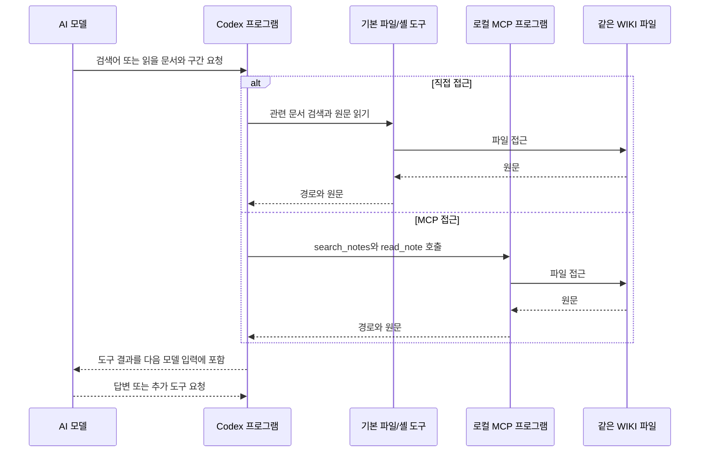

# 로컬 MCP로 WIKI를 읽는 흐름

> 기술 설명. 검토 당시의 후보와 관측을 보존한다. 현재 채택 범위는 결정 목록에서 확인하며, 미실행 계획이나 예비 시험을 제품 검증 완료로 해석하지 않는다.

## 이번에 확인하려는 문제

일반 `codex`로 시작해도 외부 WIKI를 사용할 수 있는지 시험하며 정리한 학습 문서다. **11/22 비교 후 첫 배포는 전용 시작 명령/직접 접근을 우선하고 MCP 제공은 후속 검토로 정했다.** [현재 결정 — 「11월 22일 첫 제공 범위」](../decisions/runtime/0022-wiki-entry.md)과 [과거 대안 비교 — 「두 방식의 선택 제공」](../design/runtime/entry.md)를 구분해 읽는다.

기존 시작 명령은 Codex에 WIKI 폴더의 접근 권한을 전달한다. MCP 방식에서는 Codex가 문서 작업을 Python 프로그램에 요청한다. 이 프로그램이 등록된 WIKI에서 요청한 자료를 읽어 결과를 돌려준다.

## 서버와 도구가 뜻하는 것

MCP는 AI가 외부 기능을 호출할 때 쓰는 통신 규약이다. 여기서 서버는 별도 컴퓨터가 아니라 **요청을 받아 처리하는 로컬 Python 프로그램**이다. Codex가 프로그램을 자식 프로세스로 실행한다. 이번 통신 방식인 STDIO는 그 프로그램의 표준 입력과 표준 출력으로 요청과 응답을 주고받는다는 뜻이다. 별도 웹 서버, 클라우드 배포나 수신 포트를 만들지 않았다. [공식 SDK 실행 안내](https://py.sdk.modelcontextprotocol.io/run/)

도구는 서버가 제공하는 기능이다. 이번에는 두 개만 등록했다.

| 도구 | 입력 예 | 하는 일 |
| --- | --- | --- |
| `search_notes` | 검색어 `반품 가능 기간` | WIKI에서 일치하는 줄과 문서 경로, 검색 결과의 잘림 여부 반환 |
| `read_note` | 상대 경로 `정책/반품.md` | 해당 문서의 원문 반환 |

Python 프로그램이 또 다른 AI로 판단하는 것은 아니다. 검색과 읽기는 일반 코드가 수행하고, 어떤 자료가 필요하며 그 내용을 어떻게 설명할지는 Codex의 모델이 판단한다. 반환한 본문은 모델의 입력이 되므로 로컬 MCP라는 이유로 토큰 비용이 사라지지는 않는다.

## 직접 읽기와 MCP 읽기를 비교한다는 뜻

두 방식 모두 같은 로컬 문서를 읽는다. AI 모델이 디스크를 스스로 여는 것은 아니며, 파일을 읽은 도구가 본문을 모델에 전달한다. 차이는 기존 파일/셸 도구를 사용하는지, WIKI 작업용으로 제공한 함수를 MCP를 통해 호출하는지다. MCP 연결은 폴더를 파일시스템에 붙이는 마운트가 아니며, 문서 전체를 자동으로 AI의 기억에 넣는 작업도 아니다. [공식 구조 설명](https://modelcontextprotocol.io/docs/learn/architecture)

### Codex와 모델, 입력과 출력

이 설명에서 **Codex 프로그램**은 대화 화면, 권한, 도구 실행과 결과 전달을 관리하는 CLI/호스트를 뜻한다. **모델**은 그 프로그램에서 선택한 GPT 같은 AI로, 읽을 자료를 판단하고 도구 호출을 요청하며 원문을 바탕으로 답한다. 별개의 AI 두 개를 쓰는 뜻이 아니다. MCP 프로그램은 일반 파일 처리 코드다.

입출력은 어느 프로그램을 기준으로 말하는지 구별한다. “반품.md의 10~20행을 읽어라”라는 요청은 MCP 도구의 입력이다. 그 도구가 돌려준 10~20행 본문은 MCP의 출력이고, Codex 프로그램이 그 결과를 포함해 모델에 다음 판단을 요청하면 모델의 입력이 된다. [공식 도구 호출 흐름](https://developers.openai.com/api/docs/guides/function-calling#the-tool-calling-flow)은 모델의 호출 요청, 프로그램의 도구 실행, 결과를 넣은 다음 모델 요청을 구분한다.

따라서 “Codex가 모델에 전달하는 중 잘릴 수 있다”는 말은 주로 결과가 돌아오는 방향을 뜻한다. MCP로 보낸 범위 지시가 저절로 사라진다는 뜻은 아니다. 모델이 잘못된 범위를 선택하거나 코드가 인자를 잘못 해석하는 문제는 요청 방향에서 별도로 확인한다. 직접 접근도 도구 실행 뒤 결과를 모델에 전달하는 흐름은 같다.

### 같은 요청의 두 흐름

“WIKI에서 반품 가능 기간과 예외를 찾아 설명해 줘”라는 가상 요청을 생각해 보자. `정책/반품.md`에 “14일 이내, 사용한 상품 제외”라는 내용이 있다고 가정한다. 아래 함수와 입력은 이해를 위한 예이며 최종 배포 API를 확정한 것은 아니다.

직접 접근에서는 Codex가 기존 검색 도구나 설치된 `rg` 같은 명령으로 관련 문서를 찾는다. 결과를 보고 파일 읽기 도구로 필요한 원문을 읽은 뒤, 기간과 예외를 함께 설명한다. 파일 경로와 검색 방법을 고르는 판단은 AI가 하고 실제 디스크 읽기는 도구가 수행한다.

MCP 접근에서는 Codex가 `search_notes(query="반품")`을 호출한다. 로컬 Python 프로그램이 등록된 WIKI를 검색해 경로와 일치한 원문을 돌려준다. Codex는 결과를 보고 `read_note(path="정책/반품.md")`를 호출하고, 프로그램이 반환한 본문을 근거로 설명한다. 여기서도 검색어와 문서 선택, 답변의 의미 판단은 AI가 한다. 현재 도구는 문자열 검색이며 별도 검색용 AI나 색인을 사용하지 않는다.

Java로 비유하면 파일을 읽는 기능을 호출하느냐, 별도 프로그램이 제공하는 `readNote` 기능에 요청하느냐의 차이에 가깝다. 뒤쪽 프로그램 내부에서는 같은 파일 읽기 기능을 사용할 수 있다. 이때 별도 프로그램이라는 말은 인터넷 서버를 뜻하지 않는다. 현재 로컬 MCP는 같은 PC의 프로세스이며 통신을 위해 별도 웹 서비스를 운영하지 않는다.

`read_note` 같은 이름과 파일 처리 동작은 우리가 정한다. MCP는 도구의 이름/설명/입력 형식을 알리고 호출과 결과를 주고받는 공통 규약이다. 표준 자체가 반품 정책이나 WIKI 폴더 구조를 알아주는 것은 아니다. [도구 규격](https://modelcontextprotocol.io/specification/2025-11-25/server/tools)

### MCP 도구를 만드는 이유

| 기대하는 이점 | 우리 WIKI에 적용한 예 | 필요한 구현과 한계 |
| --- | --- | --- |
| AI 도구에 같은 기능 제공 | 다른 MCP 지원 클라이언트에서도 같은 검색/읽기 함수를 발견하고 호출 | 각 호스트의 설정, 권한과 결과 처리 호환은 따로 검증. 모든 플랫폼 지원이 자동 완성되지는 않음 |
| WIKI 동작을 일정하게 제공 | 상대 경로, 읽은 구간과 남은 구간을 같은 형식으로 반환 | 형식과 처리 규칙은 우리 코드의 책임. 기존 스크립트로도 구현 가능 |
| 등록 범위 확인을 한곳에서 수행 | 프로젝트 A에 등록된 WIKI 밖 경로를 도구가 거부 | MCP 호출의 범위 보호이며 다른 셸 도구의 권한까지 바꾸는 것은 아님 |
| 환경별 파일 처리 차이를 내부에 모음 | AI는 같은 함수를 요청하고 프로그램이 해당 OS의 파일 처리를 담당 | 프로그램의 OS 지원이 필요하며 Windows 지원만으로 Linux 호환을 얻지는 않음 |

파일 보호와 공통 처리, 구조화된 결과 자체는 MCP만의 기능이 아니다. 일반 CLI 스크립트로도 같은 코드를 사용할 수 있다. MCP의 추가 가치는 **그 기능을 AI 클라이언트가 발견하고 호출하는 방법을 표준화하는 것**이다. 기존 처리 코드를 재사용할 수 있으며 MCP 때문에 별도 검색 엔진이나 중복된 파일 처리 구현이 필요한 것은 아니다.

수정에서도 같은 구분이 필요하다. 직접 접근은 기존 편집 도구를 사용하고, MCP는 수정 도구를 제공해야 한다. 예를 들어 “읽은 뒤 사용자가 바꾼 파일이면 덮지 않고 알려준다”는 기능을 만들 수 있지만 그 보호 동작은 우리가 구현하고 검증해야 한다. 현재 시험 MCP에는 읽기와 검색만 있으며 쓰기 지원이나 이 보호 기능을 검증한 것으로 해석하지 않는다.

### 공통 문제와 MCP로 추가되는 실패

잘못된 문서/구간 선택, 파일 접근 거부나 변경, 큰 출력의 잘림, 원문을 받은 뒤 답변에서 예외를 빠뜨리는 문제는 직접 접근에도 있다. 두 방식에 공통 문제가 있다는 사실만으로 입출력이 항상 동일하다는 결론을 내리지는 않는다.

MCP 연결에는 기존 직접 경로에 없던 추가 실패 지점이 있다. Python/SDK와 MCP 프로그램의 시작, 도구 발견, 통신 규격과 응답 형식의 호환이 필요하다. 실제 [첫 연결 시험](../evidence/experiments/wiki-access/2026-11-18_15-21-34-mcp-read.md)에서도 파일 처리 검사는 통과했지만 MCP의 상대 실행 경로가 잘못돼 Codex 연결이 실패했다. 별도 SDK 통신 검사에서는 기대한 구조화 결과가 없어서 실패했다. 이때 본문 문자가 실제로 유실됐다는 뜻은 아니다.

가상 예로 MCP 프로그램이 통신 출력에 일반 디버그 문장을 섞으면 메시지 처리가 깨질 수 있다. [STDIO 규격](https://modelcontextprotocol.io/specification/2025-11-25/basic/transports#stdio)은 통신 출력에는 MCP 메시지만 쓰고 로그는 별도 오류 출력으로 보내도록 구분한다. 일반 파일 도구에 없는 MCP 메시지 형식의 의존이 추가된 사례이며, 우리 시험에서 이 오류를 재현했다는 뜻은 아니다. 직접 도구도 자체 실행/출력 오류는 있을 수 있지만 MCP 의존성 자체는 없다.

우리 WIKI 도구의 구현 차이도 별도다. 파일 형식/숨김 파일 제외, 대소문자 구별, 정규식 지원이나 이어 읽기 규칙을 직접 도구와 다르게 만들면 결과가 달라진다. 이는 MCP 규격이 강제한 손실이 아니라 제공한 검색/읽기 기능의 차이 또는 결함이다. “같은 파일에 접근했다”만으로 이 차이를 검증할 수는 없다.

문제가 확인되면 발생한 단계와 미완료 범위를 남긴다. 입력 오류는 입력을 보정하고, 원문 변경/누락은 같은 원문인지 다시 확인해 필요한 구간만 읽는다. MCP 연결/응답 결함은 해당 부분을 수정한 뒤 같은 경로를 다시 검증한다. 응답이 없거나 잘린 것을 빈 문서/검색 결과 0개로 처리하지 않으며, 직접 접근의 성공으로 MCP 검증을 대신하지 않는다. 관측할 수 없는 수신 범위는 미확인으로 남긴다.

### 비용과 현재 판단

프로그램 시작, 통신, SDK와 호스트의 호환을 추가로 관리해야 한다. 기존 셸에서는 바로 가능한 검색 옵션도 MCP 도구에 없으면 해당 도구로 요청할 수 없다. 원문을 과하게 반환하거나 요청을 잘게 나누면 시간과 토큰이 늘 수 있으며 MCP 도입만으로 검색 정확성이나 절감이 보장되지는 않는다.

문서 몇 줄/파일 몇 개 같은 상한은 MCP 표준의 공통 제한이 아니다. 이전 시험에 넣은 상한, 도구 구현의 정책과 호스트가 모델에 전달하는 출력 한계를 구별한다. 직접 파일 접근도 모델에 전달되는 출력에는 한계가 있으므로 “파일 읽기 성공”과 “요청한 원문 전체 수신”을 같은 것으로 판단하지 않는다. 관련 설명은 [페이지와 전송 크기 — 「페이지 크기와 전송 크기가 다른 이유」](mcp.md#%ED%8E%98%EC%9D%B4%EC%A7%80%20%ED%81%AC%EA%B8%B0%EC%99%80%20%EC%A0%84%EC%86%A1%20%ED%81%AC%EA%B8%B0%EA%B0%80%20%EB%8B%A4%EB%A5%B8%20%EC%9D%B4%EC%9C%A0)에 있다.

외부 WIKI 폴더 하나를 Codex에서 읽고 수정하는 목적에는 직접 접근이 단순하다. 여러 AI 도구에 같은 WIKI 기능을 제공하거나 도구 수준의 범위/반환 계약이 필요할 때는 MCP의 도입 이유가 더 분명해진다. 우리 설계는 전용 시작 명령을 통한 직접 접근을 기본으로 유지하고, 일반 Codex에서 사용할 선택 MCP는 실제 편의와 품질/비용을 확인한 뒤 제공 범위를 정한다. 기술 검토에서 MCP를 설명할 수 있다는 이유만으로 필수 경로로 바꾸지 않는다.

### 같은 입출력이라는 목표의 의미

입력 범위, 원문 누락과 MCP 추가 실패에 대한 질문은 기존의 선택 MCP 검증에 필요하다. 파일에 연결됐다는 사실만으로 기존 WIKI 작업을 대신할 수 있다고 판단할 수 없기 때문이다. 구체 기준은 [동등성의 목표와 경계](../design/integration/mcp.md)에 통합하며, 이 질문으로 MCP의 첫 제공이나 전체 셸 기능의 구현을 확정하지 않는다.

예를 들어 같은 문서의 100~180행을 요청했다면 두 방식 모두 그 81행을 빠짐없이 전달해야 한다. 한 번에 받든 여러 번 이어 받든 본문의 순서와 내용은 유지해야 한다. MCP의 경로/진행 정보를 담은 JSON과 직접 도구의 출력 형식까지 똑같을 필요는 없다. [MCP 도구 규격](https://modelcontextprotocol.io/specification/2025-11-25/server/tools)은 도구별 입력 schema와 텍스트/구조화 결과를 정의하지만 특정 파일 읽기 기능이나 직접 도구와의 동등성을 자동 보장하지 않는다.

공식 [파일시스템 참조 구현](https://github.com/modelcontextprotocol/servers/tree/main/src/filesystem)도 전체 텍스트 읽기와 앞/뒤 일부 읽기를 별도로 제공한다. 그 구현의 search_files는 파일/디렉토리 경로 패턴을 찾는 기능이므로, 우리 search_notes의 본문 문자열 검색과 같은 기능으로 보면 안 된다. 이는 구현 사례를 조사한 것이며 해당 서버를 도입하거나 코드를 복제한 것은 아니다.

직접 접근도 완전한 정답 기준은 아니다. 예를 들어 [rg 공식 안내](https://github.com/BurntSushi/ripgrep/blob/master/GUIDE.md#automatic-filtering)에 따르면 디렉토리 검색은 기본적으로 숨김 파일과 ignore 대상 등을 제외한다. 사용자가 요구한 검색 범위와 다르면 옵션을 맞춰야 한다. 두 방식이 같은 문서를 빠뜨린 채 같은 결과를 냈다면 둘 다 실패다. 원문과 기대 결과에 각각 맞는지 먼저 확인하고, 모델의 답변 품질과 시간/토큰은 그다음 비교한다. 필요한 정보와 기능을 줄여서 출력만 맞추는 것은 목표에 맞지 않는다.

### 비교에서 확인할 것

먼저 같은 원문 버전, 파일/구간, 검색 대상과 옵션을 고정해 읽기 결과를 대조한다. 독립적으로 읽은 원문과 MCP 응답에서 꺼낸 본문을 비교하며 JSON 포장 전체가 같아야 한다는 기준은 아니다. 이어 실제 Codex에서 관측 가능한 수신 구간과 실패 안내를 확인한다. 이 동등성과 MCP 추가 실패 처리를 확인한 뒤 자유로운 AI 탐색의 답변 품질과 비용을 비교한다. SDK 변환 PASS나 서버의 완료 표식만으로 그 선행 조건을 통과시키지 않는다. 구체 대응은 [MCP 읽기 수용 입력 — 「MCP 읽기 보완의 검증 입력」](../verification/acceptance.md)이 소유한다.

예를 들어 “현재 채택된 오류 처리 기준과 결정 이유를 찾아줘”를 두 방식에 똑같이 요청할 수 있다. 빨리 답했는지만 보면 과거 초안만 읽은 답이 유리할 수 있다. 먼저 현재 기준과 관련 ADR을 찾았는지, 원문에 없는 이유를 만들어내지 않았는지 확인한 뒤 시간과 토큰을 비교해야 한다. 이는 질문 후보이며 아직 기존 시험 프로젝트 원문으로 만든 정답이나 실행 결과가 아니다.

일반 코드에서 같은 검색 기능을 직접 호출하거나 MCP로 호출하는 검사에는 AI가 필요 없다. 반면 실제 Codex가 어떤 검색어/문서를 선택하고 답을 만드는지는 모델을 포함해 시험해야 한다. 두 결과를 구분하는 [읽기와 검색 비교 계획 — 「실제 문서를 이용한 읽기와 검색 비교」](../verification/acceptance.md)에 원본 보존, 사본과 평가 기준을 모았다.

## 프로젝트와 경로를 구별하는 방법

시험 프로젝트 A와 B는 같은 서버 코드를 사용하고 각자의 `.harness/local.json`에서 WIKI 위치를 읽는다. A의 반품 기간은 14일, B는 7일로 다르게 준비했다. 이 값은 실제 업무 지식이 아닌 정답을 대조하기 위한 합성 자료다.

`.codex/config.toml`은 Python 프로그램을 시작하는 정보와 노출할 도구 이름만 가진다. WIKI 위치와 프로젝트 식별은 로컬 연결 파일이 소유한다. Codex 전역 설정에 WIKI 경로를 넣지 않는다. 현재 시험용 Python 환경의 상대 배치를 모든 사용자의 최종 설치 구조로 확정한 것은 아니다.

읽기 권한을 가진 MCP 프로그램은 자기 접근 범위를 직접 제한해야 한다. 이번 코드는 등록 루트 밖 상대 경로, 절대 경로, 숨김 경로와 정적인 Windows junction을 거부한다. 이것이 Codex의 일반 shell 권한을 확대하거나 모든 동시 경로 교체 공격까지 방어한다는 뜻은 아니다.

## 무엇을 검증했고 무엇이 남았나

[Windows 시험 기록](../evidence/experiments/wiki-access/2026-11-18_15-21-34-mcp-read.md)에 성공과 실패를 함께 보존한다.

1. Windows 파일 검사 9개가 통과했다. 한글, 원문 보존, 잘림, 없는 파일, 잘못된 경로와 프로젝트별 연결을 확인했다.
2. SDK 클라이언트와 서버의 실제 STDIO 연결 4회가 통과했다. 이 검사는 모델을 사용하지 않았다.
3. 일반 Codex의 첫 연결은 실행 경로 오류로 실패했다. 잘못 지정한 상대 작업 경로를 제거한 뒤 사용자가 `wiki_probe: connected (2 tools)`를 확인했다.
4. 이어 실제 Codex에서 A의 검색과 원문 읽기, 정답을 확인했다. 사용자는 추가 승인이 없었다고 보고했고, 세션 도구 기록에도 두 MCP 호출이 남아 있었다. 문서 4개의 해시도 그대로였다. 후속으로 B의 실제 검색/읽기와 A의 같은 대화 재읽기도 확인했다. A/nested의 시작 실패는 아래처럼 보정한 뒤 실제 읽기를 확인했다. [후속 근거](../evidence/experiments/wiki-access/2026-11-18_15-50-14-mcp-projects.md). 후속 [실제 Codex 비교](../evidence/experiments/wiki-access/2026-11-18_16-50-18-codex-wiki-usage.md)는 아래 「실제 Codex에서는 무엇이 달랐나」에서 설명한다.

SDK는 통신 규약을 처리해 주는 외부 라이브러리다. 이번에는 공식 Python SDK 2.3.0과 의존성을 시험 폴더 안의 가상환경에 설치했다. 가상환경은 이 시험의 패키지를 다른 Python 작업과 구별하는 폴더다. 별도 DB 서버나 MCP 전용 계정을 추가하지 않았다. 실제 배포에서는 선택 설치, 지원 버전, 갱신과 오류 안내까지 필요하다.

## 이번 오류에서 배운 점

첫 통신 검사에서는 결과가 일반 텍스트로만 반환돼 구조화된 값을 읽는 검사가 실패했다. 설치한 SDK 버전의 동작을 확인해 반환 타입을 명확히 지정하고, 구조화된 결과가 없으면 실패하도록 보완했다. 최신 설명 페이지와 설치 버전의 동작을 같은 것으로 가정하면 안 된다.

그다음 실제 Codex에서는 `cwd = ".."`라는 상대 작업 경로 때문에 프로그램 시작이 실패했다. 다른 설정 키의 상대 경로 규칙을 MCP에도 그대로 적용했던 가정을 수정했다. 해당 항목을 제거한 루트 진입은 연결됐지만, 후속 하위 폴더 진입은 다시 경로 없음으로 실패했다. Python과 서버를 찾는 상대 경로가 실행 위치에 따라 달라졌기 때문이다.

보정한 시험 흐름은 **현재 위치 → Git 프로젝트 루트 확인 → 해당 프로젝트의 MCP 실행 → 등록 WIKI 읽기**다. `project-a/nested`에서 시작해도 A 루트를 찾아 A의 연결을 읽는다. 중간에 별도 저장소가 있으면 그 경계를 넘어 부모 A를 빌리지 않는다. 이 준비는 일반 Python/Git 코드이며 별도 AI 호출이 아니다. [Git 루트 조회](https://git-scm.com/docs/git-rev-parse#Documentation/git-rev-parse.txt---show-toplevel)

새 명령으로 SDK 연결 5곳과 잘못된 위치 2곳의 거부를 확인한 뒤, 실제 Codex도 A/nested에서 A의 원문을 읽었다. 당시에는 서버의 검색/읽기 코드를 바꾸지 않았다. 시작 절차와 프로세스가 늘어나는 부담은 있으며, 시험용 가상환경 배치를 최종 제품 구조로 확정하지 않는다.

이번 결과는 MCP를 붙였다는 사실보다 **설정 발견, 프로그램 실행, 도구 호출, 결과 정확성을 나눠 검증해야 한다**는 근거다. 쓰기, 상세 WIKI 복원과 제품 전체의 지원은 후속 범위다.

## 긴 문서를 나눠 받는 이유

이번 [실제 문서 사본 시험](../evidence/experiments/wiki-access/2026-11-18_16-32-09-wiki-compare.md)은 원본을 유지한 Windows 사본 60개로 진행했다. 이전 도구는 64 KiB보다 큰 문서를 거부했는데, REQUIREMENTS는 그보다 컸다. 이 문서를 빼고 성공률을 계산하지 않고, 필요한 구간을 요청해서 이어 읽도록 보완했다.

예를 들어 `read_note`가 1~200줄과 `next_line: 201`을 반환하면 아직 뒤에 내용이 있다는 뜻이다. 다음 요청에서 201줄부터 읽는다. 검색 결과도 `next_offset`이 있으면 나머지를 받아야 한다. 시험에서는 긴 문서를 6번 이어 읽어 전체 바이트가 같은지, 검색 결과 166개를 2번 받아 빠짐없이 일치하는지 확인했다. 원문을 요약하거나 잘라서 완료라고 보고한 것이 아니다.

직접 호출과 MCP 호출은 같은 Python 기능을 실행했다. 차이는 함수에 바로 요청하느냐, 별도 프로그램에 메시지로 요청하느냐다. 이때의 MCP 추가 시간은 작게 관측됐지만, 실제 Codex가 검색어를 고르고 여러 번 요청하고 답하는 시간은 별도다. 나눠 읽기가 필요한 자료만 읽는 데 도움이 될 수도 있고, 호출이 늘어 비용이 커질 수도 있다. **이번 모델 없는 측정으로 토큰 절감을 주장할 수는 없다.**

## 실제 Codex에서는 무엇이 달랐나

같은 문서 사본과 질문을 주어도 AI가 고르는 검색어와 읽기 범위는 달랐다. 직접 접근은 rg로 검색어와 주변 문장을 묶어 읽었고, MCP는 여러 문자열을 각각 검색한 뒤 문서를 요청했다. 이번에는 직접 접근이 약 40초, MCP가 약 55초였고 MCP의 누적 토큰도 더 많았다. 한 번씩의 관측이라 항상 이렇다는 결론은 아니다.

예를 들어 1,018~1,033행이 필요하면 `start_line=1018, limit=16`이다. 여기서 limit은 “읽을 줄 수”다. 이번 AI는 처음에 끝 줄처럼 1,035를 넣어 허용 범위를 벗어났고, 다른 요청에서도 많은 줄을 중복으로 받았다. 작은 결과 여러 개를 한꺼번에 출력해도 합계가 커져 Codex에 돌아오는 중간 출력이 잘릴 수 있다. 도구가 페이지를 지원하는 것과 AI가 그 페이지를 정확히 소비하는 것은 다른 문제다.

더 중요한 점은 두 답변 모두 “영구 삭제된 문서는 복구 대상이 아니다”라는 조건을 빠뜨렸다는 것이다. MCP는 그 원문을 다시 읽은 기록까지 있었다. 문서 전달에 성공한 뒤에도 답변에 필요한 조건이 모두 반영됐는지 확인해야 한다.

누적 입력 토큰은 AI가 여러 차례 판단하면서 받은 입력을 합한 값이다. 이미 읽은 내용을 다시 받는 비용도 포함되고, 그중 일부는 캐시로 기록된다. 따라서 누적 총량을 현재 컨텍스트 크기나 구독에서 빠진 양으로 읽으면 안 된다.

이번 결과로 MCP를 반드시 쓰거나 반드시 없애야 한다고 판단하지 않는다. 일반 Codex에서 외부 WIKI를 쓰는 통로로는 동작했지만, 검색 방식과 읽기 범위, 출력량과 누락 검사를 보완할 필요가 있다. 기본 전용 시작 방식은 유지하고 선택 MCP의 제공 범위는 이 비용까지 고려해 정한다. 원시 수치와 한계는 [비교 결과](../evidence/experiments/wiki-access/2026-11-18_16-50-18-codex-wiki-usage.md)에 있다.

## 읽기 보완에서 달라질 흐름

별도 보완 코드를 작성해 일부 내부 검사를 했지만 실제 배포 환경의 검증은 아직이다. 임의로 둔 작은 제한을 배포 기준으로 쓰지 않도록 계획을 수정했다. 위에서 설명한 `start_line + limit`은 기존 시험의 방식이다. 다음 시험 후보는 “몇 줄”을 계산하는 대신 **시작 줄과 끝 줄을 직접 지정**하는 방식이다. 예를 들어 1018~1035행은 `start_line=1018, end_line=1035`로 요청한다.

핵심은 요청한 읽기 범위를 유지하는 것이다. “전체를 읽어줘”라고 했는데 첫 페이지만 읽거나 검색 결과로 대신하면 실패다. “1018~1035행”이면 그 18행을 빠짐없이 받아야 한다. 나눠 받기는 전달 방법이며 요청 범위를 줄이는 이유가 아니다.

문서를 창구에서 나눠 받는다고 생각하면 이해하기 쉽다.

1. Codex가 필요한 문서와 구간을 정해 MCP 도구에 요청한다.
2. 도구는 등록한 WIKI에서 원문을 읽고 한 번에 보낼 수 있는 만큼 반환한다. 다 못 보냈으면 나머지를 요청할 next도 준다.
3. Codex는 실제로 받은 구간을 확인하고 필요한 나머지만 이어 받는다. revision은 같은 원문인지 구별하는 값이다. 도중에 문서가 바뀌면 옛 줄 번호로 새 내용을 이어 붙이지 않는다.
4. 필요한 자료를 확보했으면 질문의 조건과 예외가 답변에 반영됐는지 확인한다. 전달 담당 도구가 이 의미 검토까지 자동으로 해주는 것은 아니다.

여기에는 도구의 반환 정책과 호스트의 출력 제한이라는 서로 다른 조건이 있다. 시험하기 편하도록 임의로 작은 봉투를 정하는 대신, 실제 배포 코드와 Codex가 사용하는 조건을 먼저 확인해야 한다. 받는 쪽이 여러 응답을 합쳐 출력하면 그 단계에서 잘릴 수도 있다. 그래서 **도구 한 번의 반환 크기**와 **호출하는 쪽이 합쳐 보여주는 크기**를 따로 확인한다. MCP 서버가 Codex 전체 문맥 크기까지 통제하는 것은 아니다. 작은 페이지가 호출 횟수를 늘릴 수도 있으므로 최종 토큰 절감은 실제로 비교해야 한다.

cursor는 읽기/검색을 이어 갈 위치와 원래 요청을 묶어 알려주는 값이다. 사람이 매번 입력하는 절차가 아니라 AI와 도구가 주고받을 정보다. 긴 한 줄의 중간까지 읽었어도 다음 문자를 이어 받을 수 있게 하고, AI가 줄 번호를 계산하는 부담을 줄이는 후보야. 원문/연결이 바뀌거나 서버가 재시작해 값이 만료되면 기준을 다시 확인한다. 이를 저장하려고 새 DB를 설치하거나 모든 읽기를 active에 기록하지 않는다.

“검색 결과 없음”과 “파일을 읽지 못해 검색을 끝내지 못함”도 다르다. 후자를 전자로 잘못 반환하면 AI가 필요한 정책 자체가 없다고 답할 수 있다. 이번 보완은 그런 차이를 전달하도록 설계하고, 이후 [시험 입력 — 「MCP 읽기 보완의 검증 입력」](../verification/acceptance.md)으로 확인하려는 작업이다. 정확한 입력/한도/오류 기준은 [MCP 읽기 명세](../design/integration/mcp.md)가 소유한다.

## MCP는 현재 모델의 한도를 아는가

현재 확인한 범위에서는 자동으로 알지 못한다. MCP가 주고받는 capabilities는 “어떤 통신 기능을 지원한다”는 정보다. “이 대화는 지금 본문을 몇 토큰까지 받을 수 있다”는 값과 다르다. 설치된 SDK와 공식 규격을 대조했지만 그 한도를 알려주는 표준 필드는 확인하지 못했다. Codex의 보존된 모델 목록 스키마도 모델 선택 정보를 제공할 뿐이었다. [확인 근거](../evidence/experiments/wiki-access/2026-11-19_15-17-25-mcp-capabilities.md)

예를 들어 1~200행을 요청했을 때 MCP가 200행을 모두 보냈더라도 Codex가 모델에 전달하는 과정에서 일부를 잘랐다면, 모델이 전체를 읽은 것은 아니다. “200행까지 보냈다”는 숫자만 확인할 것이 아니라 받은 본문과 남은 구간을 확인해야 한다. 확인되는 누락은 같은 원문에서 이어 읽고, 확인할 수 없는 누락 가능성은 해결됐다고 보고하지 않는다.

그래서 사용자에게 Codex 버전이나 모델을 고정하도록 요구하는 대신, 지원 기능을 확인하고 실제 전달 결과를 검증하는 방향이다. 모델/설정이 달라지면 영향받는 조건을 다시 확인한다. 이를 위해 매번 AI에게 한도를 물어보거나 새 서버를 하나 더 켜는 방식은 아니다. 실제 반환 크기와 자원 정책은 아직 정해야 하며, 이번 작업은 자동 적응 기능의 완성이 아니다. 상세는 [확인 수단과 미확인 처리 — 「실행 조건의 확인과 미확인 처리」](../design/runtime/entry.md)에 있다.

## 페이지 크기와 전송 크기가 다른 이유

우리 읽기 코드가 만든 결과를 SDK에 넘기면, SDK는 통신 규격에 맞는 JSON으로 바꾼다. 받는 쪽 SDK는 그것을 다시 프로그램에서 다루기 편한 객체로 바꾼다. 이 마지막 객체에 편의를 위한 필드가 생길 수 있으므로, 그 객체를 JSON으로 출력한 크기가 실제 통신 크기와 항상 같지는 않다.

이번에는 바로 이 차이를 확인했다. 보존된 문서 사본을 Windows SDK로 변환하고 되돌렸을 때 본문은 같았지만, 구형 규격에서 클라이언트 객체에 `resultType`이 추가됐다. 앞선 검사는 그 객체를 전송 원문이라고 잘못 이름 붙여 크기를 비교했다. 따라서 차이만큼 숫자를 더하는 방식으로 고치는 것이 아니라 무엇의 크기를 재는지부터 구분해야 한다. [진단 결과](../evidence/experiments/wiki-access/2026-11-19_15-35-59-mcp-output.md)

페이지 목표는 “이번에 보내는 원문과 위치/진행 정보의 묶음 크기”로 설계하고 있어. 예를 들어 문서의 마지막 절이 다음 묶음으로 넘어가더라도 계속 읽어야 하며, 문서가 크다는 이유로 그 절을 제외하면 안 된다. 구조화 결과와 호환용 텍스트에 같은 내용을 담으면 실제 응답은 더 커질 수 있다. 그 비용과 Codex가 실제로 받은 본문은 따로 확인한다.

작게 나누면 잘림을 줄이는 데 도움이 될 수 있지만 호출과 토큰 비용이 늘 수도 있다. 후속 [사본 분포 확인](../evidence/experiments/wiki-access/2026-11-20_00-33-30-mcp-read-contract.md)으로 16KiB를 논리 결과 한 페이지의 기본값 후보로 제안했다. 60개 중 본문만으로 55개가 그 안에 들지만, 포장까지 넣어도 한 번에 전달되는지나 실제 호출/토큰 수를 확인한 결과는 아니다. 검증 때만 이 값을 쓰는 것이 아니라 채택할 배포 후보에도 같은 설정을 사용해야 한다. 아직 현재 시험 도구나 Codex 설정에 적용하지 않았다.

예를 들어 첫 응답이 잘렸다면 그 응답을 만들었던 요청을 더 작은 page_bytes로 다시 보내야 해. 바로 next로 넘어가면 못 받은 앞부분이 남는다. 이미 제대로 받은 부분과 다시 받은 부분을 대조해 같은 원문을 빠짐없이 이어 가는 방식이다. 숨겨진 잘림을 확인할 수 없는 경우는 여전히 미확인으로 남긴다. 작은 숫자 하나로 원문 보존이나 토큰 절감을 보장할 수는 없다.
